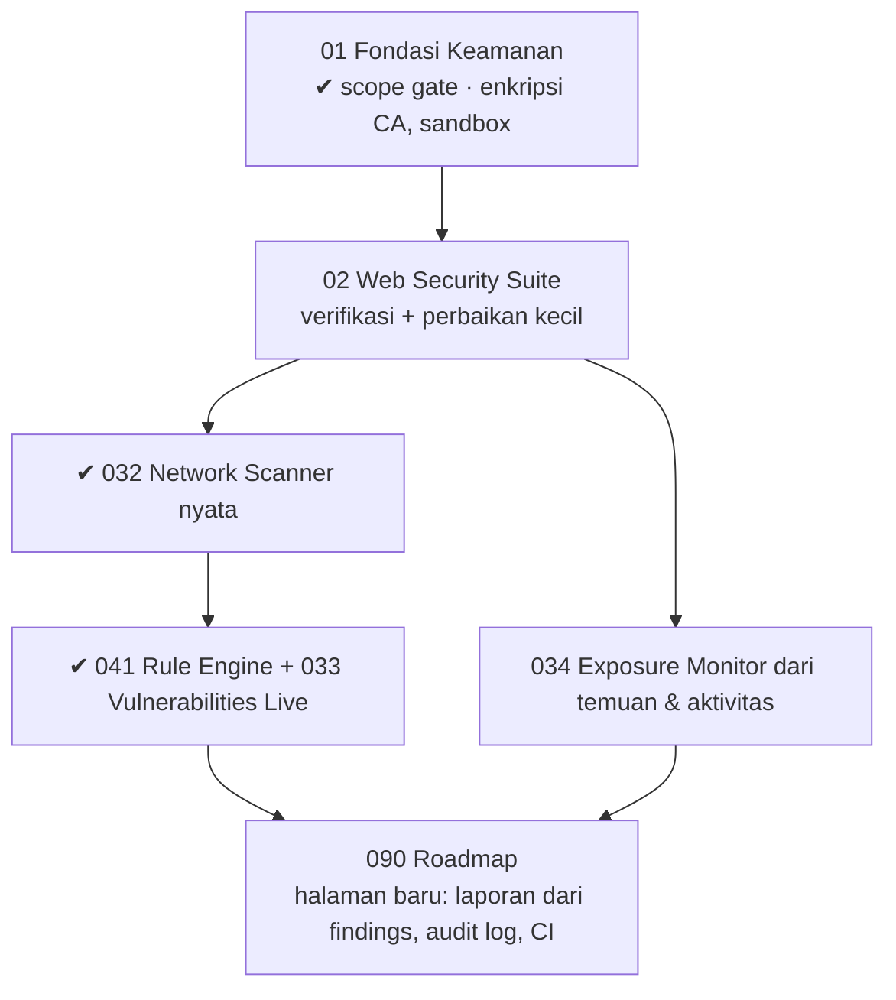

# 000 — Index Dokumentasi Interu

[001 — Ringkasan Proyek](001_ringkasan-proyek.md) →

Dokumentasi teknis **Interu — Cyber Operations** (Kartika Cyber Hackathon 2026, Kategori 01: Penindakan). Semua isi ditulis dari kode sumber. Jika ada perbedaan dengan `README.md`, ikuti dokumen di folder ini.

## Cara membaca

- **Nomor = urutan pengerjaan.** Bacalah dari atas ke bawah: fondasi → Web Security Suite → Operations → Detection → penutup.
- **`x0_…` = pengantar kelompok.** Isinya gambaran kelompok, hubungan antar-fitur, dan urutan kerja.
- **`x1_…`, `x2_…`, dst. = penjelasan lengkap tiap fitur.** Setiap dokumen memakai 7 bagian yang sama: Status · Tujuan · Cara kerja · File terkait · Cara pakai · Batasan/temuan · Checklist pengerjaan.
- **Status:** ✅ NYATA (benar-benar mengirim/memproses data) · 🟡 SEBAGIAN (fungsi nyata, tetapi ada batasan yang dicatat). Tidak ada lagi halaman simulasi: mode simulasi dan halaman data palsu sudah dihapus.

## Daftar isi & status

### 00 — Pengantar

| Dokumen | Isi |
|---|---|
| [001 Ringkasan Proyek](001_ringkasan-proyek.md) | Apa itu Interu, masalah yang diselesaikan, tech stack |
| [002 Setup & Build](002_setup-dan-build.md) | Instalasi, script npm, env var `RUY_*`, import CA |
| [003 Arsitektur](003_arsitektur.md) | Main/preload/renderer, API `window.ruy`, channel IPC `ruy:*` |

### 01 — Fondasi Keamanan

| Dokumen | Status | Catatan utama |
|---|---|---|
| [010 Pengantar Fondasi Keamanan](010_fondasi-keamanan.md) | — | Gambaran kelompok |
| [011 Scope Gate](011_scope-gate.md) | ✅ | Berlaku untuk `ruy:http`, scanner, dan proxy; mendukung CIDR; diuji dengan `npm test` |
| [012 Root CA & Sertifikat](012_root-ca-dan-sertifikat.md) | ✅ | Berfungsi, tetapi private key **tidak dienkripsi** |
| [013 Hardening Electron](013_hardening-electron.md) | 🟡 | contextIsolation + CSP aktif, tetapi `sandbox:false` |

### 02 — Web Security Suite

| Dokumen | Status | Catatan utama |
|---|---|---|
| [020 Pengantar Web Security Suite](020_web-security-suite.md) | — | Alur Proxy → Repeater/Intruder |
| [021 Proxy / MITM](021_proxy-mitm.md) | ✅ | Dekripsi HTTPS hanya untuk host dalam scope; host lain diteruskan tanpa disadap |
| [022 Repeater](022_repeater.md) | ✅ | Live saja; request awal `GET /` ke `localhost:3000` |
| [023 Intruder](023_intruder.md) | ✅ | Satu mode (setara Sniper), hanya penanda `§…§` pertama yang diganti |
| [024 Target / Discovery](024_target-discovery.md) | ✅ | Live saja; wordlist berisi 20 path |
| [025 Decoder](025_decoder.md) | ✅ | Offline |
| [026 Comparer](026_comparer.md) | ✅ | Diff LCS, offline; dua pane mulai kosong |
| [027 Sequencer](027_sequencer.md) | ✅ | Menganalisa token yang di-paste operator (`src/shared/tokens.ts`) |

### 03 — Operations & Analysis

| Dokumen | Status | Catatan utama |
|---|---|---|
| [030 Pengantar Operations](030_operations.md) | — | Mana yang sudah nyata, strategi untuk sisanya |
| [032 Network Scanner](032_network-scanner.md) | ✅ | TCP connect scan nyata, scope-gated; hanya Live |
| [033 Vulnerabilities](033_vulnerabilities.md) | ✅ | Temuan Rule Engine (nyata); tanpa katalog demo |
| [034 Exposure Monitor](034_threat-monitor.md) | ✅ | Temuan & aktivitas nyata (dulu Threat Monitor) |
| [037 Settings](037_settings.md) | ✅ | Preferensi nyata; "Reset local data" |

### 04 — Detection

| Dokumen | Status | Catatan utama |
|---|---|---|
| [040 Pengantar Detection](040_detection.md) | — | Alur scanner/proxy/probe → Rule Engine → findings |
| [041 Rule Engine](041_rule-engine.md) | ✅ | 408 template bergaya Nuclei; deteksi produk KEV; verifikasi probe; Suspected vs Confirmed |
| [042 Scan Terautentikasi](042_scan-terautentikasi.md) | ✅ | Scan di balik login: cookie Interu Browser atau header manual; lewati logout; berhenti saat sesi habis |

### 09 — Penutup

| Dokumen | Isi |
|---|---|
| [090 Roadmap](090_roadmap.md) | Semua checklist digabung menjadi satu rencana berurutan |
| [092 Panduan Tampilan](092_panduan-tampilan.md) | Konvensi UI: token warna, bentuk, tata letak, aksesibilitas, selector e2e, guard test |

## Alur pengerjaan

✔ = sudah selesai.

