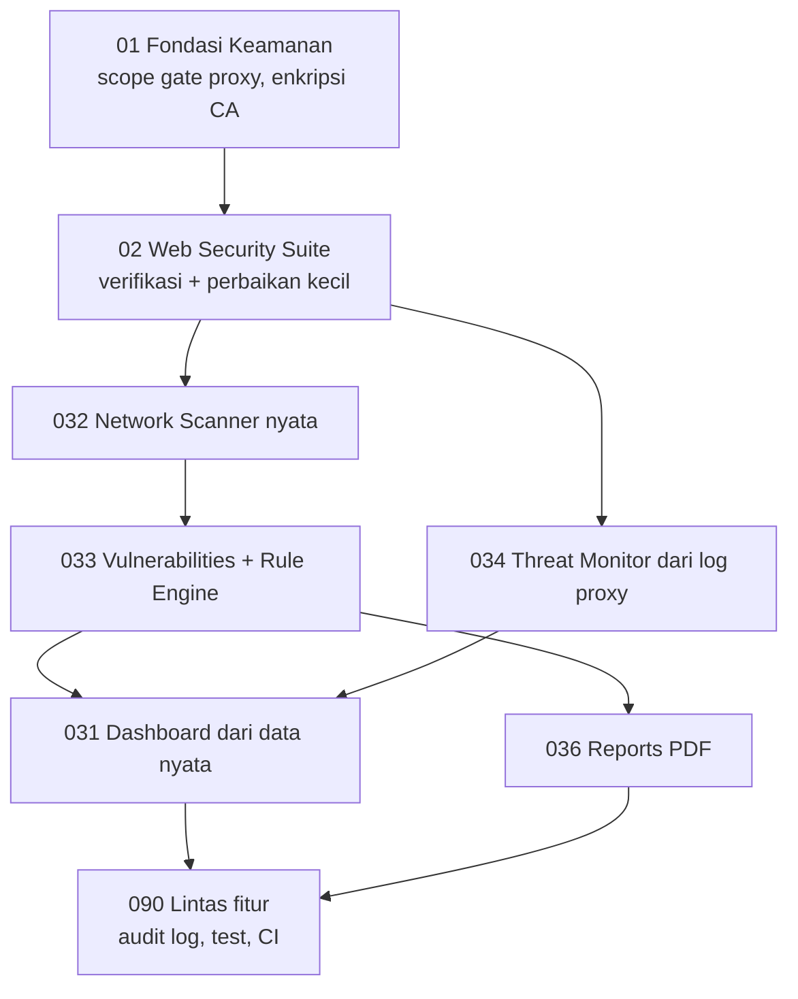

# 000 — Index Dokumentasi Interu

[001 — Ringkasan Proyek](001_ringkasan-proyek.md) →

Dokumentasi teknis **Interu — Cyber Operations** (Kartika Cyber Hackathon 2026, Kategori 01: Penindakan). Semua isi ditulis dari kode sumber. Jika ada perbedaan dengan `README.md`, ikuti dokumen di folder ini.

## Cara membaca

- **Nomor = urutan pengerjaan.** Bacalah dari atas ke bawah: fondasi → fitur yang sudah nyata → fitur yang masih simulasi.
- **`x0_…` = pengantar kelompok.** Isinya gambaran kelompok, hubungan antar-fitur, dan urutan kerja.
- **`x1_…`, `x2_…`, dst. = penjelasan lengkap tiap fitur.** Setiap dokumen memakai 7 bagian yang sama: Status · Tujuan · Cara kerja · File terkait · Cara pakai · Batasan/temuan · Checklist pengerjaan.
- **Status:** ✅ NYATA (benar-benar mengirim/memproses data) · 🟡 SEBAGIAN · ⚪ SIMULASI (data contoh).

## Daftar isi & status

### 00 — Pengantar

| Dokumen | Isi |
|---|---|
| [001 Ringkasan Proyek](001_ringkasan-proyek.md) | Apa itu Interu, masalah yang diselesaikan, tech stack |
| [002 Setup & Build](002_setup-dan-build.md) | Instalasi, script npm, env var `RUY_*`, import CA |
| [003 Arsitektur](003_arsitektur.md) | Main/preload/renderer, API `window.ruy`, channel IPC `ruy:*` |

### 01 — Fondasi Keamanan

| Dokumen | Status | Catatan utama |
|---|---|---|
| [010 Pengantar Fondasi Keamanan](010_fondasi-keamanan.md) | — | Gambaran kelompok |
| [011 Scope Gate](011_scope-gate.md) | 🟡 | `hostInScope` aktif untuk `ruy:http`, **proxy belum di-gate** |
| [012 Root CA & Sertifikat](012_root-ca-dan-sertifikat.md) | ✅ | Berfungsi, tetapi private key **tidak dienkripsi** |
| [013 Hardening Electron](013_hardening-electron.md) | 🟡 | contextIsolation + CSP aktif, tetapi `sandbox:false` |

### 02 — Web Security Suite

| Dokumen | Status | Catatan utama |
|---|---|---|
| [020 Pengantar Web Security Suite](020_web-security-suite.md) | — | Alur Proxy → Repeater/Intruder |
| [021 Proxy / MITM](021_proxy-mitm.md) | ✅ | Dekripsi HTTPS, intercept, browser terproksi |
| [022 Repeater](022_repeater.md) | ✅ | Mode live + simulasi |
| [023 Intruder](023_intruder.md) | ✅ | Satu mode (setara Sniper), hanya penanda `§…§` pertama yang diganti |
| [024 Target / Discovery](024_target-discovery.md) | ✅ | Wordlist berisi 20 path |
| [025 Decoder](025_decoder.md) | ✅ | Offline |
| [026 Comparer](026_comparer.md) | ✅ | Diff LCS, offline |
| [027 Sequencer](027_sequencer.md) | 🟡 | Perhitungannya nyata, tokennya dibuat lokal |

### 03 — Operations & Analysis

| Dokumen | Status | Catatan utama |
|---|---|---|
| [030 Pengantar Operations](030_operations.md) | — | Strategi untuk mengganti data simulasi dengan data nyata |
| [031 Dashboard](031_dashboard.md) | ⚪ | Data dari `mock.ts` |
| [032 Network Scanner](032_network-scanner.md) | ⚪ | Tidak ada paket yang dikirim |
| [033 Vulnerabilities](033_vulnerabilities.md) | ⚪ | Katalog statis |
| [034 Threat Monitor](034_threat-monitor.md) | ⚪ | Event sintetis |
| [035 Firewall](035_firewall.md) | ⚪ | Tidak mengubah firewall OS |
| [036 Reports](036_reports.md) | 🟡 | Export file nyata, isinya masih data contoh |
| [037 Settings](037_settings.md) | 🟡 | Preferensi nyata |

### 09 — Penutup

| Dokumen | Isi |
|---|---|
| [090 Roadmap](090_roadmap.md) | Semua checklist digabung menjadi satu rencana berurutan |

## Alur pengerjaan

