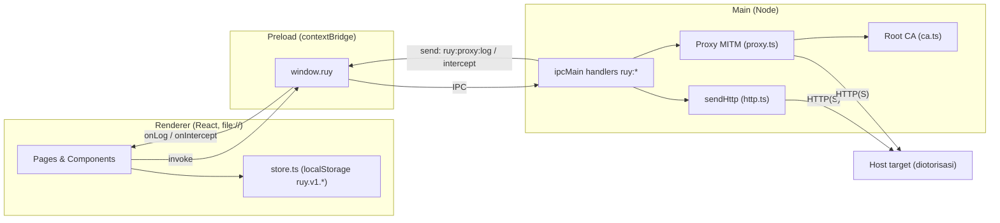
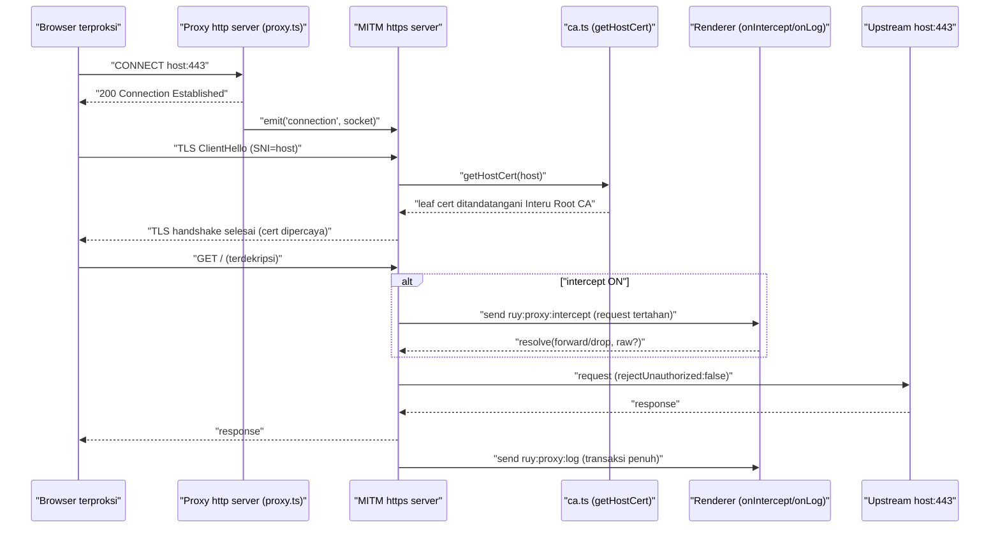

# 003 — Arsitektur

← [002 — Setup & Build](002_setup-dan-build.md) · [Index](000_index.md) · [010 — Fondasi Keamanan (Pengantar)](010_fondasi-keamanan.md) →

## Tiga proses Electron

| Proses | File utama | Tugas |
|---|---|---|
| **Main** | `../src/main/index.ts` | Lifecycle app, buat window, daftar handler IPC `ruy:*`, HTTP sender nyata, proxy MITM, export CA, browser terproksi. |
| **Preload** | `../src/preload/index.ts` | Expose `window.ruy` lewat `contextBridge` (contextIsolation aktif). Jembatan satu-satunya renderer ↔ main. |
| **Renderer** | `../src/renderer/src/main.tsx` → `App.tsx` | UI React. Tidak punya akses Node; semua trafik nyata lewat `window.ruy`. |

Kode bersama di `../src/shared/` (`http.ts`, `proxy.ts`) dipakai ketiga root build
karena bebas framework.

## API `window.ruy` (`../src/preload/index.ts`)

| Jalur | Tipe | Mengundang channel | Fungsi |
|---|---|---|---|
| `ruy.platform` | string | — | `process.platform`. |
| `ruy.versions` | obj | — | Versi electron/chrome/node. |
| `ruy.http.send(req, scope)` | invoke | `ruy:http` | Kirim HTTP(S) nyata, scope-gated. |
| `ruy.proxy.start(port)` | invoke | `ruy:proxy:start` | Start proxy di port. |
| `ruy.proxy.stop()` | invoke | `ruy:proxy:stop` | Stop proxy. |
| `ruy.proxy.status()` | invoke | `ruy:proxy:status` | `{ running }`. |
| `ruy.proxy.setIntercept(on)` | invoke | `ruy:proxy:intercept` | Nyalakan/matikan intercept. |
| `ruy.proxy.resolve(id, action, raw?)` | invoke | `ruy:proxy:resolve` | Forward/drop request yang ditahan. |
| `ruy.proxy.openBrowser(url?)` | invoke | `ruy:proxy:openBrowser` | Buka browser terproksi (auto-trust CA). |
| `ruy.proxy.exportCA()` | invoke | `ruy:proxy:exportCA` | Tulis root CA ke Downloads. |
| `ruy.proxy.onLog(cb)` | listener | `ruy:proxy:log` | Stream transaksi proxy (main→renderer). Mengembalikan fungsi unsubscribe. |
| `ruy.proxy.onIntercept(cb)` | listener | `ruy:proxy:intercept` | Notifikasi request tertahan (main→renderer). |

## Channel IPC `ruy:*` (`../src/main/index.ts`)

| Channel | Arah | Mekanisme | Handler / sumber | Fungsi |
|---|---|---|---|---|
| `ruy:http` | renderer→main | `ipcMain.handle` | `sendHttp` (`../src/main/http.ts`) | Kirim HTTP nyata; **scope-gated** via `hostInScope`. |
| `ruy:proxy:start` | renderer→main | `handle` | `startProxy` (`../src/main/proxy.ts`) | Start proxy (default 8080). |
| `ruy:proxy:stop` | renderer→main | `handle` | `stopProxy` | Stop proxy, reset session port. |
| `ruy:proxy:status` | renderer→main | `handle` | `isRunning` | Status jalan/tidak. |
| `ruy:proxy:intercept` | renderer→main | `handle` | `setIntercept` | Set flag intercept. |
| `ruy:proxy:resolve` | renderer→main | `handle` | `resolveIntercept` | Forward/drop request tertahan. |
| `ruy:proxy:exportCA` | renderer→main | `handle` | `exportCA` (`../src/main/ca.ts`) | Export root CA ke folder Downloads. |
| `ruy:proxy:openBrowser` | renderer→main | `handle` | inline di `index.ts` | Buka `BrowserWindow` terproksi, auto-trust cert. |
| `ruy:proxy:log` | main→renderer | `webContents.send` (via `emit`) | `proxy.ts` `handleRequest` | Stream log transaksi. |
| `ruy:proxy:intercept` | main→renderer | `webContents.send` (via `emitToRenderer`) | `proxy.ts` `handleRequest` | Kirim request tertahan; main juga `show()/focus()` window. |

> Nama `ruy:proxy:intercept` **dipakai dua arah**: sebagai `ipcMain.handle`
> (renderer menyetel intercept) dan sebagai event `webContents.send` (main
> memberitahu renderer ada request tertahan). Preload `onIntercept` mendengarkan
> event tersebut.

## Store (`../src/renderer/src/store/store.ts`)

- Persistensi lokal di `localStorage`, namespace `ruy.v1.`. Tidak ada server/DB.
- `useSettings()` / `patchSettings()` — store global `Settings` (theme,
  persistence, liveFeed, reduceMotion, operatorName, **scope**) via
  `useSyncExternalStore`.
- `usePersistentState(key, initial)` — `useState` yang ditulis ke localStorage
  (hormati toggle `persistence`).
- `resetDemoEnvironment()` — hapus semua key `ruy.v1.*`.
- `useApplyTheme` / `useBodyMotionFlag` — set `data-theme` / `data-reduce-motion`
  di `<html>`.

## Routing (`../src/renderer/src/App.tsx`, HashRouter)

HashRouter dipakai sengaja karena bundle dimuat via `file://` (lihat `main.tsx`).

| Path | Komponen | Kelompok |
|---|---|---|
| `/` | `Dashboard` | Operations |
| `/web/target` | `Target` | Web Suite |
| `/web/proxy` | `Proxy` | Web Suite |
| `/web/repeater` | `Repeater` | Web Suite |
| `/web/intruder` | `Intruder` | Web Suite |
| `/web/sequencer` | `Sequencer` | Web Suite |
| `/web/decoder` | `Decoder` | Web Suite |
| `/web/comparer` | `Comparer` | Web Suite |
| `/scanner` | `NetworkScanner` | Operations |
| `/vulnerabilities` | `Vulnerabilities` | Operations |
| `/threats` | `ThreatMonitor` | Operations |
| `/firewall` | `Firewall` | Operations |
| `/reports` | `Reports` | Analysis |
| `/settings` | `Settings` | — |
| `*` | `Navigate → /` | fallback |

## Theming

Tema diterapkan ke `document.documentElement.dataset.theme` (`dark` / `light`)
oleh `useApplyTheme`. Dark = "Dark Kingdom" (default), Light = "Silver Daylight".
CSS global di `../src/renderer/src/styles/global.css`.

## Diagram komponen

## Sequence: satu request HTTPS lewat proxy MITM

