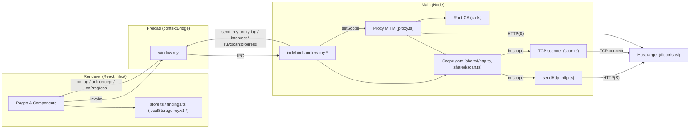
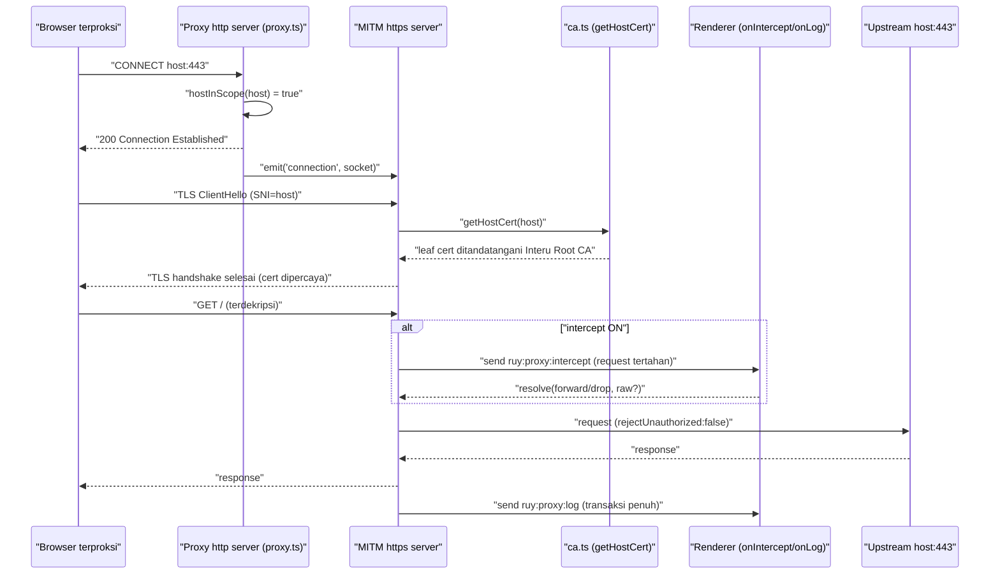

# 003 — Arsitektur

← [002 — Setup & Build](002_setup-dan-build.md) · [Index](000_index.md) · [010 — Fondasi Keamanan (Pengantar)](010_fondasi-keamanan.md) →

## Tiga proses Electron

| Proses | File utama | Tugas |
|---|---|---|
| **Main** | `../src/main/index.ts` | Lifecycle app, buat window, daftar handler IPC `ruy:*`, HTTP sender nyata (`http.ts`), proxy MITM scope-gated (`proxy.ts`), TCP scanner (`scan.ts`), export CA (`ca.ts`), browser terproksi. |
| **Preload** | `../src/preload/index.ts` | Expose `window.ruy` lewat `contextBridge` (contextIsolation aktif). Jembatan satu-satunya renderer ↔ main. |
| **Renderer** | `../src/renderer/src/main.tsx` → `App.tsx` | UI React. Tidak punya akses Node; semua trafik nyata lewat `window.ruy`. |

Kode bersama di `../src/shared/` dipakai ketiga root build karena bebas framework:

| File | Isi |
|---|---|
| `http.ts` | Tipe `HttpReq`/`HttpRes`, gate `hostInScope`. |
| `proxy.ts` | Tipe `ProxyLogEntry` (log proxy). |
| `scan.ts` | Tipe scan, port set per profil, `expandTargets`, gate `ipInScope` / `targetsInScope`, `MAX_IPS` 4096, `MAX_ATTEMPTS` 262144. |
| `rules.ts` | Rule Engine: `TEMPLATES`, `analyzeScan`, `analyzeHttpResponse`, `buildActiveRequest`, `matchActive` (lihat [041](041_rule-engine.md)). |
| `scope.test.ts`, `rules.test.ts` | Unit test vitest (`npm test`). |

## API `window.ruy` (`../src/preload/index.ts`)

| Jalur | Tipe | Mengundang channel | Fungsi |
|---|---|---|---|
| `ruy.platform` | string | — | `process.platform`. |
| `ruy.versions` | obj | — | Versi electron/chrome/node. |
| `ruy.http.send(req, scope)` | invoke | `ruy:http` | Kirim HTTP(S) nyata, scope-gated. |
| `ruy.proxy.start(port)` | invoke | `ruy:proxy:start` | Start proxy di port. |
| `ruy.proxy.stop()` | invoke | `ruy:proxy:stop` | Stop proxy. |
| `ruy.proxy.status()` | invoke | `ruy:proxy:status` | `{ running }`. |
| `ruy.proxy.setIntercept(on)` | invoke | `ruy:proxy:intercept` | Nyalakan/matikan intercept. |
| `ruy.proxy.setScope(scope)` | invoke | `ruy:proxy:scope` | Set scope proxy; dipanggil `App.tsx` tiap `settings.scope` berubah. |
| `ruy.proxy.resolve(id, action, raw?)` | invoke | `ruy:proxy:resolve` | Forward/drop request yang ditahan. |
| `ruy.proxy.openBrowser(url?)` | invoke | `ruy:proxy:openBrowser` | Buka browser terproksi (auto-trust CA). |
| `ruy.proxy.exportCA()` | invoke | `ruy:proxy:exportCA` | Tulis root CA ke Downloads. |
| `ruy.proxy.onLog(cb)` | listener | `ruy:proxy:log` | Stream transaksi proxy (main→renderer). Mengembalikan fungsi unsubscribe. |
| `ruy.proxy.onIntercept(cb)` | listener | `ruy:proxy:intercept` | Notifikasi request tertahan (main→renderer). |
| `ruy.scan.run(req, scope, scanId)` | invoke | `ruy:scan:tcp` | TCP connect scan nyata, scope-gated per IP. |
| `ruy.scan.cancel(scanId)` | invoke | `ruy:scan:cancel` | Batalkan scan yang sedang jalan. |
| `ruy.scan.onProgress(cb)` | listener | `ruy:scan:progress` | Stream `ScanEvent` (start/log/progress/host/done/error). Mengembalikan unsubscribe. |

## Channel IPC `ruy:*` (`../src/main/index.ts`)

| Channel | Arah | Mekanisme | Handler / sumber | Fungsi |
|---|---|---|---|---|
| `ruy:http` | renderer→main | `ipcMain.handle` | `sendHttp` (`../src/main/http.ts`) | Kirim HTTP nyata; **scope-gated** via `hostInScope`. |
| `ruy:proxy:start` | renderer→main | `handle` | `startProxy` (`../src/main/proxy.ts`) | Start proxy (default 8080). |
| `ruy:proxy:stop` | renderer→main | `handle` | `stopProxy` | Stop proxy, reset session port. |
| `ruy:proxy:status` | renderer→main | `handle` | `isRunning` | Status jalan/tidak. |
| `ruy:scan:tcp` | renderer→main | `handle` | `runScan` (`../src/main/scan.ts`) | `expandTargets` → **scope gate** `targetsInScope` → batas `MAX_ATTEMPTS`; `timeoutMs` di-clamp 100–10000 (default 1200), `scanId` harus number > 0, concurrency 256. |
| `ruy:scan:cancel` | renderer→main | `handle` | `cancelScan` | Hanya scan yang sedang jalan; id tak dikenal diabaikan. |
| `ruy:scan:progress` | main→renderer | `webContents.send` (via `emitToRenderer`) | `runScan` | Event progres scan. |
| `ruy:proxy:intercept` | renderer→main | `handle` | `setIntercept` | Set flag intercept. |
| `ruy:proxy:scope` | renderer→main | `handle` | `setScope` | Set scope proxy (array string; non-array → `[]`). |
| `ruy:proxy:resolve` | renderer→main | `handle` | `resolveIntercept` | Forward/drop request tertahan. |
| `ruy:proxy:exportCA` | renderer→main | `handle` | `exportCA` (`../src/main/ca.ts`) | Export root CA ke folder Downloads. |
| `ruy:proxy:openBrowser` | renderer→main | `handle` | inline di `index.ts` | Siapkan session terproksi (auto-trust CA Interu, tanpa bypass loopback) lalu buka jendela browser (`main/browser.ts`). |
| `ruy:browser:go\|back\|forward\|reload\|stop\|focusContent` | toolbar→main | `handle`/`on` | `main/browser.ts` | Navigasi browser terproksi; hanya diterima dari view toolbar. Balasan: event `ruy:browser:state`. |
| `ruy:proxy:log` | main→renderer | `webContents.send` (via `emit`) | `proxy.ts` `handleRequest` | Stream log transaksi — **hanya host in-scope**. |
| `ruy:proxy:intercept` | main→renderer | `webContents.send` (via `emitToRenderer`) | `proxy.ts` `handleRequest` | Kirim request tertahan (hanya in-scope); main juga `show()/focus()` window. |

> Nama `ruy:proxy:intercept` **dipakai dua arah**: sebagai `ipcMain.handle`
> (renderer menyetel intercept) dan sebagai event `webContents.send` (main
> memberitahu renderer ada request tertahan). Preload `onIntercept` mendengarkan
> event tersebut.

## Store (`../src/renderer/src/store/store.ts`)

- Persistensi lokal di `localStorage`, namespace `ruy.v1.`. Tidak ada server/DB.
- `useSettings()` / `patchSettings()` — store global `Settings` (theme,
  persistence, liveFeed, reduceMotion, operatorName, **scope**) via
  `useSyncExternalStore`.
- `usePersistentState(key, initial)` — `useState` yang ditulis ke localStorage
  (hormati toggle `persistence`).
- `resetLocalData()` — hapus semua key `ruy.v1.*` (tombol "Reset local data" di Settings). Key lama yang sudah tidak dipakai (`scanner.mode`, `vulns.view`, `vulns.status`, `firewall.rules`) cukup diabaikan bila masih ada.
- Store lain: `findings.ts` (temuan Rule Engine, key `ruy.v1.findings`, maks 1000,
  dedupe per `key`; ditulis Scanner + Proxy, dibaca Rule Engine + Vulnerabilities)
  dan `transfer.ts` (kirim request ke Repeater/Intruder).
- `useApplyTheme` / `useBodyMotionFlag` — set `data-theme` / `data-reduce-motion`
  di `<html>`.

## Routing (`../src/renderer/src/App.tsx`, HashRouter)

HashRouter dipakai sengaja karena bundle dimuat via `file://` (lihat `main.tsx`).

Kelompok = label grup sidebar (`../src/renderer/src/components/Sidebar.tsx`):
Web Security Suite, Operations, Detection, System.

| Path | Komponen | Kelompok sidebar |
|---|---|---|
| `/` | `Navigate → /threats` | — (landing page = Exposure Monitor) |
| `/web/target` | `Target` | Web Security Suite |
| `/web/crawler` | `Crawler` | Web Security Suite |
| `/web/activescan` | `ActiveScan` | Web Security Suite |
| `/web/proxy` | `Proxy` | Web Security Suite |
| `/web/repeater` | `Repeater` | Web Security Suite |
| `/web/intruder` | `Intruder` | Web Security Suite |
| `/web/sequencer` | `Sequencer` | Web Security Suite |
| `/web/decoder` | `Decoder` | Web Security Suite |
| `/web/comparer` | `Comparer` | Web Security Suite |
| `/scanner` | `NetworkScanner` | Operations |
| `/vulnerabilities` | `Vulnerabilities` | Operations |
| `/threats` | `ThreatMonitor` | Operations |
| `/detection` | `RuleEngine` | Detection |
| `/settings` | `Settings` | System |
| `*` | `Navigate → /` | fallback |

## Theming

Tema diterapkan ke `document.documentElement.dataset.theme` (`dark` / `light`)
oleh `useApplyTheme`. Dark = default, Light = alternatif; warna didefinisikan sebagai token peran
di `../src/renderer/src/styles/global.css` (lihat [092 — Panduan Tampilan](092_panduan-tampilan.md)).

## Diagram komponen

## Sequence: satu request HTTPS lewat proxy MITM (host in-scope)

Host out-of-scope tidak melewati alur ini: `CONNECT` langsung jadi tunnel TCP buta
(`net.connect`) tanpa dekripsi, log, atau intercept. Lihat [021](021_proxy-mitm.md).

