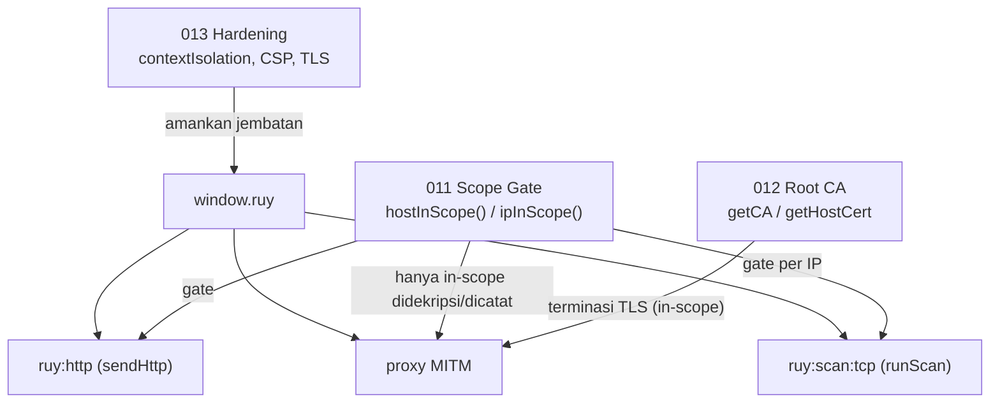

# 010 — Fondasi Keamanan (Pengantar)

← [003 — Arsitektur](003_arsitektur.md) · [Index](000_index.md) · [011 — Scope Gate](011_scope-gate.md) →

## Tujuan kelompok

Kelompok **Fondasi keamanan (01x)** adalah lapisan yang membuat Interu bisa
dipakai menyerang trafik nyata **secara aman dan legal-by-design**:

- membatasi aksi "live" (HTTP, TCP scan, tangkapan proxy) hanya ke host/IP yang
  diotorisasi (**Scope Gate**),
- menyediakan **Root CA & sertifikat** untuk mendekripsi HTTPS (MITM),
- mengeraskan proses Electron (**hardening**) agar jembatan Node tidak jadi lubang.

Ini bukan fitur yang dilihat juri sebagai "menu", tapi fondasi yang menentukan
apakah Web Security Suite (02x) aman dipakai.

## Daftar fitur

| Kode | Fitur | Status | Dokumen |
|---|---|---|---|
| 011 | Scope Gate (otorisasi target) | ✅ Nyata | [011_scope-gate.md](011_scope-gate.md) |
| 012 | Root CA & Sertifikat (TLS MITM) | ✅ Nyata | [012_root-ca-dan-sertifikat.md](012_root-ca-dan-sertifikat.md) |
| 013 | Hardening Electron | 🟡 Sebagian | [013_hardening-electron.md](013_hardening-electron.md) |

## Hubungan antar fitur

> Ketiga jalur trafik nyata di-gate di proses main. Proxy meneruskan host
> out-of-scope tanpa dekripsi/log (CONNECT = tunnel buta). Detail di [011](011_scope-gate.md).

## Tabel status

| Fitur | Nyata? | Catatan singkat |
|---|---|---|
| Scope Gate | Nyata | `ruy:http`, `ruy:scan:tcp`, dan proxy; IP via IP persis/CIDR; 10 unit test. |
| Root CA & Sertifikat | Nyata | Berfungsi penuh; key tanpa enkripsi, tanpa revoke/cleanup. |
| Hardening Electron | Sebagian | contextIsolation + CSP kuat; `sandbox:false` & TLS bypass disengaja untuk MITM. |

## Urutan pengerjaan yang disarankan

1. ~~**011 Scope Gate** — terapkan gate di proxy.~~ Selesai (proxy scope-gated,
   ada test). Sisa kecil: entri IP+port, log audit.
2. **012 Root CA** — tambah proteksi key + mekanisme hapus/revoke CA.
3. **013 Hardening** — dokumentasikan & batasi TLS bypass hanya ke alur MITM;
   pertimbangkan `sandbox:true` bila preload memungkinkan.
