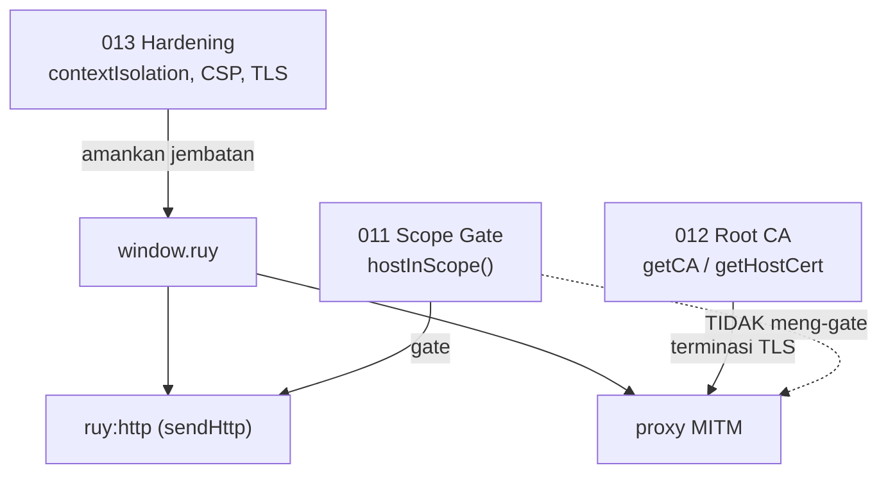

# 010 — Fondasi Keamanan (Pengantar)

← [003 — Arsitektur](003_arsitektur.md) · [Index](000_index.md) · [011 — Scope Gate](011_scope-gate.md) →

## Tujuan kelompok

Kelompok **Fondasi keamanan (01x)** adalah lapisan yang membuat Interu bisa
dipakai menyerang trafik nyata **secara aman dan legal-by-design**:

- membatasi aksi "live" hanya ke host yang diotorisasi (**Scope Gate**),
- menyediakan **Root CA & sertifikat** untuk mendekripsi HTTPS (MITM),
- mengeraskan proses Electron (**hardening**) agar jembatan Node tidak jadi lubang.

Ini bukan fitur yang dilihat juri sebagai "menu", tapi fondasi yang menentukan
apakah Web Security Suite (02x) aman dipakai.

## Daftar fitur

| Kode | Fitur | Status | Dokumen |
|---|---|---|---|
| 011 | Scope Gate (otorisasi target) | 🟡 Sebagian | [011_scope-gate.md](011_scope-gate.md) |
| 012 | Root CA & Sertifikat (TLS MITM) | ✅ Nyata | [012_root-ca-dan-sertifikat.md](012_root-ca-dan-sertifikat.md) |
| 013 | Hardening Electron | 🟡 Sebagian | [013_hardening-electron.md](013_hardening-electron.md) |

## Hubungan antar fitur

> Garis putus-putus menandai temuan utama: **proxy MITM tidak di-gate oleh Scope**.
> Hanya `ruy:http` (Repeater) dan pre-check di halaman renderer yang memakai
> `hostInScope`. Detail di [011](011_scope-gate.md).

## Tabel status

| Fitur | Nyata? | Catatan singkat |
|---|---|---|
| Scope Gate | Sebagian | Nyata untuk `ruy:http` + pre-check UI; proxy lolos tanpa gate. |
| Root CA & Sertifikat | Nyata | Berfungsi penuh; key tanpa enkripsi, tanpa revoke/cleanup. |
| Hardening Electron | Sebagian | contextIsolation + CSP kuat; `sandbox:false` & TLS bypass disengaja untuk MITM. |

## Urutan pengerjaan yang disarankan

1. **011 Scope Gate** — tutup celah: terapkan `hostInScope` di `handleRequest`
   (proxy) agar selaras dengan `ruy:http`.
2. **012 Root CA** — tambah proteksi key + mekanisme hapus/revoke CA.
3. **013 Hardening** — dokumentasikan & batasi TLS bypass hanya ke alur MITM;
   pertimbangkan `sandbox:true` bila preload memungkinkan.
