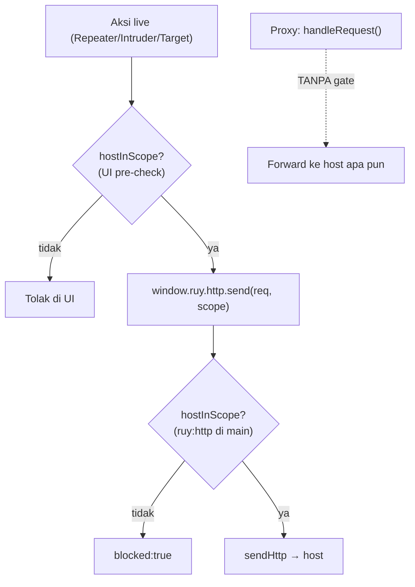

# 011 — Scope Gate

← [010 — Fondasi Keamanan (Pengantar)](010_fondasi-keamanan.md) · [Index](000_index.md) · [012 — Root CA & Sertifikat (TLS MITM)](012_root-ca-dan-sertifikat.md) →

## 1. Status

🟡 **SEBAGIAN** — gate nyata dan dipakai untuk `ruy:http` (Repeater) serta
pre-check di UI, tetapi **proxy MITM tidak ter-gate** (lihat temuan).

## 2. Tujuan fitur

Menegakkan *legal-by-design*: aksi yang mengirim trafik nyata hanya boleh ke host
yang didaftarkan operator ke **Scope**. Scope kosong = tidak ada yang diizinkan
(authorization-first by default).

## 3. Cara kerja

Inti gate ada di satu fungsi murni, `hostInScope(url, scope)`
(`../src/shared/http.ts`):

- Ambil `hostname` dari URL (lowercase). URL tak valid → `false`.
- Untuk tiap entri scope: buang skema `http(s)://` dan path, lalu cocokkan.
- Lolos jika `host === s` **atau** `host` berakhiran `"." + s` (subdomain).

Dipakai di dua sisi:

- **Main / authoritative** — handler `ruy:http` di `../src/main/index.ts`
  memanggil `hostInScope(req.url, scope)`; jika gagal, kembalikan
  `{ ok:false, blocked:true, error:"Target host is not in the authorized scope…" }`
  **tanpa** mengirim request.
- **Renderer / pre-check (UX)** — `Target.tsx`, `Intruder.tsx`, `Repeater.tsx`
  memanggil `hostInScope` lebih dulu untuk menolak cepat sebelum invoke.

## 4. File terkait

| File | Fungsi utama |
|---|---|
| [`../src/shared/http.ts`](../src/shared/http.ts) | `hostInScope(url, scope)` — logika gate. |
| [`../src/main/index.ts`](../src/main/index.ts) | Handler `ruy:http` memanggil gate (otoritatif). |
| [`../src/renderer/src/pages/web/Repeater.tsx`](../src/renderer/src/pages/web/Repeater.tsx) | Pre-check sebelum kirim. |
| [`../src/renderer/src/pages/web/Intruder.tsx`](../src/renderer/src/pages/web/Intruder.tsx) | Pre-check sebelum fuzzing. |
| [`../src/renderer/src/pages/web/Target.tsx`](../src/renderer/src/pages/web/Target.tsx) | Pre-check discovery live. |
| [`../src/main/proxy.ts`](../src/main/proxy.ts) | `handleRequest` — **tidak** memanggil gate. |
| [`../src/renderer/src/store/store.ts`](../src/renderer/src/store/store.ts) | `Settings.scope` (array host) disimpan di localStorage. |

## 5. Cara pakai

1. Buka **Settings** → isi daftar **Scope** dengan host yang diizinkan
   (mis. `demo.ruy.local`, `example.com`).
2. Jalankan aksi live (Repeater/Intruder/Target). Host di luar scope ditolak.
3. Subdomain dari host scope ikut diizinkan (`api.example.com` lolos jika
   `example.com` ada di scope).

## 6. Batasan / temuan

- **TEMUAN UTAMA — proxy tidak scope-gated.** `handleRequest` di
  `../src/main/proxy.ts` meneruskan request ke host mana pun yang diminta browser
  terproksi; `hostInScope` tidak pernah dipanggil di jalur proxy. Jadi klaim
  "legal-by-design" hanya berlaku untuk `ruy:http`/Repeater, bukan untuk trafik
  yang lewat Proxy/Open Browser. (Diverifikasi: grep `hostInScope` tidak muncul
  di `proxy.ts`.)
- Pre-check di renderer hanya UX; keamanan nyata ada di handler main.
- Pencocokan hanya berbasis hostname (tanpa port/path/skema). IP cocok sebagai
  string literal.
- Scope kosong memblokir semua — aman sebagai default.

## 7. Checklist pengerjaan

- [ ] Terapkan `hostInScope(u.href, scope)` di `handleRequest` (`proxy.ts`) dan tolak di luar scope (mis. balas `403`).
- [ ] Teruskan daftar scope dari renderer ke proxy saat `startProxy` / per-request (saat ini proxy tak punya akses scope).
- [ ] Samakan pesan penolakan proxy dengan `ruy:http` ("…not in the authorized scope").
- [ ] Tambah test unit `hostInScope` (host sama, subdomain, URL invalid, scope kosong, port/skema).
- [ ] Tambah log audit tiap penolakan scope (dukung legal-by-design).
- [ ] Dokumentasikan di README bahwa proxy kini ter-gate (perbaiki klaim lama).
