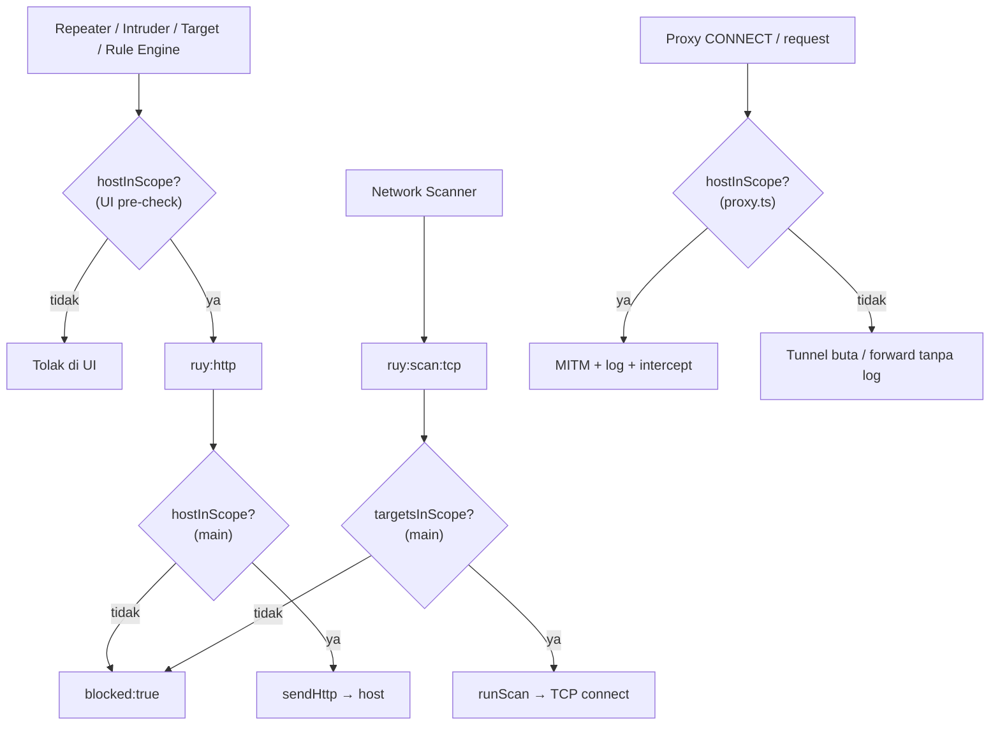

# 011 — Scope Gate

← [010 — Fondasi Keamanan (Pengantar)](010_fondasi-keamanan.md) · [Index](000_index.md) · [012 — Root CA & Sertifikat (TLS MITM)](012_root-ca-dan-sertifikat.md) →

## 1. Status

✅ **NYATA** — gate otoritatif di proses main untuk ketiga jalur trafik nyata:
`ruy:http` (Repeater/Intruder/Target/Rule Engine), `ruy:scan:tcp` (Network
Scanner), dan **proxy MITM**. Ada unit test (`npm test`).

## 2. Tujuan fitur

Menegakkan *legal-by-design*: aksi yang mengirim **atau menangkap** trafik nyata
hanya boleh ke host/IP yang didaftarkan operator ke **Scope**. Scope kosong = tidak
ada yang diizinkan (authorization-first by default).

## 3. Cara kerja

Dua fungsi murni, dipakai di main dan renderer:

**`hostInScope(url, scope)`** (`../src/shared/http.ts`) — untuk URL:

- Ambil `hostname` via WHATWG `URL` (lowercase). URL tak valid → `false`.
  Catatan: `URL` menormalkan IP oktal, mis. `http://010.0.0.1/` → host `8.0.0.1`;
  gate menilai alamat yang **benar-benar dihubungi**.
- Host **IPv4** → `ipInScope(host, scope)`: hanya cocok IP persis atau masuk CIDR.
  Tidak ada suffix-match untuk IP (`0.1` tidak meloloskan `10.0.0.1`).
- Host **nama** → dicocokkan hanya ke entri non-IP: buang `http(s)://`, path, dan
  **port** (`example.com:8080` → `example.com`), lalu lolos jika `host === s` atau
  subdomain (`host` berakhiran `"." + s`).

**`ipInScope(ip, scope)`** / **`targetsInScope(ips, scope)`** (`../src/shared/scan.ts`):

- Entri IP persis (`10.20.0.14`) atau CIDR (`10.20.0.0/24`). Mask CIDR harus 1–2
  digit dan ≤ 32; `10.0.0.0/` ditolak (tidak lagi dibaca sebagai /0).
- Entri hostname **tidak** mengotorisasi scan IP.
- `targetsInScope` mengembalikan IP pertama yang di luar scope.

Penerapan di main (otoritatif):

| Jalur | Lokasi | Perilaku di luar scope |
|---|---|---|
| `ruy:http` | `../src/main/index.ts` | `{ ok:false, blocked:true, error:"Target host is not in the authorized scope…" }`, request tidak dikirim. |
| `ruy:scan:tcp` | `../src/main/index.ts` | `expandTargets` dulu (IP tunggal dinormalkan, `010.0.0.1` → `10.0.0.1`), lalu `targetsInScope`; satu IP saja di luar → `blocked:true`, tidak ada socket dibuka. |
| Proxy `CONNECT` | `../src/main/proxy.ts` | Tunnel TCP buta (`net.connect`): tidak didekripsi, dicatat, atau di-intercept. |
| Proxy `handleRequest` | `../src/main/proxy.ts` | Diteruskan apa adanya; tanpa intercept dan tanpa event `ruy:proxy:log`. |

Scope proxy disimpan di modul `proxy.ts` lewat `setScope` (IPC `ruy:proxy:scope`,
preload `window.ruy.proxy.setScope`). `App.tsx` menyinkronkan `settings.scope` ke
proxy lewat `useEffect` setiap kali scope berubah, dari halaman mana pun.

Renderer juga pre-check (UX, menolak cepat): `Repeater.tsx`, `Intruder.tsx`,
`Target.tsx`, `RuleEngine.tsx` memanggil `hostInScope` sebelum invoke.

## 4. File terkait

| File | Fungsi utama |
|---|---|
| [`../src/shared/http.ts`](../src/shared/http.ts) | `hostInScope(url, scope)`. |
| [`../src/shared/scan.ts`](../src/shared/scan.ts) | `ipInScope`, `targetsInScope`, `expandTargets`, `parseMask`. |
| [`../src/main/index.ts`](../src/main/index.ts) | Gate di `ruy:http` dan `ruy:scan:tcp`; handler `ruy:proxy:scope`. |
| [`../src/main/proxy.ts`](../src/main/proxy.ts) | `setScope`; gate di `connect` (tunnel buta) dan `handleRequest`. |
| [`../src/renderer/src/App.tsx`](../src/renderer/src/App.tsx) | `useEffect` → `window.ruy.proxy.setScope(settings.scope)`. |
| [`../src/renderer/src/components/ScopeBar.tsx`](../src/renderer/src/components/ScopeBar.tsx) | Editor scope (dipakai di Proxy, Repeater, Intruder, Target, Network Scanner, Rule Engine). |
| [`../src/renderer/src/store/store.ts`](../src/renderer/src/store/store.ts) | `Settings.scope` (array string) di localStorage. |
| [`../src/shared/scope.test.ts`](../src/shared/scope.test.ts) | 10 unit test gate + `expandTargets`. |

## 5. Cara pakai

1. Di halaman live (Proxy, Repeater/Intruder/Target mode Live, Network Scanner
   mode Live, Rule Engine), tambah entri di **Authorized scope** (`ScopeBar`):
   hostname (`example.com`), IP (`10.20.0.14`), atau CIDR (`10.20.0.0/24`).
   Scope tersimpan global, jadi berlaku di semua halaman.
2. Hostname meloloskan subdomainnya (`api.example.com` lolos jika `example.com`
   ada). IP/CIDR hanya meloloskan alamat yang dicakup.
3. Proxy: tanpa scope, riwayat Proxy tetap kosong (semua lalu lintas hanya
   diteruskan).
4. Jalankan test: `npm test`.

## 6. Batasan / temuan

- Pre-check di renderer hanya UX; keamanan nyata ada di main.
- Pencocokan hostname tidak memperhatikan port/skema; `example.com:8443` di scope
  juga meloloskan `example.com:80`.
- Entri IP dengan port (`10.0.0.1:8080`) **tidak cocok sama sekali** di
  `ipInScope` (port tidak dibuang untuk entri IP) — tulis IP tanpa port.
  `ScopeBar` menyimpan port apa adanya.
- IPv6 praktis tidak bisa di-scope: entri `[::1]` terpotong di `:` pertama menjadi
  `[`, jadi host IPv6 tidak pernah lolos (aman, tapi tidak bisa dipakai).
- Semantik `010.0.0.1` berbeda per jalur, tapi masing-masing konsisten dengan
  alamat yang dihubungi: URL (WHATWG) → `8.0.0.1`; target scanner → `10.0.0.1`.
- Gate memakai hostname, bukan IP hasil DNS: hostname in-scope yang resolve ke IP
  lain tetap lolos.
- Out-of-scope di proxy tetap **diteruskan** (bukan diblokir) agar browser
  terproksi tetap bisa dipakai; hanya penangkapan yang dibatasi.

## 7. Checklist pengerjaan

- [x] Terapkan gate di proxy (`handleRequest` + `CONNECT`); out-of-scope tidak didekripsi/dicatat.
- [x] Teruskan scope dari renderer ke proxy (`ruy:proxy:scope`, sinkron dari `App.tsx`).
- [x] Tambah test unit `hostInScope` / `ipInScope` / `expandTargets` (`src/shared/scope.test.ts`).
- [x] Dokumentasikan di README bahwa proxy kini ter-gate.
- [x] IP dicek via IP persis/CIDR, tanpa suffix-match; mask CIDR kosong ditolak.
- [ ] Samakan penanganan entri IP+port dengan hostname (buang port) atau tolak di `ScopeBar`.
- [ ] Opsi blokir (bukan teruskan) trafik out-of-scope di proxy.
- [ ] Tambah log audit tiap penolakan scope (dukung legal-by-design).
- [ ] Pertimbangkan cek IP hasil resolve DNS untuk hostname in-scope.
