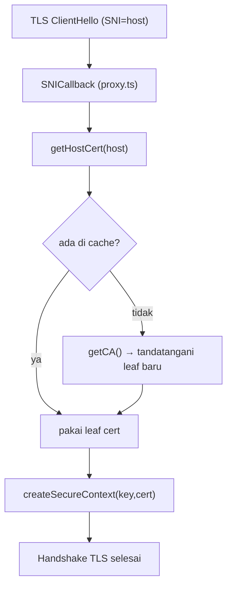

# 012 — Root CA & Sertifikat (TLS MITM)

← [011 — Scope Gate](011_scope-gate.md) · [Index](000_index.md) · [013 — Hardening Electron](013_hardening-electron.md) →

## 1. Status

✅ **NYATA & DIPERKUAT** — root CA dan sertifikat per-host dibuat dengan
node-forge untuk mendekripsi HTTPS di proxy. Private key CA kini **disimpan
terenkripsi** (Electron safeStorage/DPAPI) dan ada **Remove CA** (`deleteCA()`).

## 2. Tujuan fitur

Menyediakan Certificate Authority lokal agar proxy bisa **terminasi TLS**
(HTTPS MITM): tiap host target diberi leaf cert yang ditandatangani root CA
Interu, sehingga trafik HTTPS bisa dibaca dan diintercept.

## 3. Cara kerja

- `getCA()` — kembalikan bundle CA (cert + key). Cert publik dibaca dari
  `userData/ca/interu-ca.crt`; private key dibaca dari `interu-ca.key.enc`
  (terenkripsi safeStorage/DPAPI). Jika tidak ada/gagal, `createRootCA()` membuat
  baru (RSA 2048, CN "Interu Root CA", `cA:true`, berlaku 10 tahun) lalu menulis
  cert plaintext + **key terenkripsi**. Key plaintext lama (`interu-ca.key`) dari
  build sebelumnya otomatis **dimigrasi** ke bentuk terenkripsi lalu dihapus.
  Di-cache di memori (`bundle`).
- `writeCaKey()/readCaKey()` — enkripsi/dekripsi key via Electron `safeStorage`
  (DPAPI di Windows, Keychain di macOS), terikat ke user OS. Bila keyring OS tak
  tersedia, fallback plaintext dengan peringatan.
- `deleteCA()` — hapus cert + key (enc & plaintext) dan reset cache; CA baru
  dibuat otomatis saat dipakai lagi. `caFingerprint()` — SHA-256 cert untuk UI.
- `getHostCert(host)` — buat/cache leaf cert untuk host (RSA 2048, SAN DNS atau IP,
  `extKeyUsage serverAuth`, berlaku 2 tahun), ditandatangani oleh key CA.
  Dipakai oleh `SNICallback` server MITM di `proxy.ts`.
- `exportCA(destDir)` — tulis PEM root CA ke `destDir/Interu-Root-CA.crt`.
  Handler `ruy:proxy:exportCA` memanggilnya dengan folder **Downloads**.

**Trust:** browser bawaan "Open Browser" memercayai CA lewat
`setCertificateVerifyProc` di `../src/main/index.ts` — kini **hanya** cert yang
di-issue `Interu Root CA` yang di-`cb(0)`; cert lain divalidasi normal (`cb(-3)`).
Browser eksternal harus meng-import `Interu-Root-CA.crt` manual (lihat
[002](002_setup-dan-build.md)).

## 4. File terkait

| File | Fungsi utama |
|---|---|
| [`../src/main/ca.ts`](../src/main/ca.ts) | `getCA`, `getHostCert`, `exportCA`, `createRootCA`, `caDir`. |
| [`../src/main/proxy.ts`](../src/main/proxy.ts) | `SNICallback` memakai `getHostCert` untuk terminasi TLS. |
| [`../src/main/index.ts`](../src/main/index.ts) | Handler `ruy:proxy:exportCA`; auto-trust `setCertificateVerifyProc`. |

## 5. Cara pakai

1. Start proxy (halaman Proxy). Untuk HTTPS di browser eksternal, tekan
   **Export CA** → file ke folder Downloads.
2. Import `Interu-Root-CA.crt` ke Trusted Root (OS) atau Authorities (Firefox).
3. Atau cukup pakai **Open Browser** bawaan (auto-trust, tak perlu import).

## 6. Batasan / temuan

- **Private key kini terenkripsi** via safeStorage (DPAPI) — tidak lagi plaintext.
  Hanya user OS yang sama yang bisa mendekripsi. Fallback plaintext hanya bila
  keyring OS tak tersedia (jarang), dengan peringatan di konsol.
- **Remove CA tersedia** (`deleteCA()` + tombol di UI Proxy): menghapus cert+key.
  Men-distrust di OS/browser tetap manual (CA bisa sudah di-import ke sana).
- **Cache host hanya di memori** (`hostCache` Map) — leaf cert tak dipersist,
  dibuat ulang tiap proses; wajar.
- `getHostCert` memakai `serialNumber` berbasis `Date.now()+random` — cukup unik,
  tapi bukan monotonic kriptografis.
- `caDir()` memakai `app.getPath('userData')`, sedangkan `exportCA` menulis ke
  folder Downloads yang diberikan handler; dua lokasi berbeda.

## 7. Checklist pengerjaan

- [x] Enkripsi `interu-ca.key` saat ditulis (Electron safeStorage / DPAPI) + migrasi key plaintext lama.
- [x] Tambah fungsi `deleteCA()` + tombol "Remove CA" (handler `ruy:proxy:removeCA`, UI Proxy) yang menghapus cert+key dan reset `bundle`.
- [ ] Tambah helper/instruksi uninstall trust (certmgr / Firefox) di UI setelah export.
- [ ] Batasi izin file pada folder `ca/` (ACL/permission) saat dibuat.
- [ ] Pertimbangkan masa berlaku CA lebih pendek + regenerasi, bukan 10 tahun.
- [ ] Tambah peringatan eksplisit di UI Export CA soal risiko key tak terenkripsi.
