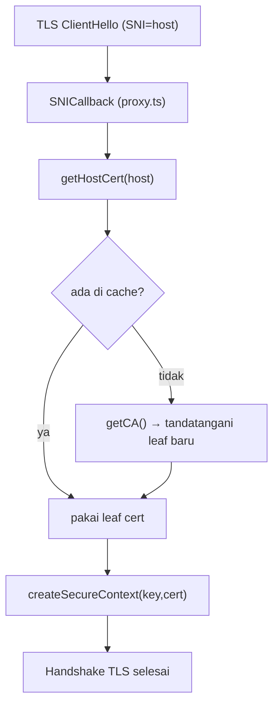

# 012 — Root CA & Sertifikat (TLS MITM)

← [011 — Scope Gate](011_scope-gate.md) · [Index](000_index.md) · [013 — Hardening Electron](013_hardening-electron.md) →

## 1. Status

✅ **NYATA** — root CA dan sertifikat per-host dibuat dengan node-forge dan
dipakai untuk mendekripsi HTTPS di proxy. Berfungsi penuh.

## 2. Tujuan fitur

Menyediakan Certificate Authority lokal agar proxy bisa **terminasi TLS**
(HTTPS MITM): tiap host target diberi leaf cert yang ditandatangani root CA
Interu, sehingga trafik HTTPS bisa dibaca dan diintercept.

## 3. Cara kerja

- `getCA()` — kembalikan bundle CA (cert + key). Dibaca dari
  `userData/ca/interu-ca.crt` & `interu-ca.key` bila ada; jika tidak ada atau
  gagal dibaca, `createRootCA()` membuat baru (RSA 2048, `commonName` "Interu
  Root CA", `basicConstraints cA:true`, masa berlaku 10 tahun) lalu menulisnya ke
  disk. Di-cache di memori (`bundle`).
- `getHostCert(host)` — buat/cache leaf cert untuk host (RSA 2048, SAN DNS atau IP,
  `extKeyUsage serverAuth`, berlaku 2 tahun), ditandatangani oleh key CA.
  Dipakai oleh `SNICallback` server MITM di `proxy.ts`.
- `exportCA(destDir)` — tulis PEM root CA ke `destDir/Interu-Root-CA.crt`.
  Handler `ruy:proxy:exportCA` memanggilnya dengan folder **Downloads**.

**Trust:** browser bawaan "Open Browser" memercayai CA otomatis lewat
`ses.setCertificateVerifyProc((_req, cb) => cb(0))` di `../src/main/index.ts`.
Browser eksternal harus meng-import `Interu-Root-CA.crt` manual (lihat
[002](002_setup-dan-build.md)).

## 4. File terkait

| File | Fungsi utama |
|---|---|
| [`../src/main/ca.ts`](../src/main/ca.ts) | `getCA`, `getHostCert`, `exportCA`, `createRootCA`, `caDir`. |
| [`../src/main/proxy.ts`](../src/main/proxy.ts) | `SNICallback` memakai `getHostCert` untuk terminasi TLS. |
| [`../src/main/index.ts`](../src/main/index.ts) | Handler `ruy:proxy:exportCA`; auto-trust `setCertificateVerifyProc`. |

## 5. Cara pakai

1. Start proxy (halaman Proxy). Untuk HTTPS di browser eksternal, tekan
   **Export CA** → file ke folder Downloads.
2. Import `Interu-Root-CA.crt` ke Trusted Root (OS) atau Authorities (Firefox).
3. Atau cukup pakai **Open Browser** bawaan (auto-trust, tak perlu import).

## 6. Batasan / temuan

- **Private key tanpa enkripsi.** `interu-ca.key` ditulis via
  `forge.pki.privateKeyToPem(bundle.caKey)` tanpa passphrase. Siapa pun yang
  membaca file itu bisa menyamar sebagai CA tepercaya di mesin yang trust CA
  tersebut.
- **Tanpa cleanup / revoke.** Tidak ada kode untuk menghapus folder `ca/`,
  mencabut CA, atau men-distrust. Hapus trust harus manual di OS/browser.
- **Cache host hanya di memori** (`hostCache` Map) — leaf cert tak dipersist,
  dibuat ulang tiap proses; wajar.
- `getHostCert` memakai `serialNumber` berbasis `Date.now()+random` — cukup unik,
  tapi bukan monotonic kriptografis.
- `caDir()` memakai `app.getPath('userData')`, sedangkan `exportCA` menulis ke
  folder Downloads yang diberikan handler; dua lokasi berbeda.

## 7. Checklist pengerjaan

- [ ] Enkripsi `interu-ca.key` saat ditulis (passphrase via `privateKeyToPem(key, passphrase)` atau DPAPI Windows).
- [ ] Tambah fungsi `deleteCA()` / tombol "Remove CA" yang menghapus folder `ca/` dan reset `bundle`.
- [ ] Tambah helper/instruksi uninstall trust (certmgr / Firefox) di UI setelah export.
- [ ] Batasi izin file pada folder `ca/` (ACL/permission) saat dibuat.
- [ ] Pertimbangkan masa berlaku CA lebih pendek + regenerasi, bukan 10 tahun.
- [ ] Tambah peringatan eksplisit di UI Export CA soal risiko key tak terenkripsi.
