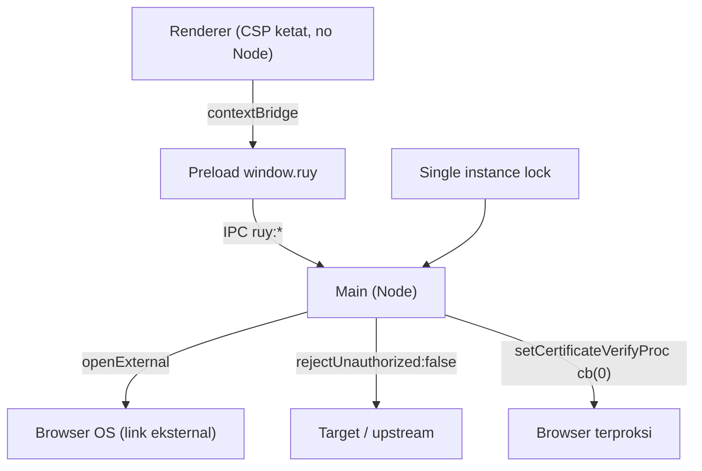

# 013 — Hardening Electron

← [012 — Root CA & Sertifikat (TLS MITM)](012_root-ca-dan-sertifikat.md) · [Index](000_index.md) · [020 — Web Security Suite (Pengantar)](020_web-security-suite.md) →

## 1. Status

🟡 **SEBAGIAN** — proteksi inti Electron (contextIsolation, CSP, single-instance,
openExternal) sudah benar; beberapa pelonggaran (`sandbox:false`, TLS bypass)
**disengaja** untuk mendukung MITM, tetapi memperluas permukaan risiko.

## 2. Tujuan fitur

Mengeraskan proses Electron supaya jembatan Node (`window.ruy`) tidak bisa
disalahgunakan oleh konten renderer, dan memastikan pelonggaran yang perlu untuk
alat pentest (MITM, self-signed cert) terbatas dan dipahami.

## 3. Cara kerja

Konfigurasi `webPreferences` window utama (`../src/main/index.ts`):

| Setting | Nilai | Maksud |
|---|---|---|
| `contextIsolation` | `true` | Renderer terpisah dari konteks preload; `window.ruy` lewat `contextBridge` saja. **Disengaja (baik).** |
| `nodeIntegration` | `false` | Renderer tidak punya `require`/Node API. **Disengaja (baik).** |
| `sandbox` | `false` | Preload boleh pakai Node (`ipcRenderer`, modul). **Disengaja**, tapi melemahkan sandbox. |

Perlindungan lain:

- **CSP ketat** di `../src/renderer/index.html`:
  `default-src 'self'; script-src 'self'; style-src 'self' 'unsafe-inline';
  img-src 'self' data:; connect-src 'self'; object-src 'none'; base-uri 'self'`.
  Tidak ada skrip/koneksi remote; app offline penuh.
- **`shell.openExternal`** di `setWindowOpenHandler` — semua link eksternal dibuka
  di browser OS, window baru internal selalu `deny`. **Disengaja (baik).**
- **Single instance lock** — `app.requestSingleInstanceLock()`; instance kedua
  memfokuskan window pertama. **Disengaja (baik).**
- **`Menu.setApplicationMenu(null)`** — hilangkan menu default.

TLS bypass (sengaja, demi MITM & target self-signed):

| Lokasi | Kode | Alasan |
|---|---|---|
| `../src/main/http.ts` | `rejectUnauthorized: false` | Target uji sering pakai sertifikat self-signed. |
| `../src/main/proxy.ts` | `rejectUnauthorized: false` | Proxy upstream boleh cert invalid. |
| `../src/main/index.ts` | `ses.setCertificateVerifyProc((_req, cb) => cb(0))` | Browser terproksi auto-trust leaf MITM. |

## 4. File terkait

| File | Fungsi utama |
|---|---|
| [`../src/main/index.ts`](../src/main/index.ts) | `webPreferences`, `setWindowOpenHandler`, single-instance lock, `setCertificateVerifyProc`. |
| [`../src/renderer/index.html`](../src/renderer/index.html) | Meta CSP. |
| [`../src/preload/index.ts`](../src/preload/index.ts) | Expose `window.ruy` via `contextBridge` (guard `process.contextIsolated`). |
| [`../src/main/http.ts`](../src/main/http.ts) | `rejectUnauthorized:false` (sender). |
| [`../src/main/proxy.ts`](../src/main/proxy.ts) | `rejectUnauthorized:false` (upstream proxy). |

## 5. Cara pakai

Tidak ada aksi pengguna; hardening aktif otomatis. Yang perlu disadari operator:
TLS verification dimatikan pada jalur trafik alat, jadi MITM/self-signed sengaja
diterima — ini fitur alat pentest, bukan bug.

## 6. Batasan / temuan

- **Mana yang disengaja (aman):** `contextIsolation:true`, `nodeIntegration:false`,
  CSP ketat, `openExternal` + `deny` window baru, single-instance lock.
- **Pelonggaran disengaja (risiko sadar):**
  - `sandbox:false` — perlu agar preload memakai Node; kompromikan isolasi proses
    renderer bila ada bug.
  - TLS bypass di tiga lokasi — perlu untuk MITM/self-signed, tetapi berlaku
    **global** di jalur masing-masing (bukan hanya host scope).
- `setCertificateVerifyProc` dipasang untuk session `interu-proxied` saja, jadi
  terbatas ke browser terproksi (baik). Namun `cb(0)` memercayai **semua** cert di
  session itu, bukan hanya yang ditandatangani Interu CA.
- Preload punya cabang fallback non-isolated (`window.ruy = api`) yang tak terpakai
  karena `contextIsolation:true`.

## 7. Checklist pengerjaan

- [ ] Evaluasi `sandbox:true`; pindahkan kebutuhan Node preload ke IPC bila bisa.
- [ ] Batasi `rejectUnauthorized:false` hanya untuk host yang discope, bukan global.
- [ ] Di `setCertificateVerifyProc`, verifikasi cert benar-benar ditandatangani Interu CA sebelum `cb(0)`.
- [ ] Tambah test/smoke yang memastikan CSP tidak longgar antar rilis.
- [ ] Hapus cabang fallback non-isolated di preload (dead code) atau beri komentar jelas.
- [ ] Dokumentasikan secara eksplisit di README bahwa TLS verification dimatikan di jalur alat.
