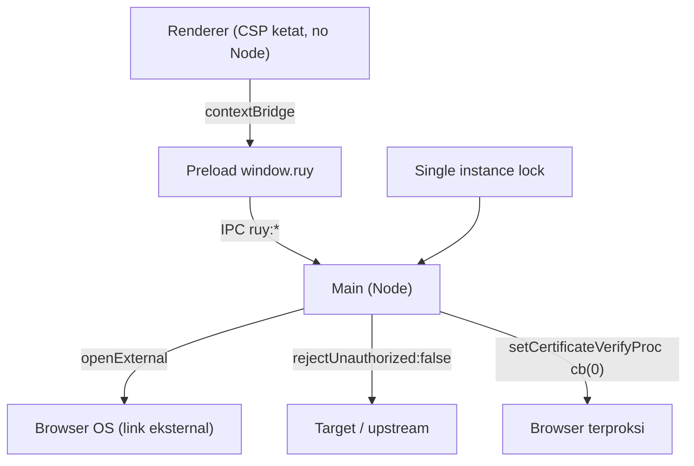

# 013 — Hardening Electron

← [012 — Root CA & Sertifikat (TLS MITM)](012_root-ca-dan-sertifikat.md) · [Index](000_index.md) · [020 — Web Security Suite (Pengantar)](020_web-security-suite.md) →

## 1. Status

🟢 **DIPERKUAT** — proteksi inti Electron (contextIsolation, CSP, single-instance,
openExternal) benar; `sandbox:true` kini aktif; `setCertificateVerifyProc`
dibatasi hanya mempercayai cert yang ditandatangani Interu CA (bukan lagi `cb(0)`
untuk semua). TLS bypass pada jalur alat (`http.ts`/`proxy.ts`/`scan.ts`) tetap
**disengaja** dan sudah scope-gated — itu memang perilaku alat pentest.

## 2. Tujuan fitur

Mengeraskan proses Electron supaya jembatan Node (`window.ruy`) tidak bisa
disalahgunakan oleh konten renderer, dan memastikan pelonggaran yang perlu untuk
alat pentest (MITM, self-signed cert) terbatas dan dipahami.

## 3. Cara kerja

Konfigurasi `webPreferences` window utama (`../src/main/index.ts`):

| Setting | Nilai | Maksud |
|---|---|---|
| `contextIsolation` | `true` | Renderer terpisah dari konteks preload; `window.ruy` lewat `contextBridge` saja. **Disengaja (baik).** |
| `nodeIntegration` | `false` | Renderer tidak punya `require`/Node API. **Disengaja (baik).** |
| `sandbox` | `true` | Renderer di-sandbox penuh; preload hanya pakai `contextBridge`/`ipcRenderer`/`process.platform|versions` (kompatibel sandbox). **Disengaja (baik).** |

Perlindungan lain:

- **CSP ketat** di `../src/renderer/index.html`:
  `default-src 'self'; script-src 'self'; style-src 'self' 'unsafe-inline';
  img-src 'self' data:; connect-src 'self'; object-src 'none'; base-uri 'self'`.
  Tidak ada skrip/koneksi remote; app offline penuh.
- **`shell.openExternal`** di `setWindowOpenHandler` — semua link eksternal dibuka
  di browser OS, window baru internal selalu `deny`. **Disengaja (baik).**
- **Single instance lock** — `app.requestSingleInstanceLock()`; instance kedua
  memfokuskan window pertama. **Disengaja (baik).**
- **`Menu.setApplicationMenu(null)`** — hilangkan menu default.

TLS bypass (sengaja, demi MITM & target self-signed):

| Lokasi | Kode | Alasan |
|---|---|---|
| `../src/main/http.ts` | `rejectUnauthorized: false` | Target uji sering pakai sertifikat self-signed. |
| `../src/main/proxy.ts` | `rejectUnauthorized: false` | Proxy upstream boleh cert invalid (HTTPS hanya sampai sini untuk host in-scope; out-of-scope di-tunnel buta). |
| `../src/main/scan.ts` | `tls.connect({ rejectUnauthorized: false })` | Banner grab di port TLS (profil Deep). |
| `../src/main/index.ts` | `setCertificateVerifyProc` → `cb(0)` **hanya** bila issuer = `Interu Root CA`, selain itu `cb(-3)` (verifikasi normal Chromium) | Browser terproksi hanya auto-trust leaf MITM dari CA kita; cert asli host out-of-scope tetap divalidasi normal. |

## 4. File terkait

| File | Fungsi utama |
|---|---|
| [`../src/main/index.ts`](../src/main/index.ts) | `webPreferences`, `setWindowOpenHandler`, single-instance lock, `setCertificateVerifyProc`. |
| [`../src/main/browser.ts`](../src/main/browser.ts) | Jendela browser terproksi: view sandbox, cek pengirim IPC, allow-list http/https untuk address bar, `will-navigate`, `will-redirect`, pop-up. |
| [`../src/preload/browser.ts`](../src/preload/browser.ts) | Preload minimal toolbar browser (hanya niat navigasi; main yang memutuskan). |
| [`../src/renderer/index.html`](../src/renderer/index.html) | Meta CSP. |
| [`../src/preload/index.ts`](../src/preload/index.ts) | Expose `window.ruy` (`http`, `proxy`, `scan`) via `contextBridge` (guard `process.contextIsolated`). |
| [`../src/main/http.ts`](../src/main/http.ts) | `rejectUnauthorized:false` (sender). |
| [`../src/main/proxy.ts`](../src/main/proxy.ts) | `rejectUnauthorized:false` (upstream proxy). |

## 5. Cara pakai

Tidak ada aksi pengguna; hardening aktif otomatis. Yang perlu disadari operator:
TLS verification dimatikan pada jalur trafik alat, jadi MITM/self-signed sengaja
diterima — ini fitur alat pentest, bukan bug.

## 6. Batasan / temuan

- **Mana yang disengaja (aman):** `contextIsolation:true`, `nodeIntegration:false`,
  CSP ketat, `openExternal` + `deny` window baru, single-instance lock.
- **Pelonggaran disengaja (risiko sadar):**
  - TLS bypass di `http.ts`/`proxy.ts`/`scan.ts` — perlu untuk MITM/self-signed,
    dan kini hanya tercapai untuk target in-scope (lihat [011](011_scope-gate.md)).
- `setCertificateVerifyProc` dipasang untuk session `interu-proxied` saja **dan**
  kini hanya `cb(0)` bila cert di-issue `Interu Root CA`; selain itu `cb(-3)`
  (verifikasi default Chromium). Jadi cert asli host yang di-tunnel tetap
  divalidasi normal, bukan dipercaya buta.
- Browser terproksi memakai pola yang sama: dua `WebContentsView` dengan `sandbox:true`, `contextIsolation:true`, `nodeIntegration:false`; toolbar punya CSP sendiri (`default-src 'none'`) dan setiap IPC `ruy:browser:*` ditolak bila bukan dari view toolbar. Skema selain http/https tidak pernah dimuat (address bar, redirect, maupun navigasi oleh halaman).
- `sandbox:true` aktif — catatan: stdout Electron (GUI subsystem di Windows) tak
  ter-capture oleh smoke harness, jadi verifikasi `window.ruy` paling pasti lewat
  uji klik satu fitur Live di UI.
- Preload punya cabang fallback non-isolated (`window.ruy = api`) yang tak terpakai
  karena `contextIsolation:true`.

## 7. Checklist pengerjaan

- [x] `sandbox:true` diaktifkan; preload hanya memakai API yang kompatibel sandbox.
- [x] Batasi `rejectUnauthorized:false` hanya untuk host yang discope (tercapai lewat scope gate di `ruy:http`, `ruy:scan:tcp`, dan proxy).
- [x] Di `setCertificateVerifyProc`, verifikasi cert di-issue Interu CA sebelum `cb(0)` (selain itu `cb(-3)`).
- [ ] Tambah test/smoke yang memastikan CSP tidak longgar antar rilis.
- [ ] Hapus cabang fallback non-isolated di preload (dead code) atau beri komentar jelas.
- [ ] Dokumentasikan secara eksplisit di README bahwa TLS verification dimatikan di jalur alat.
