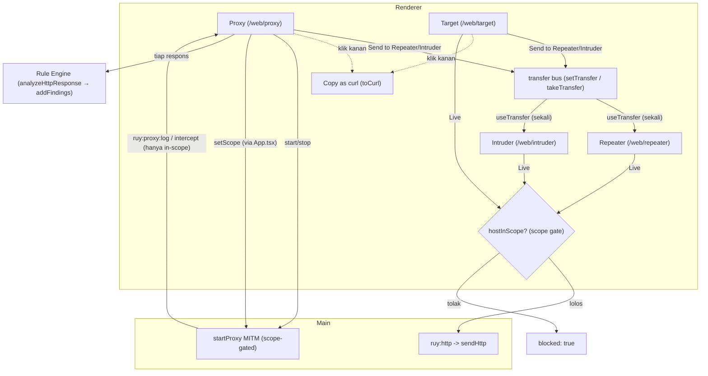

# 020 — Web Security Suite (Pengantar)

← [013 — Hardening Electron](013_hardening-electron.md) · [Index](000_index.md) · [021 — Proxy / MITM](021_proxy-mitm.md) →

> Kelompok fitur bergaya **Burp Suite** di dalam Interu ("Interu — Cyber Operations", brand lama **RUY**). Berisi tujuh modul: Target, Proxy, Repeater, Intruder, Sequencer, Decoder, Comparer. Semua berada di `src/renderer/src/pages/web/` dengan backend di proses `main` (`src/main/proxy.ts`, `src/main/http.ts`, `src/main/index.ts`).

## Tujuan

Menyediakan alat pentest web interaktif di dalam satu aplikasi desktop Electron, dengan dua prinsip utama:

1. **Legal-by-design** — semua request *live* dan semua tangkapan proxy melewati **gerbang scope** (`hostInScope`, [`../src/shared/http.ts`](../src/shared/http.ts); detail [011](011_scope-gate.md)). Scope kosong = tidak ada target yang diizinkan dan riwayat Proxy kosong.
2. **Semua modul live dan scope-gated** — tidak ada mode simulasi dan tidak ada data contoh. Modul yang mengirim trafik (Proxy, Repeater, Intruder, Target) memakai jalur nyata lewat proses main; **scope** adalah pintunya (host di luar scope ditolak).

## Daftar fitur

| # | Modul | Dokumen | Route | Status |
|---|-------|---------|-------|--------|
| 021 | Proxy / MITM | [021_proxy-mitm.md](021_proxy-mitm.md) | `/web/proxy` | ✅ NYATA |
| 022 | Repeater | [022_repeater.md](022_repeater.md) | `/web/repeater` | ✅ NYATA |
| 023 | Intruder | [023_intruder.md](023_intruder.md) | `/web/intruder` | ✅ NYATA |
| 024 | Target / Discovery | [024_target-discovery.md](024_target-discovery.md) | `/web/target` | ✅ NYATA |
| 025 | Decoder | [025_decoder.md](025_decoder.md) | `/web/decoder` | ✅ NYATA |
| 026 | Comparer | [026_comparer.md](026_comparer.md) | `/web/comparer` | ✅ NYATA |
| 027 | Sequencer | [027_sequencer.md](027_sequencer.md) | `/web/sequencer` | ✅ NYATA |

Rute terdaftar di [`../src/renderer/src/App.tsx`](../src/renderer/src/App.tsx); menu di [`../src/renderer/src/components/Sidebar.tsx`](../src/renderer/src/components/Sidebar.tsx) grup "Web Security Suite".

## Alur antar modul

Proxy (dan Target) bisa mengoper request ke Repeater/Intruder lewat **transfer bus** satu-tembak ([`../src/renderer/src/store/transfer.ts`](../src/renderer/src/store/transfer.ts)). Menu klik-kanan juga menyediakan **Copy as curl** (`toCurl`, [`../src/renderer/src/lib/http.ts`](../src/renderer/src/lib/http.ts)). Semua request Live melewati **gerbang scope**.

> **Catatan:** gerbang scope berlaku untuk `ruy:http` (Repeater/Intruder/Target Live) **dan** proxy MITM: host out-of-scope diteruskan tanpa dekripsi/log (CONNECT = tunnel buta) — lihat [021](021_proxy-mitm.md). Respons proxy in-scope juga dianalisis pasif oleh Rule Engine ([041](041_rule-engine.md)).

## Status: semua live

| Modul | Mode | Yang benar-benar terjadi |
|-------|------|--------------------------|
| Proxy | Live | MITM proxy nyata untuk host in-scope; **Open Browser** = `BrowserWindow` terproksi |
| Target | Live | Discovery wordlist nyata (GET per path) |
| Repeater | Live | `sendHttp` nyata; request awal `GET /` ke `localhost:3000` |
| Intruder | Live | Request nyata per payload; template `POST /api/login` ke `localhost:3000` |
| Sequencer | Offline nyata | Menganalisa token yang di-paste operator (`src/shared/tokens.ts`) |
| Decoder | Offline nyata | Transform URL/Base64/Hex/HTML/ASCII beneran |
| Comparer | Offline nyata | LCS line-diff beneran |

## Urutan pengerjaan (disarankan)

1. Baca pengantar ini (020).
2. **021 Proxy** — fondasi penangkapan trafik + MITM.
3. **022 Repeater** & **023 Intruder** — konsumen transfer bus.
4. **024 Target** — site map + content discovery.
5. **025 Decoder**, **026 Comparer**, **027 Sequencer** — utilitas pendukung.
6. Lanjut ke [030 Operations](030_operations.md).

## File terkait (ringkas)

| File | Peran |
|------|-------|
| [`../src/main/proxy.ts`](../src/main/proxy.ts) | Mesin proxy intercept + MITM TLS |
| [`../src/main/http.ts`](../src/main/http.ts) | Klien HTTP(S) nyata (`sendHttp`) |
| [`../src/main/index.ts`](../src/main/index.ts) | Handler IPC `ruy:*` + scope gate (`ruy:http`), `ruy:proxy:scope` |
| [`../src/preload/index.ts`](../src/preload/index.ts) | Bridge `window.ruy` |
| [`../src/shared/http.ts`](../src/shared/http.ts) | `hostInScope`, tipe `HttpReq`/`HttpRes` |
| [`../src/shared/proxy.ts`](../src/shared/proxy.ts) | Tipe `ProxyLogEntry`, `HeldRequest` |
| [`../src/shared/rules.ts`](../src/shared/rules.ts) | `analyzeHttpResponse` (analisis pasif respons proxy) |
| [`../src/renderer/src/lib/http.ts`](../src/renderer/src/lib/http.ts) | `parseRawRequest`, `toCurl`, `sendLive` |
| [`../src/renderer/src/store/transfer.ts`](../src/renderer/src/store/transfer.ts) | Transfer bus Send-to-Repeater/Intruder |
| [`../src/renderer/src/data/burp.ts`](../src/renderer/src/data/burp.ts) | `PAYLOAD_SETS` (daftar payload Intruder) |

---
← [013 Hardening Electron](013_hardening-electron.md) · [Index](000_index.md) · [next: 021 Proxy / MITM](021_proxy-mitm.md) →
