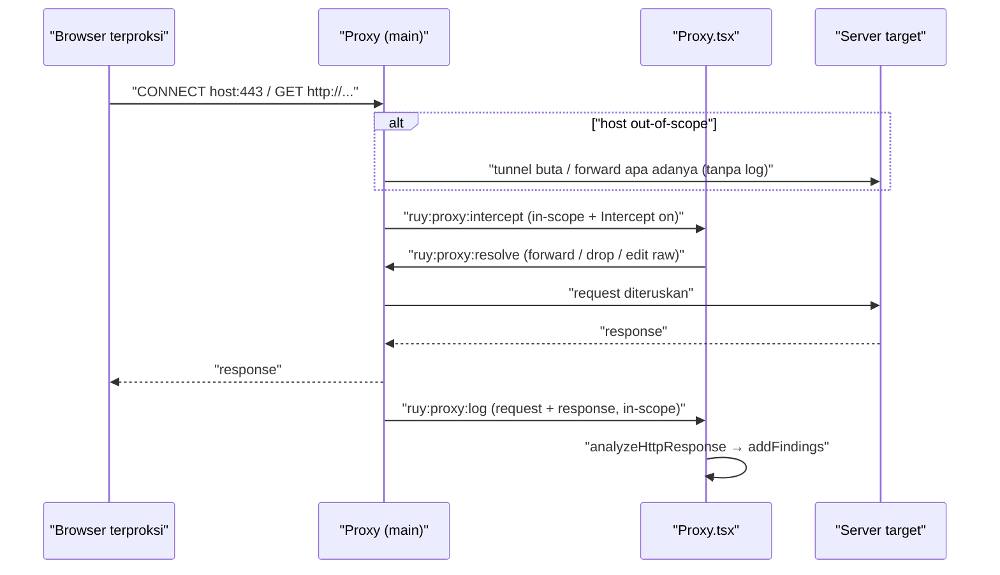

# 021 — Proxy / MITM

← [020 — Web Security Suite (Pengantar)](020_web-security-suite.md) · [Index](000_index.md) · [022 — Repeater](022_repeater.md) →

## 1. Status

✅ **NYATA** — proxy forward intercept sungguhan dengan MITM HTTPS, **scope-gated**: hanya host in-scope yang didekripsi, dicatat, dan bisa di-intercept. Ada juga data sample/demo offline sebagai pelengkap.

## 2. Tujuan fitur

Menangkap trafik HTTP dan (via MITM) HTTPS ke host di **Authorized scope** yang melewati proxy, menampilkannya di **HTTP History**, serta memungkinkan operator **menahan (hold), meneruskan (forward), menjatuhkan (drop), atau mengedit** request sebelum diteruskan ke server.

## 3. Cara kerja

**Backend ([`../src/main/proxy.ts`](../src/main/proxy.ts)):**
- `startProxy(port, emitFn)` membuat dua server: `http.createServer()` (listen `127.0.0.1:port`) dan `https.createServer()` MITM dengan `SNICallback` yang mencetak sertifikat per-host dari root CA Interu (`getHostCert`, [`../src/main/ca.ts`](../src/main/ca.ts)).
- Scope modul (`let scope`) diisi lewat `setScope(s)` (non-array → `[]`); IPC `ruy:proxy:scope`, disinkronkan dari `App.tsx` setiap `settings.scope` berubah.
- Event `connect` (CONNECT untuk HTTPS) cek `hostInScope('https://<host:port>/', scope)`:
  - **in-scope** → balas `200 Connection Established` lalu serahkan socket ke server MITM (`mitm.emit('connection', clientSocket)`); TLS diterminasi lokal dan isinya terlihat.
  - **out-of-scope** → **tunnel TCP buta** (`net.connect` ke host:port, pipe dua arah): tidak didekripsi, tidak dicatat, tidak di-intercept.
- `handleRequest` menghitung `inScope = hostInScope(u.href, scope)` dan menyusun raw request (`buildRawReq`). Hanya bila `intercepting && inScope`, ia meng-emit `ruy:proxy:intercept` lalu menunggu keputusan di `pending` Map. Request diteruskan dengan `http`/`https.request` (`rejectUnauthorized: false`); hanya bila in-scope hasilnya di-emit sebagai `ruy:proxy:log`. Out-of-scope = diteruskan apa adanya, tanpa jejak.
- Header respons di log ditulis **satu baris per nilai** (tiap `Set-Cookie` di baris sendiri) agar rule cookie bisa menilai flag tiap cookie. Sama di `sendHttp` (`../src/main/http.ts`).
- `setScope`, `setIntercept`, `resolveIntercept(id, action, raw)`, `stopProxy()`, `getPort()`, `isRunning()`.

**IPC ([`../src/main/index.ts`](../src/main/index.ts)):** `ruy:proxy:start|stop|status|intercept|scope|resolve|openBrowser|exportCA`. Event dikirim ke renderer lewat `emitToRenderer`; khusus `ruy:proxy:intercept`, window utama di-`show()`/`focus()` agar operator bisa menekan Forward/Drop.

**Browser terproksi (`ruy:proxy:openBrowser`):** membuka `BrowserWindow` baru dengan `session.fromPartition('interu-proxied')`, memasang `setProxy({ proxyRules: '127.0.0.1:<port>' })` dan `setCertificateVerifyProc((_req, cb) => cb(0))` (mempercayai sertifikat MITM otomatis). Satu window dipakai ulang (`proxiedBrowser`). `ruy:proxy:exportCA` menulis `Interu-Root-CA.crt` ke folder Downloads untuk browser eksternal.

**Frontend ([`../src/renderer/src/pages/web/Proxy.tsx`](../src/renderer/src/pages/web/Proxy.tsx)):** menampilkan `ScopeBar` dan disclaimer bahwa hanya host in-scope yang didekripsi/ditangkap. Berlangganan `onLog` (tiap entri dengan `response` diumpankan ke `analyzeHttpResponse` → `addFindings`, lihat [041](041_rule-engine.md)) dan `onIntercept`, tombol Start/Stop, toggle Intercept, Open Browser, Export CA, "Demo (offline)" (render `BrowserSim`), "Load sample" (dari `HTTP_HISTORY`). Klik-kanan baris history → Send to Repeater/Intruder (`setTransfer`, mode `live`), Copy URL, Copy as curl (`toCurl`).

## 4. File terkait

| File | Fungsi utama |
|------|--------------|
| [`../src/main/proxy.ts`](../src/main/proxy.ts) | `startProxy`, `stopProxy`, `setScope`, `handleRequest`, `setIntercept`, `resolveIntercept`, `parseRaw`, `buildRawReq` |
| [`../src/main/ca.ts`](../src/main/ca.ts) | `getCA`, `getHostCert`, `exportCA` |
| [`../src/main/index.ts`](../src/main/index.ts) | handler IPC `ruy:proxy:*` (termasuk `ruy:proxy:scope`), `emitToRenderer`, `ruy:proxy:openBrowser`, hook `RUY_PROXY_TEST`/`RUY_PROXY_SCOPE` |
| [`../src/preload/index.ts`](../src/preload/index.ts) | `proxy.start/stop/status/setIntercept/setScope/resolve/openBrowser/exportCA/onLog/onIntercept` |
| [`../src/shared/proxy.ts`](../src/shared/proxy.ts) | `ProxyLogEntry`, `HeldRequest` |
| [`../src/shared/http.ts`](../src/shared/http.ts) | `hostInScope` (gate proxy) |
| [`../src/renderer/src/App.tsx`](../src/renderer/src/App.tsx) | Sinkron `settings.scope` → `proxy.setScope` |
| [`../src/renderer/src/components/ScopeBar.tsx`](../src/renderer/src/components/ScopeBar.tsx) | Editor scope di halaman Proxy |
| [`../src/renderer/src/pages/web/Proxy.tsx`](../src/renderer/src/pages/web/Proxy.tsx) | UI: scope, history, intercept, browser, export CA, umpan Rule Engine |
| [`../src/renderer/src/pages/web/BrowserSim.tsx`](../src/renderer/src/pages/web/BrowserSim.tsx) | Browser simulasi offline tertanam (Demo) |

## 5. Cara pakai

1. Buka **Proxy** (`/web/proxy`), tambahkan host target di **Authorized scope** (tanpa scope, riwayat tetap kosong). Set port (default 8080), klik **Start**.
2. Klik **Open Browser** untuk membuka browser terproksi yang otomatis mempercayai CA Interu (http & https host in-scope tertangkap; host lain tetap bisa dibuka, hanya tidak dicatat). Atau arahkan proxy browser eksternal ke `127.0.0.1:8080` dan **Export CA** lalu trust di OS/browser.
3. Nyalakan **Intercept** untuk menahan request; edit raw di textarea bila perlu, lalu **Forward** atau **Drop**.
4. Lihat **HTTP History**; klik baris untuk inspeksi Request/Response; klik-kanan untuk Send to Repeater/Intruder atau Copy as curl.
5. Tanpa target nyata: klik **Load sample** atau **Demo (offline)** untuk data contoh.

## 6. Batasan / temuan

- **Scope gate (diperbaiki).** `hostInScope` kini dipanggil di `connect` dan `handleRequest`. Out-of-scope **tetap diteruskan** (bukan diblokir), hanya tidak didekripsi/dicatat/di-intercept. Semantik gate (IP via CIDR, port di entri diabaikan untuk hostname, dll.) di [011](011_scope-gate.md).
- Perubahan scope berlaku untuk koneksi baru; tunnel CONNECT yang sudah terbentuk (MITM atau buta) tidak dievaluasi ulang.
- Riwayat Proxy hanya di state halaman (maks 500 entri), hilang saat pindah halaman/restart; temuan Rule Engine tetap tersimpan di `findings.ts`.
- `BrowserSim` (Demo offline) **tidak** didaftarkan sebagai route di `App.tsx`; ia hanya dirender di dalam `Proxy.tsx` saat tombol Demo ditekan. Browser nyata memakai `ruy:proxy:openBrowser` (BrowserWindow terpisah), bukan `BrowserSim`.
- Proxy mendengar hanya di `127.0.0.1`. Body non-teks di history diringkas (`[N bytes ... omitted]`), raw dipotong `CAP = 50000` byte.
- Tipe `ProxyLogEntry.kind` dideklarasikan `'http' | 'https-tunnel'`, tetapi `proxy.ts` meng-emit `kind: scheme` bernilai `'http'`/`'https'` — mismatch tipe minor (tidak mempengaruhi runtime).
- Error upstream dibalas `502`; request yang di-drop dibalas `502 Dropped by Interu`.

## 7. Checklist pengerjaan

- [x] Tambah scope gate di `handleRequest` + `connect` (out-of-scope = tunnel buta / forward tanpa log).
- [x] IPC `ruy:proxy:scope` + sinkron dari `App.tsx`; `ScopeBar` di halaman Proxy.
- [x] `Set-Cookie` satu baris per cookie di log proxy dan `sendHttp`.
- [x] Respons tertangkap diumpankan ke Rule Engine (`analyzeHttpResponse` → `addFindings`).
- [ ] Verifikasi `startProxy` listen di `127.0.0.1:8080` dan `isRunning()` benar.
- [ ] Uji Open Browser: http dan https tertangkap, sertifikat MITM dipercaya.
- [ ] Uji Intercept: hold → edit raw → Forward meneruskan versi tereedit; Drop balas 502.
- [ ] Uji Export CA menulis `Interu-Root-CA.crt` ke Downloads.
- [ ] Konfirmasi klik-kanan history mengoper ke Repeater/Intruder (mode live) dan Copy as curl benar.
- [ ] Uji `RUY_PROXY_TEST` dengan `RUY_PROXY_SCOPE` kosong (tanpa `RUY_PROXY_LOG`) dan `=example.com` (ada log + MITM).
- [ ] Perbaiki tipe `ProxyLogEntry.kind` (`'https-tunnel'` vs nilai runtime `'https'`).
- [ ] Opsi blokir trafik out-of-scope (bukan hanya pass-through).

---
← [020 Web Security Suite](020_web-security-suite.md) · [Index](000_index.md) · [next: 022 Repeater](022_repeater.md) →
