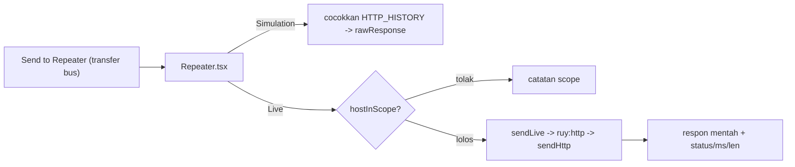

# 022 — Repeater

← [021 — Proxy / MITM](021_proxy-mitm.md) · [Index](000_index.md) · [023 — Intruder](023_intruder.md) →

## 1. Status

🟡 **SEBAGIAN** — mode **Simulation** (respon canned) dan mode **Live** (request HTTP nyata lewat proses main, digerbangi scope).

## 2. Tujuan fitur

Menyusun ulang (craft) dan mengirim ulang satu HTTP request secara manual, lalu membaca responsnya — seperti Repeater di Burp. Menerima request dari modul lain lewat "Send to Repeater".

## 3. Cara kerja

- **Simulation (`sendSim`)**: mem-parse baris pertama request, mencocokkan `path`+`method` ke `HTTP_HISTORY` ([`../src/renderer/src/data/burp.ts`](../src/renderer/src/data/burp.ts)); bila tak ketemu memakai `SIM_SEED` (= `HTTP_HISTORY[3]`, POST /api/login). Respon dibangun `rawResponse(tx)` dengan latensi acak buatan. Tidak ada paket keluar.
- **Live (`sendRealLive`)**: `parseRawRequest(request, target)` ([`../src/renderer/src/lib/http.ts`](../src/renderer/src/lib/http.ts)) → cek `hostInScope(req.url, settings.scope)`; jika gagal tampilkan catatan ⛔ dan berhenti. Jika lolos, `sendLive(req, scope)` memanggil `window.ruy.http.send` → IPC `ruy:http` → `sendHttp` ([`../src/main/http.ts`](../src/main/http.ts)). Respon mentah (`res.raw`) ditampilkan beserta status/waktu/ukuran.
- **Transfer masuk (`useTransfer('repeater', …)`)**: mengisi mode, target, dan raw request dari payload (sekali saat mount).

## 4. File terkait

| File | Fungsi utama |
|------|--------------|
| [`../src/renderer/src/pages/web/Repeater.tsx`](../src/renderer/src/pages/web/Repeater.tsx) | `sendSim`, `sendRealLive`, `send`, `useTransfer` |
| [`../src/renderer/src/lib/http.ts`](../src/renderer/src/lib/http.ts) | `parseRawRequest`, `originOf`, `sendLive` |
| [`../src/shared/http.ts`](../src/shared/http.ts) | `hostInScope`, `HttpReq`/`HttpRes` |
| [`../src/main/http.ts`](../src/main/http.ts) | `sendHttp` (klien HTTP nyata) |
| [`../src/renderer/src/store/transfer.ts`](../src/renderer/src/store/transfer.ts) | `useTransfer` konsumsi payload |
| [`../src/renderer/src/components/ScopeBar.tsx`](../src/renderer/src/components/ScopeBar.tsx) | Editor scope (hanya tampil di mode Live) |

## 5. Cara pakai

1. Buka **Repeater** (`/web/repeater`) — atau klik-kanan baris di Proxy/Target → **Send to Repeater**.
2. Pilih **Simulation** untuk demo tanpa trafik, atau **Live** untuk request nyata.
3. (Live) Isi target dan tambahkan host-nya di **Authorized scope** (ScopeBar).
4. Edit raw request di panel kiri.
5. Klik **Send**; baca respon di panel kanan beserta Status/Time/Length.

## 6. Batasan / temuan

- Di mode Live, `Content-Length` dari editor diabaikan — `sendHttp` membiarkan Node menghitungnya ulang.
- Sim hanya mengenali method `GET|POST|PUT|PATCH|DELETE` di baris pertama; selain itu default `GET`.
- Mode Live memakai `rejectUnauthorized: false` (menerima sertifikat self-signed) sesuai kebutuhan target uji.
- Scope gate dicek dua kali: di renderer (`sendRealLive`) dan di main (handler `ruy:http`). Semantik gate (IP via IP persis/CIDR, subdomain untuk hostname) di [011](011_scope-gate.md).
- Body respons dipotong di **5 MB** (`MAX_BODY` di `sendHttp`); respons lebih besar terpotong tanpa penanda error. Header multi-nilai (`Set-Cookie`) tampil satu baris per nilai.

## 7. Checklist pengerjaan

- [ ] Verifikasi parsing raw: method, path, headers, body terbaca benar oleh `parseRawRequest`.
- [ ] Uji Simulation: respon canned muncul dengan status/latency.
- [ ] Uji Live tanpa scope → request diblok dengan catatan ⛔.
- [ ] Uji Live dengan host di scope → respon nyata tampil.
- [ ] Konfirmasi "Send to Repeater" dari Proxy/Target mengisi target+raw+mode via `useTransfer`.

---
← [021 Proxy / MITM](021_proxy-mitm.md) · [Index](000_index.md) · [next: 023 Intruder](023_intruder.md) →
