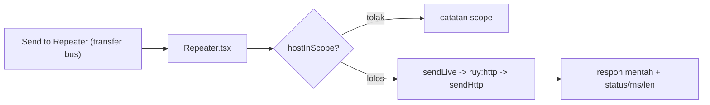

# 022 — Repeater

← [021 — Proxy / MITM](021_proxy-mitm.md) · [Index](000_index.md) · [023 — Intruder](023_intruder.md) →

## 1. Status

✅ **NYATA** — live saja: request HTTP nyata lewat proses main, digerbangi scope. Tidak ada mode simulasi.

## 2. Tujuan fitur

Menyusun ulang (craft) dan mengirim ulang satu HTTP request secara manual, lalu membaca responsnya — seperti Repeater di Burp. Menerima request dari modul lain lewat "Send to Repeater".

## 3. Cara kerja

- **Request awal**: `GET / HTTP/1.1` ke `localhost:3000`, dibangun `rawFromParts('GET', 'localhost:3000', '/')` ([`../src/renderer/src/lib/http.ts`](../src/renderer/src/lib/http.ts)).
- **Kirim (`send`)**: `parseRawRequest(request, target)` ([`../src/renderer/src/lib/http.ts`](../src/renderer/src/lib/http.ts)) → cek `hostInScope(req.url, settings.scope)`; jika gagal tampilkan `Note` bertipe `block` dan berhenti. Jika lolos, `sendLive(req, scope)` memanggil `window.ruy.http.send` → IPC `ruy:http` → `sendHttp` ([`../src/main/http.ts`](../src/main/http.ts)). Respon mentah (`res.raw`) ditampilkan beserta status/waktu/ukuran.
- **Transfer masuk (`useTransfer('repeater', …)`)**: mengisi target dan raw request dari payload (sekali saat mount). `TransferPayload` tidak lagi punya field `mode`.

## 4. File terkait

| File | Fungsi utama |
|------|--------------|
| [`../src/renderer/src/pages/web/Repeater.tsx`](../src/renderer/src/pages/web/Repeater.tsx) | `send`, `useTransfer`, `DEFAULT_REQUEST` |
| [`../src/renderer/src/lib/http.ts`](../src/renderer/src/lib/http.ts) | `parseRawRequest`, `originOf`, `sendLive` |
| [`../src/shared/http.ts`](../src/shared/http.ts) | `hostInScope`, `HttpReq`/`HttpRes` |
| [`../src/main/http.ts`](../src/main/http.ts) | `sendHttp` (klien HTTP nyata) |
| [`../src/renderer/src/store/transfer.ts`](../src/renderer/src/store/transfer.ts) | `useTransfer` konsumsi payload |
| [`../src/renderer/src/components/ScopeBar.tsx`](../src/renderer/src/components/ScopeBar.tsx) | Editor scope |

## 5. Cara pakai

1. Buka **Repeater** (`/web/repeater`) — atau klik-kanan baris di Proxy/Target → **Send to Repeater**.
2. Semua request nyata (tidak ada mode simulasi).
3. Isi target dan tambahkan host-nya di **Authorized scope** (ScopeBar).
4. Edit raw request di panel kiri.
5. Klik **Send**; baca respon di panel kanan beserta Status/Time/Length.

## 6. Batasan / temuan

- `Content-Length` dari editor diabaikan — `sendHttp` membiarkan Node menghitungnya ulang.
- Klien memakai `rejectUnauthorized: false` (menerima sertifikat self-signed) sesuai kebutuhan target uji.
- Scope gate dicek dua kali: di renderer (`send`) dan di main (handler `ruy:http`). Semantik gate (IP via IP persis/CIDR, subdomain untuk hostname) di [011](011_scope-gate.md).
- Body respons dipotong di **5 MB** (`MAX_BODY` di `sendHttp`); respons lebih besar terpotong tanpa penanda error. Header multi-nilai (`Set-Cookie`) tampil satu baris per nilai.

## 7. Checklist pengerjaan

- [ ] Verifikasi parsing raw: method, path, headers, body terbaca benar oleh `parseRawRequest`.
- [ ] Uji tanpa scope → request diblok dengan `Note` `block`.
- [ ] Uji dengan host di scope → respon nyata tampil.
- [ ] Konfirmasi "Send to Repeater" dari Proxy/Target mengisi target+raw via `useTransfer`.

---
← [021 Proxy / MITM](021_proxy-mitm.md) · [Index](000_index.md) · [next: 023 Intruder](023_intruder.md) →
