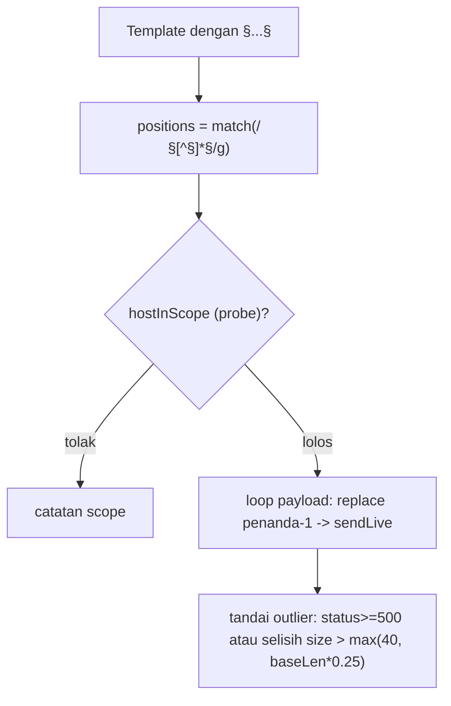

# 023 — Intruder

← [022 — Repeater](022_repeater.md) · [Index](000_index.md) · [024 — Target / Content Discovery](024_target-discovery.md) →

## 1. Status

✅ **NYATA** — live saja: satu request nyata per payload, digerbangi scope. Tidak ada mode simulasi.

## 2. Tujuan fitur

Menguji daftar payload secara otomatis pada satu titik injeksi di dalam template request, lalu menyorot hasil yang menonjol (outlier) — seperti Intruder di Burp.

## 3. Cara kerja

**Penanda posisi:** titik injeksi ditandai `§…§`. Jumlah penanda dihitung `template.match(/§[^§]*§/g)`. **Catatan:** substitusi payload (`template.replace(/§[^§]*§/, …)`) **tanpa flag `/g`**, jadi hanya **penanda pertama** yang diganti per request.

**Payload set** ([`../src/renderer/src/data/burp.ts`](../src/renderer/src/data/burp.ts), `PAYLOAD_SETS`): `Common usernames` (8), `SQLi probes` (6), `Directory fuzz` (8), `HTTP methods` (7).

- **Template awal**: `POST /api/login` ke `localhost:3000` (konstanta `TEMPLATE` di `Intruder.tsx`).
- **Serangan (`startLive`)**: probe `template.replace(/§[^§]*§/, 'x')` di-cek `hostInScope`; bila gagal berhenti dengan `Note` bertipe `block`. Lalu untuk tiap payload: `filled = template.replace(/§[^§]*§/, p…)` (tanda kutip di-escape), `parseRawRequest(filled, target)`, `sendLive(req, scope)`. `baseLen` = ukuran respon OK pertama; **outlier** = respon OK dengan `status >= 500` **atau** `|size - baseLen| > max(40, baseLen*0.25)`.

> **Attack type yang benar-benar diimplementasikan:** hanya **satu mode** (satu titik injeksi, satu daftar payload berurutan — setara "Sniper"). Tidak ada Battering ram / Pitchfork / Cluster bomb.

## 4. File terkait

| File | Fungsi utama |
|------|--------------|
| [`../src/renderer/src/pages/web/Intruder.tsx`](../src/renderer/src/pages/web/Intruder.tsx) | `startLive`, `stop`, `positions`, `useTransfer`, `TEMPLATE` |
| [`../src/renderer/src/data/burp.ts`](../src/renderer/src/data/burp.ts) | `PAYLOAD_SETS` |
| [`../src/renderer/src/lib/http.ts`](../src/renderer/src/lib/http.ts) | `parseRawRequest`, `sendLive` |
| [`../src/shared/http.ts`](../src/shared/http.ts) | `hostInScope` |
| [`../src/renderer/src/store/transfer.ts`](../src/renderer/src/store/transfer.ts) | `useTransfer('intruder', …)` |
| [`../src/renderer/src/components/ScopeBar.tsx`](../src/renderer/src/components/ScopeBar.tsx) | Editor scope |

## 5. Cara pakai

1. Buka **Intruder** (`/web/intruder`) — atau Send to Intruder dari Proxy/Target.
2. Bungkus titik injeksi dengan `§…§` pada template (default `{"username": "§admin§", …}`).
3. Pilih **Payload set** (angka di kurung = jumlah payload).
4. Isi target dan tambahkan host-nya ke scope (semua request nyata).
5. Klik **Start attack**; pantau progress bar dan kolom **Note** (`outlier`). Klik **Stop** untuk menghentikan.

## 6. Batasan / temuan

- **Hanya penanda pertama** yang disubstitusi (regex tanpa `/g`). Beberapa `§…§` tidak akan diisi semua.
- Hitungan `positions` memakai `/g` sehingga bisa menampilkan >1 padahal hanya 1 yang dipakai saat serangan.
- Serangan berjalan sekuensial (await per payload); tidak ada konkuransi/throttle.
- Heuristik outlier sederhana (status/ukuran), bukan analisis konten mendalam.

## 7. Checklist pengerjaan

- [ ] Verifikasi deteksi penanda `§…§` dan tampilan jumlah `positions`.
- [ ] Uji tanpa scope → ditolak lewat probe `hostInScope`.
- [ ] Uji dengan scope → request per payload terkirim, `baseLen` & outlier benar.
- [ ] **Perbaiki/putuskan:** apakah substitusi harus `/g` (multi-penanda) atau dibatasi satu (dokumentasikan).
- [ ] Konfirmasi tombol Stop menghentikan loop (`stopFlag`).

---
← [022 Repeater](022_repeater.md) · [Index](000_index.md) · [next: 024 Target / Discovery](024_target-discovery.md) →
