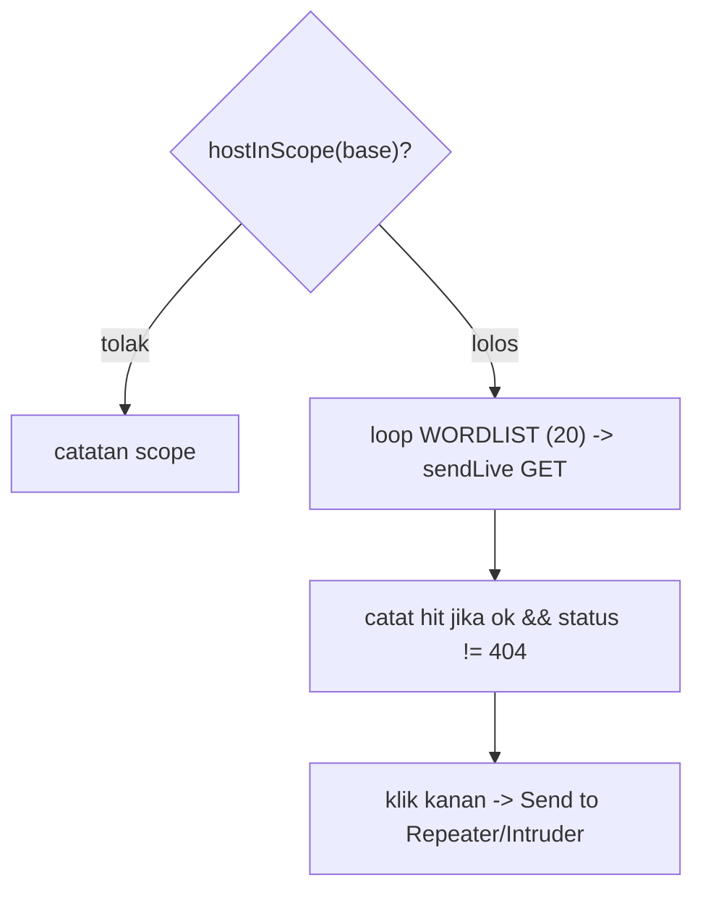

# 024 — Target / Content Discovery

← [023 — Intruder](023_intruder.md) · [Index](000_index.md) · [025 — Decoder](025_decoder.md) →

## 1. Status

✅ **NYATA** — live saja: content discovery wordlist nyata, digerbangi scope. Site map buatan (`SITE_MAP`) sudah dihapus.

## 2. Tujuan fitur

Memetakan permukaan serang (attack surface) target: menjalankan **content discovery** — menembak daftar path umum (wordlist) ke target nyata dan mencatat yang ditemukan.

## 3. Cara kerja

- **Content discovery (`discover`)**: `base = target` tanpa trailing slash; cek `hostInScope(base + '/', scope)`. Lalu untuk tiap entri **WORDLIST** (didefinisikan di [`../src/renderer/src/pages/web/Target.tsx`](../src/renderer/src/pages/web/Target.tsx), **20 entri**): `sendLive({ method:'GET', url: base+path, headers:{'User-Agent':'Interu/1.0'} }, scope)`. Hit dicatat bila `res.ok && res.status !== 404`. Klik-kanan hit → Send ke Repeater/Intruder.

**Isi WORDLIST (20):** `/`, `/admin`, `/login`, `/dashboard`, `/api`, `/api/users`, `/api/login`, `/robots.txt`, `/.env`, `/.git/HEAD`, `/backup.zip`, `/config.php`, `/server-status`, `/uploads`, `/static`, `/debug`, `/phpinfo.php`, `/wp-login.php`, `/.well-known/security.txt`, `/sitemap.xml`.

## 4. File terkait

| File | Fungsi utama |
|------|--------------|
| [`../src/renderer/src/pages/web/Target.tsx`](../src/renderer/src/pages/web/Target.tsx) | `WORDLIST`, `discover`, `sendMenu`, `liveHost` |
| [`../src/renderer/src/lib/http.ts`](../src/renderer/src/lib/http.ts) | `sendLive`, `rawFromParts` |
| [`../src/shared/http.ts`](../src/shared/http.ts) | `hostInScope` |
| [`../src/renderer/src/store/transfer.ts`](../src/renderer/src/store/transfer.ts) | `setTransfer` (Send to …) |
| [`../src/renderer/src/components/ScopeBar.tsx`](../src/renderer/src/components/ScopeBar.tsx) | Editor scope |

## 5. Cara pakai

1. Buka **Target / Site Map** (`/web/target`).
2. Isi target, tambahkan host ke **Authorized scope**, klik **Discover**.
3. Pantau progress; klik path yang ditemukan untuk melihat respon nyata; klik-kanan untuk kirim ke Repeater/Intruder.

## 6. Batasan / temuan

- WORDLIST statis (20 path), tidak bisa diedit dari UI; tidak ada rekursi/kedalaman.
- Discovery sekuensial (await per path); tidak ada throttle/konkuransi.
- Hit disaring hanya dengan `status !== 404`; status lain (mis. 403) dianggap "ketemu".
- Hanya ada hasil live (daftar hit); tidak ada site map pohon buatan.

## 7. Checklist pengerjaan

- [ ] Hitung ulang WORDLIST (20) dan konfirmasi path yang ditembak.
- [ ] Uji Live tanpa scope → ditolak; dengan scope → hit tercatat.
- [ ] Konfirmasi filter hit (`ok && status != 404`) sesuai harapan.
- [ ] Uji klik-kanan Send to Repeater/Intruder dan Copy URL.

---
← [023 Intruder](023_intruder.md) · [Index](000_index.md) · [next: 025 Decoder](025_decoder.md) →
