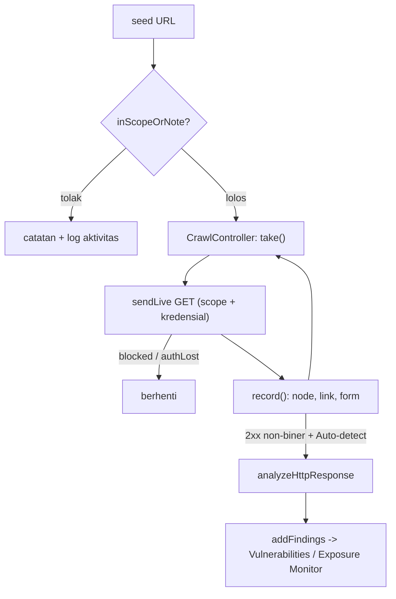

# 028 — Crawler

← [027 — Sequencer](027_sequencer.md) · [Index](000_index.md) · [029 — Active Scan](029_active-scan.md) →

## 1. Status

✅ **NYATA** — crawl rekursif nyata (GET) hanya ke host dalam Authorized scope; opsional deteksi pasif memakai Rule Engine dan bisa berjalan dengan sesi login (scan terautentikasi).

## 2. Tujuan fitur

Memetakan permukaan serang secara otomatis: dari satu URL awal (seed), Crawler mengikuti link dalam scope, mencatat endpoint, parameter query, dan form, lalu (dengan **Auto-detect**) menjalankan template pasif Rule Engine pada tiap respons. Hasilnya masuk ke Vulnerabilities dan Exposure Monitor. Berbeda dari [024 Target](024_target-discovery.md) yang menembak wordlist tetap, Crawler menemukan path dari konten target.

## 3. Cara kerja

- **Opsi** (`Crawler.tsx`; nilai di-clamp): **Depth** 0–6 (default 2, `DEFAULT_CRAWL_OPTIONS`), **Max pages** 1–2000 (default 150), **Concurrency** 1–16 (UI default 8), **Same host only** (default aktif), **+ subdomains** (hanya bila Same host aktif), **Auto-detect (passive rules)** (default aktif).
- **Gerbang scope** (lihat [011](011_scope-gate.md)): `inScopeOrNote` menolak seed di luar scope dan mencatat penolakan ke log aktivitas. Selama crawl, `CrawlController.allowedHost` memanggil `hostInScope` dan kebijakan same-host/subdomain sebelum tiap URL masuk antrean; `sendLive` kembali menolak di proses main. Bila respons `blocked`, crawl berhenti.
- **Frontier BFS** (`src/shared/crawl.ts`): `CrawlController` memegang antrean, himpunan `seen` (kunci URL tanpa fragment, query dipertahankan), batas depth, dan anggaran `maxPages` (`take()` mengembalikan `null` bila habis). Ekstensi aset/biner (`css`, gambar, font, `pdf`, `zip`, `map`, dll.) tidak diambil; `.js` tetap diambil karena disniff untuk path API. `extractLinks` membaca `href/src/action/data-href/data-url` plus path `"/…"` di dalam script/JSON; `extractForms` mengurai method, action, dan input bernama.
- **Hanya GET.** Tiap halaman diambil dengan `sendLive` (`GET`, `User-Agent: Interu/1.0`, timeout 12 dtk). Body hanya diurai untuk tipe `html/xml/js/json/text`.
- **Auto-detect:** `analyzeHttpResponse` ([041](041_rule-engine.md)) dijalankan **hanya** untuk respons 2xx non-biner (bukan redirect, 404, atau halaman error) agar tidak ada false positive dari header yang wajar hilang di redirect. Temuan di-dedupe per `key`, lalu `addFindings` mendorongnya ke findings store, yang diumpankan ke [033 Vulnerabilities](033_vulnerabilities.md) dan [034 Exposure Monitor](034_threat-monitor.md). Satu entri `pushActivity` (kategori `scan`) dicatat di akhir.
- **Scan terautentikasi** ([042](042_scan-terautentikasi.md)): `<ScopeBar withAuth />` menampilkan AuthBar (cookie Interu Browser atau header manual). Selama kredensial terpasang, URL bergaya `logout/delete/…` dilewati di proses main; respons `401` atau redirect ke login menandai `authLost` dan Crawler berhenti dengan pesan di log.
- **UI:** kartu Pages/Endpoints/Forms/Findings, tabel **Crawl Map**, panel **Details** (parameter, form, respons mentah), **Crawl Log** (maks 400 baris terakhir). Klik kanan baris atau tombol Repeater/Intruder = **Send to Repeater/Intruder** (`GET` lewat `setTransfer`), plus Copy URL/Copy request.

## 4. File terkait

| File | Fungsi utama |
|------|--------------|
| [`../src/renderer/src/pages/web/Crawler.tsx`](../src/renderer/src/pages/web/Crawler.tsx) | UI, worker pool, auto-detect, Send to Repeater/Intruder |
| [`../src/shared/crawl.ts`](../src/shared/crawl.ts) | `CrawlController`, `extractLinks`, `extractForms`, `normalizeUrl`, `isFetchable`, ringkasan |
| [`../src/shared/crawl.test.ts`](../src/shared/crawl.test.ts) | Tes unit logika di atas |
| [`../src/renderer/src/lib/http.ts`](../src/renderer/src/lib/http.ts) | `sendLive`, `inScopeOrNote`, `rawFromParts` |
| [`../src/renderer/src/components/ScopeBar.tsx`](../src/renderer/src/components/ScopeBar.tsx) | Editor scope; `withAuth` menampilkan AuthBar |
| [`../src/renderer/src/components/AuthBar.tsx`](../src/renderer/src/components/AuthBar.tsx) | Cookie browser / header manual |
| [`../src/shared/rules.ts`](../src/shared/rules.ts) | `analyzeHttpResponse` |
| [`../src/renderer/src/store/findings.ts`](../src/renderer/src/store/findings.ts) | `addFindings` |

## 5. Cara pakai

1. Buka **Crawler** (`/web/crawler`).
2. Tambahkan host target ke **Authorized scope**. Untuk area di balik login: login di Interu Browser, lalu nyalakan **Use Interu Browser cookies** di AuthBar.
3. Isi URL seed, atur depth/max pages/concurrency, klik **Launch Crawl** (Enter juga bisa); **Stop** menghentikan.
4. Telusuri Crawl Map, klik baris untuk detail, klik kanan untuk kirim ke Repeater/Intruder. Temuan ada di Vulnerabilities dan Exposure Monitor.

Pengamatan terukur: crawl `http://127.0.0.1:8080/WebGoat/start.mvc` pada WebGoat lokal menemukan 1 halaman tanpa login dan 14 halaman dengan sesi Interu Browser; link `/WebGoat/logout` dilewati sehingga sesi tetap valid.

## 6. Batasan / temuan

- Redirect **tidak diikuti** (`src/main/http.ts` tidak menangani redirect), jadi seed harus menjawab langsung. Contoh: `/WebGoat/` menjawab 404 saat login, pakai `/WebGoat/start.mvc`.
- Hanya GET; form POST dicatat tetapi tidak dikirim. Tidak ada eksekusi JavaScript, jadi halaman SPA yang merender link lewat JS hanya terjangkau lewat sniff path di source.
- Respons dibatasi 5 MB per request (`MAX_BODY` di `src/main/http.ts`); respons raw yang ditampilkan dipotong 20.000 karakter.
- Daftar URL "berbahaya" saat terautentikasi berbasis nama; sesi habis hanya terdeteksi lewat `401`/redirect login ([042](042_scan-terautentikasi.md)).
- Tidak ada fitur re-test atau jadwal ulang; jalankan ulang crawl secara manual. Hasil Crawl Map tidak disimpan antar sesi.
- Tes unit hanya mencakup logika murni `crawl.ts`; worker pool dan auto-detect di `Crawler.tsx` hanya tercakup e2e autentikasi.

## 7. Checklist pengerjaan

- [x] Logika murni di `src/shared/crawl.ts`: `normalizeUrl` (buang fragment/skema non-http), `queryParams`, `isFetchable`, `extractLinks`, `extractForms`, `pageTitle`, `contentTypeLabel`, ringkasan.
- [x] `crawl.test.ts` menguji BFS: seed pertama, dedupe, host di luar scope diblokir, kebijakan subdomain, `maxDepth`, anggaran `maxPages`, aset dilewati.
- [x] Gerbang scope di seed dan di frontier; penolakan dicatat.
- [x] Auto-detect hanya pada 2xx non-biner; temuan masuk findings store.
- [x] Mode terautentikasi (lewati logout, berhenti saat sesi habis) dengan e2e `auth-scan.e2e.ts`.
- [ ] Tes unit untuk worker pool / auto-detect (saat ini hanya lewat e2e).
- [ ] Ikuti redirect same-scope untuk seed (belum ada).
- [ ] Re-test / simpan hasil crawl (belum ada).

---
← [027 Sequencer](027_sequencer.md) · [Index](000_index.md) · [next: 029 Active Scan](029_active-scan.md) →
