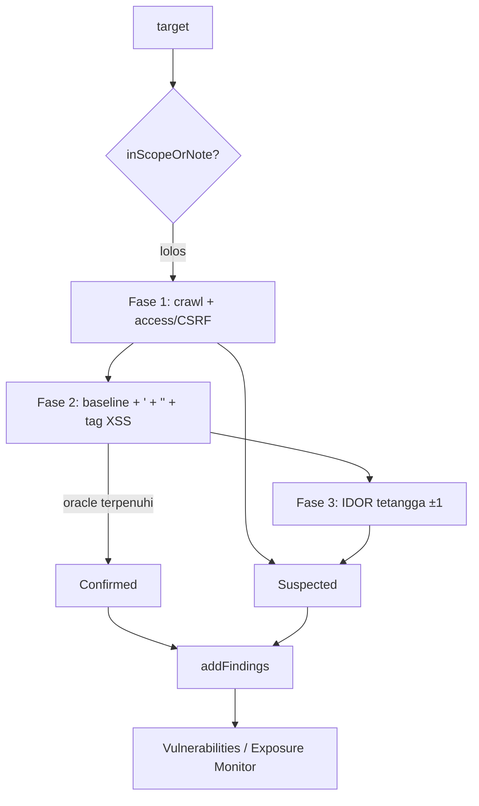

# 029 — Active Scan

← [028 — Crawler](028_crawler.md) · [Index](000_index.md) · [030 — Operations & Analysis (Pengantar Kelompok)](030_operations.md) →

## 1. Status

✅ **NYATA** — meng-crawl target lalu mengirim probe berbasis oracle ke parameter query. SQLi dan XSS dilaporkan **Confirmed** hanya bila oracle deterministik terpenuhi; IDOR, access, dan CSRF hanya **Suspected**. Scope-gated dan mendukung scan terautentikasi.

## 2. Tujuan fitur

Menemukan kerentanan web umum secara otomatis dengan false positive minimal: Interu memetakan permukaan (crawl), menyuntikkan probe ke tiap parameter, dan hanya mengklaim "Confirmed" bila ada bukti yang tidak bisa dibantah. Hal yang butuh konteks manusia ditandai "Suspected" untuk diverifikasi manual.

## 3. Cara kerja

- **Opsi** (`ActiveScan.tsx`): **Depth** 0–5 (default 2), **Max pages** 1–500 (default 40), **Concurrency** 1–16 (default 8), dan saklar **SQLi**, **XSS**, **IDOR**, **Access/CSRF** (semua aktif).
- **Gerbang scope** ([011](011_scope-gate.md)): `inScopeOrNote` menolak target di luar scope (dicatat ke log aktivitas); semua request memakai `sendLive` yang digerbang lagi di proses main. Respons `blocked` menghentikan scan.
- **Fase 1 — crawl** (`CrawlController`, sama dengan [028](028_crawler.md), `sameHostOnly` + subdomain aktif). Dari tiap halaman: URL ber-query dicatat satu per kombinasi path+nama parameter; form **GET** diubah jadi URL (field diisi `1`) agar ikut diinjeksi; form POST hanya diperiksa CSRF. Access/CSRF dievaluasi dari hasil crawl itu sendiri.
- **Fase 2 — injeksi** (maks 80 endpoint berparameter). Per parameter (`planQueryParams`): request baseline, lalu
  - **SQLi** — nilai + `'` dan nilai + `''`. **Confirmed** (`critical`, CWE-89) bila `detectSqlError` menemukan error DB (MySQL, MariaDB, PostgreSQL, MSSQL, Oracle, SQLite, generik) pada respons `'` **dan tidak ada** di baseline; `balancedClears` (error hilang pada `''`) memperkuat bukti.
  - **XSS** — payload keluar-konteks yang membuka tag unik `<x-interu-TOKEN>`. **Confirmed** (`high`, CWE-79) hanya bila tag muncul **verbatim** di respons HTML; bentuk ter-encode (`&lt;…&gt;`) atau respons non-HTML tidak dilaporkan.
- **Fase 3 — IDOR** (maks 40 kandidat): parameter bergaya id (nama atau nilai numerik) dicoba dengan tetangga ±1. **Suspected** (`medium`, CWE-639) bila tetangga menjawab 200 berbeda material, bukan halaman auth wall, dan bodi minimal 64 karakter.
- **Access / CSRF — Suspected** (`medium`): path sensitif (`/admin`, `/dashboard`, dll.) berstatus 200 bukan form login (CWE-284); form POST bernuansa mengubah state tanpa field token CSRF (CWE-352).
- **Aliran temuan:** tiap temuan didedupe per `key` stabil (mis. `webvuln:sqli:origin/path:param`), muncul di tabel Findings (Sev, Conf, Finding, Where) beserta evidence, remediation, dan respons; di akhir `addFindings` mengirim ke findings store sehingga tampil di [033 Vulnerabilities](033_vulnerabilities.md) dan [034 Exposure Monitor](034_threat-monitor.md) (lihat [041](041_rule-engine.md)). Tombol **Repeater/Intruder** mengirim URL temuan (`GET`). **Scan Log** memuat tiap temuan (`CONFIRMED` / `~ suspected`) dan ringkasan jumlah request.
- **Scan terautentikasi** ([042](042_scan-terautentikasi.md)): `<ScopeBar withAuth />`; URL bergaya logout/delete dilewati saat kredensial terpasang, dan `authLost` (401 atau redirect ke login) menghentikan scan dengan pesan di log.

## 4. File terkait

| File | Fungsi utama |
|------|--------------|
| [`../src/renderer/src/pages/web/ActiveScan.tsx`](../src/renderer/src/pages/web/ActiveScan.tsx) | UI, tiga fase, worker pool, Send to Repeater/Intruder |
| [`../src/shared/webvuln.ts`](../src/shared/webvuln.ts) | Oracle dan builder temuan: `sqliErrorVerdict`, `xssReflectVerdict`, `idorVerdict`, `accessVerdict`, `csrfMissing`, `planQueryParams` |
| [`../src/shared/webvuln.test.ts`](../src/shared/webvuln.test.ts) | Tes unit oracle |
| [`../src/shared/crawl.ts`](../src/shared/crawl.ts) | `CrawlController` (fase crawl) |
| [`../src/renderer/src/lib/http.ts`](../src/renderer/src/lib/http.ts) | `sendLive`, `inScopeOrNote` |
| [`../src/renderer/src/components/ScopeBar.tsx`](../src/renderer/src/components/ScopeBar.tsx) · [`AuthBar.tsx`](../src/renderer/src/components/AuthBar.tsx) | Scope dan kredensial |

## 5. Cara pakai

1. Buka **Active Scan** (`/web/activescan`).
2. Masukkan host target ke **Authorized scope** (hanya target milik sendiri / berizin). Untuk area login, aktifkan cookie Interu Browser di AuthBar dan gunakan akun uji.
3. Isi URL, pilih kelas kerentanan, klik **Launch Scan**; **Stop** menghentikan.
4. Klik temuan untuk melihat evidence/remediation/respons; verifikasi manual yang Suspected, atau kirim ke Repeater.

## 6. Batasan / temuan

- Memodifikasi **hanya parameter query (GET)**; tidak ada injeksi ke body POST, header, atau cookie. Tidak ada blind/time-based SQLi, DOM/stored XSS. Selain SQLi/XSS tidak ada kelas lain (mis. SSRF, command injection).
- Redirect tidak diikuti (`src/main/http.ts`); seed harus menjawab langsung. IDOR benar-benar butuh dua identitas, maka hanya Suspected. Heuristik access/CSRF berbasis nama dan bisa meleset pada halaman publik yang sengaja.
- Batas permintaan: maks 80 endpoint berparameter, 40 kandidat IDOR, 500 halaman; tiap parameter butuh 1 baseline + 2 SQLi + 1 XSS = 4 request. Probe dikirim ke target, jadi jalankan hanya pada sistem yang diizinkan.
- Guard false positive: error yang sudah ada di baseline tidak dihitung; XSS ter-encode tidak dihitung; IDOR mengabaikan bodi identik, kecil, atau auth wall.
- Tidak ada fitur re-test per temuan (belum ada); hasil di panel hilang saat scan berikutnya, hanya store findings yang bertahan. Evidence request/respons dipotong 4096 karakter.
- Logika orkestrasi di `ActiveScan.tsx` tidak punya tes unit; hanya oracle murni yang diuji.

## 7. Checklist pengerjaan

- [x] Oracle murni di `src/shared/webvuln.ts` dengan `webvuln.test.ts`.
- [x] Tes: `detectSqlError` (signature DB, tanpa FP pada teks biasa), `sqliErrorVerdict` (error hanya setelah quote, `balancedClears`, tidak confirm bila error ada di baseline), `xssReflectVerdict` (verbatim confirmed, ter-encode/non-HTML tidak), IDOR (auth wall, identik, non-200 ditolak), `accessVerdict`, `csrfMissing`, `planQueryParams`, builder temuan (severity, CWE, key).
- [x] Gerbang scope dan penolakan tercatat; berhenti pada `blocked` dan `authLost`.
- [x] Temuan mengalir ke findings store (Vulnerabilities, Exposure Monitor).
- [x] Mode terautentikasi (lihat [042](042_scan-terautentikasi.md)).
- [ ] Tes unit untuk alur tiga fase di `ActiveScan.tsx` (hanya oracle yang diuji).
- [ ] Injeksi ke body POST / header, dan re-test per temuan (belum ada).

---
← [028 Crawler](028_crawler.md) · [Index](000_index.md) · [next: 030 Operations](030_operations.md) →
