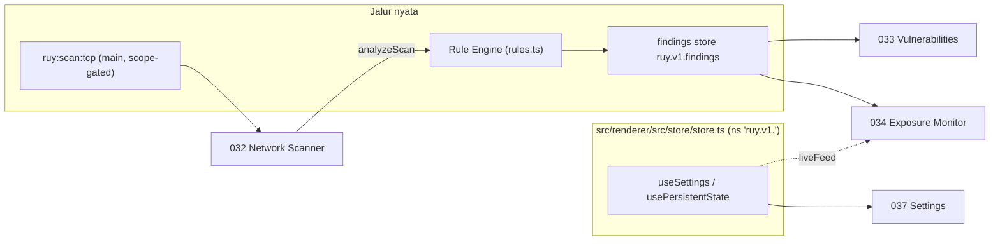

# 030 — Operations (Pengantar Kelompok)

← [027 — Sequencer](027_sequencer.md) · [Index](000_index.md) · [032 — Network Scanner](032_network-scanner.md) →

Kelompok **Operations** berisi panel operasi Interu. Semuanya **live-only**: **Network Scanner** melakukan TCP connect scan nyata lewat main process, **Vulnerabilities** membaca temuan nyata dari [Rule Engine](041_rule-engine.md), dan **Exposure Monitor** (landing page, `/` → `/threats`) hanya menampilkan temuan dan aktivitas nyata. Tidak ada mode simulasi dan tidak ada data contoh.

Halaman yang dulu 100% data palsu (Dashboard, Firewall Rules, Reports) **sudah dihapus** dari sidebar dan route; ide pengganti yang masih bernilai tercatat di [090 — Roadmap](090_roadmap.md) sebagai halaman baru.

## Tujuan

- Menyediakan "panel operasi" yang jujur (scanner, kerentanan, exposure monitor, pengaturan).
- Menjadi tempat berlabuh hasil nyata (hasil scan, temuan Rule Engine, log) tanpa mengubah tata letak.
- Setiap modul nyata dijaga scope gate; tanpa scope, tidak ada yang berjalan.

## Daftar fitur (032–034, 037)

| Doc | Halaman | Sumber data | Status |
| --- | --- | --- | --- |
| [032_network-scanner.md](032_network-scanner.md) | Network Scanner | IPC `ruy:scan:tcp` (Node `net`); bridge hilang → "Scanner bridge unavailable" | ✅ NYATA |
| [033_vulnerabilities.md](033_vulnerabilities.md) | Vulnerabilities | store temuan Rule Engine | ✅ NYATA |
| [034_threat-monitor.md](034_threat-monitor.md) | Exposure Monitor (dulu Threat Monitor) | temuan, scan, scope & intercept nyata | ✅ NYATA |
| [037_settings.md](037_settings.md) | Settings | store settings + versi runtime | ✅ NYATA |

## Sumber data tiap halaman

Catatan IPC: **Network Scanner** memanggil `window.ruy.scan` (`ruy:scan:tcp`, `ruy:scan:cancel`, event `ruy:scan:progress`). Probe aktif Rule Engine memakai `window.ruy.http` (lihat [041](041_rule-engine.md)). Vulnerabilities dan Exposure Monitor tidak memanggil IPC (membaca store); Settings hanya membaca `window.ruy.versions`/`platform`.

## Tabel status ringkas

| Aspek | Nyata? | Keterangan |
| --- | --- | --- |
| Scan host/port | ✅ | TCP connect via `net`, scope-gated, banner grab di profil `deep` |
| Temuan kerentanan | ✅ | Dari Rule Engine: scanner, proxy, probe aktif |
| Feed Exposure Monitor | ✅ | Temuan & aktivitas nyata; bukan IDS |
| Data lokal disimpan | ✅ | localStorage `ruy.v1.*` |
| Preferensi & tema | ✅ | Disimpan & diterapkan |
| Info runtime (Electron/Chrome/Node) | ✅ | Dibaca dari `window.ruy.versions` |

## Ide halaman baru

Halaman berikut **belum ada**; semuanya akan dibangun dari data nyata (lihat [090](090_roadmap.md)):

| Ide | Status | Catatan |
| --- | --- | --- |
| Laporan dari temuan Confirmed asli + PDF | ⏭ | Halaman baru, membaca `useFindings()` |
| Ekspor rule Windows Firewall (`netsh`) | Opsional, hati-hati | Mulai dari *export*, baru apply dengan konfirmasi + hak admin |
| Riwayat hasil scan | ⏭ | Simpan hasil scan agar bisa dirujuk halaman lain |

> Alur **target → scan → Rule Engine → Vulnerabilities** berjalan nyata; mata rantai terakhir yang kurang adalah laporan dari temuan nyata.
