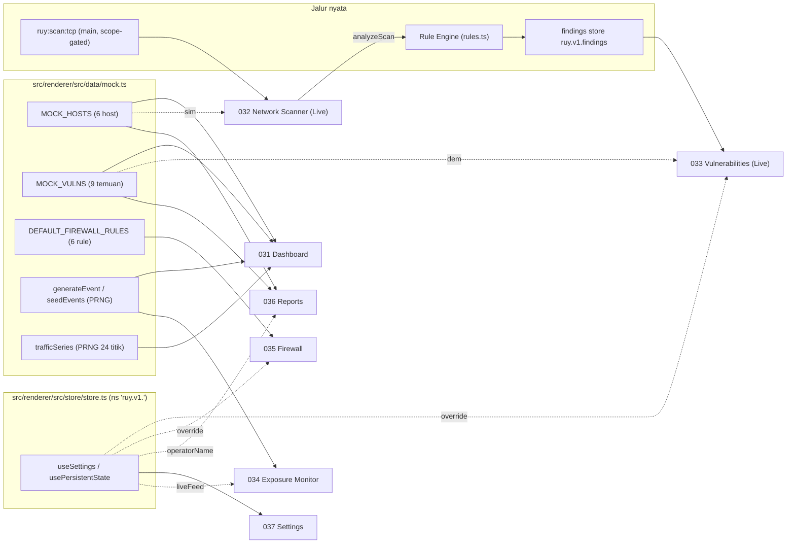

# 030 — Operations & Analysis (Pengantar Kelompok)

← [027 — Sequencer](027_sequencer.md) · [Index](000_index.md) · [031 — Dashboard (Security Overview)](031_dashboard.md) →

Kelompok **Operations & Analysis** berisi panel operasi Interu. Kondisinya kini **campuran**: **Network Scanner** sudah melakukan TCP connect scan nyata lewat main process, dan **Vulnerabilities** (tampilan Live) membaca temuan nyata dari [Rule Engine](041_rule-engine.md). Dashboard, Threat Monitor, Firewall, dan isi Reports masih membaca data simulasi dari `src/renderer/src/data/mock.ts`.

Dokumen ini jujur menandai mana yang nyata dan mana yang simulasi — juri akan memeriksa klaim ini.

## Tujuan

- Menyediakan "panel operasi" lengkap (dashboard, scanner, kerentanan, monitor ancaman, firewall, laporan, pengaturan).
- Menjadi tempat berlabuh hasil nyata (hasil scan, temuan Rule Engine, log) tanpa mengubah tata letak.
- Tetap aman untuk demo: setiap modul nyata dijaga scope gate dan punya mode/tampilan simulasi yang diberi label.

## Daftar fitur (031–037)

| Doc | Halaman | Sumber data | Status |
| --- | --- | --- | --- |
| [031_dashboard.md](031_dashboard.md) | Dashboard / Security Overview | `mock.ts` (hosts, vulns, traffic, events) | ⚪ SIMULASI |
| [032_network-scanner.md](032_network-scanner.md) | Network Scanner | Live: IPC `ruy:scan:tcp` (Node `net`) · Sim: `MOCK_HOSTS` | ✅ NYATA (+ fallback sim) |
| [033_vulnerabilities.md](033_vulnerabilities.md) | Vulnerability Assessment | Live: store temuan Rule Engine · Demo: `MOCK_VULNS` | 🟡 SEBAGIAN (Live nyata) |
| [034_threat-monitor.md](034_threat-monitor.md) | Exposure Monitor (dulu Threat Monitor) | temuan, scan, scope & intercept nyata | ✅ NYATA |
| [035_firewall.md](035_firewall.md) | Firewall Rules | `DEFAULT_FIREWALL_RULES` + localStorage | ⚪ SIMULASI |
| [036_reports.md](036_reports.md) | Reports | rakitan dari `mock.ts` | 🟡 SEBAGIAN (export file nyata) |
| [037_settings.md](037_settings.md) | Settings | store settings + versi runtime | 🟡 SEBAGIAN (preferensi nyata) |

## Sumber data tiap halaman

Catatan IPC: **Network Scanner** memanggil `window.ruy.scan` (`ruy:scan:tcp`, `ruy:scan:cancel`, event `ruy:scan:progress`). Probe aktif Rule Engine memakai `window.ruy.http` (lihat [041](041_rule-engine.md)). Halaman Operations lain (Dashboard, Vulnerabilities, Threat Monitor, Firewall, Reports) tidak memanggil IPC; Settings hanya membaca `window.ruy.versions`/`platform`.

## Tabel status ringkas

| Aspek | Nyata? | Keterangan |
| --- | --- | --- |
| Scan host/port | ✅ | TCP connect via `net`, scope-gated, banner grab di profil `deep` |
| Temuan kerentanan (Live) | ✅ | Dari Rule Engine: scanner, proxy, probe aktif |
| Katalog Demo / data Dashboard | ⚪ | Statis di `mock.ts` |
| Feed ancaman | ⚪ | PRNG `makeRng`, template fiksi |
| Rule firewall | ⚪ | Hanya localStorage, tak sentuh Windows Firewall |
| Perubahan status / rule disimpan | ✅ | localStorage `ruy.v1.*` |
| Export laporan ke file | ✅ | Blob + download dialog (isi masih mock) |
| Preferensi & tema | ✅ | Disimpan & diterapkan |
| Info runtime (Electron/Chrome/Node) | ✅ | Dibaca dari `window.ruy.versions` |

## Strategi me-nyata-kan

Pola yang terbukti: renderer memanggil `ipcRenderer.invoke('ruy:...')` lewat preload; main process mengerjakan operasi OS/jaringan dan menegakkan **scope gate**.

| Fitur | Status | Langkah berikut |
| --- | --- | --- |
| Network Scanner | ✅ Selesai | Audit log, simpan riwayat hasil scan |
| Vulnerabilities | ✅ Live selesai | Status kerja per temuan, bukti lengkap |
| Rule Engine | ✅ Selesai ([041](041_rule-engine.md)) | Upgrade Suspected → Confirmed, soft-404 |
| Reports | ⏭ | Rakit dari `useFindings()` + PDF |
| Dashboard | ⏭ | Agregasi dari findings store (`useFindingCounts` sudah tersedia) |
| Exposure Monitor | Selesai | Dibangun dari temuan & aktivitas nyata; sensor host di luar cakupan |
| Firewall | Opsional, hati-hati | Mulai dari *export* rule, baru `netsh` |

### Urutan yang disarankan

1. ~~**Network Scanner**~~ — ✅ selesai.
2. ~~**Rule Engine**~~ — ✅ selesai ([041](041_rule-engine.md)).
3. ~~**Vulnerabilities**~~ — ✅ tampilan Live selesai.
4. **Reports** — laporkan temuan nyata + PDF.
5. **Dashboard** — ganti sumber mock jadi agregasi store nyata.
6. **Exposure Monitor** — selesai. Monitor sensor host (Event Log / IDS) tetap di luar cakupan.
7. **Firewall** (opsional, hati-hati) — mulai dari export, baru integrasi `netsh`.

> Saran lomba: alur demo **target → scan → Rule Engine → Vulnerabilities** kini berjalan nyata; mata rantai terakhir yang kurang adalah **Reports** dari temuan nyata.
