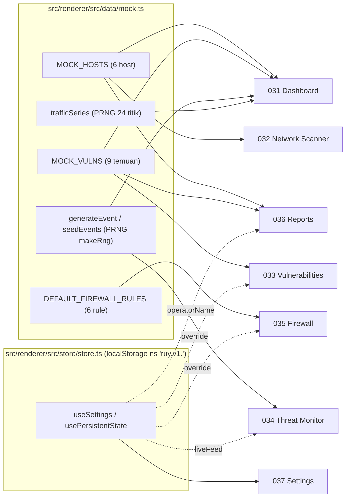

# 030 — Operations & Analysis (Pengantar Kelompok)

← [027 — Sequencer](027_sequencer.md) · [Index](000_index.md) · [031 — Dashboard (Security Overview)](031_dashboard.md) →

Kelompok **Operations & Analysis** adalah bagian Interu yang saat ini **berjalan di atas data simulasi**. Berbeda dengan Web Security Suite (Proxy/Repeater/Intruder/Target) yang sudah mengirim trafik HTTP asli lewat main process, semua halaman di kelompok ini membaca data statis/deterministik dari satu file: `src/renderer/src/data/mock.ts`.

Dokumen ini jujur menandai mana yang nyata dan mana yang simulasi — juri akan memeriksa klaim ini.

## Tujuan

- Menyediakan "panel operasi" lengkap (dashboard, scanner, kerentanan, monitor ancaman, firewall, laporan, pengaturan) sebagai kerangka UI yang sudah jadi.
- Menjadi tempat berlabuh hasil nyata nanti (hasil scan asli, temuan dari Rule Engine, log asli) tanpa harus mengubah tata letak.
- Tetap aman dipakai untuk demo: tidak ada paket yang dikirim, tidak ada file sistem yang disentuh, semua di-label SIMULATED.

## Daftar fitur (031–037)

| Doc | Halaman | Sumber data | Status |
|-----|---------|-------------|--------|
| [031_dashboard.md](031_dashboard.md) | Dashboard / Security Overview | `mock.ts` (hosts, vulns, traffic, events) | ⚪ SIMULASI |
| [032_network-scanner.md](032_network-scanner.md) | Network Scanner | `MOCK_HOSTS` + animasi timer | ⚪ SIMULASI |
| [033_vulnerabilities.md](033_vulnerabilities.md) | Vulnerability Assessment | `MOCK_VULNS` + override lokal | ⚪ SIMULASI |
| [034_threat-monitor.md](034_threat-monitor.md) | Threat Monitor | generator event PRNG | ⚪ SIMULASI |
| [035_firewall.md](035_firewall.md) | Firewall Rules | `DEFAULT_FIREWALL_RULES` + localStorage | ⚪ SIMULASI |
| [036_reports.md](036_reports.md) | Reports | rakitan dari `mock.ts` | 🟡 SEBAGIAN (export file nyata) |
| [037_settings.md](037_settings.md) | Settings | store settings + versi runtime | 🟡 SEBAGIAN (preferensi nyata) |

## Bagaimana `mock.ts` memberi makan tiap halaman

Catatan penting: **tidak ada satupun halaman di kelompok ini yang memanggil `window.ruy.http` atau `window.ruy.proxy`** (IPC main process). Jembatan IPC itu hanya dipakai Web Security Suite. Jadi Operations 100% lokal-renderer.

## Tabel status ringkas

| Aspek | Nyata? | Keterangan |
|-------|--------|------------|
| Data host/kerentanan | ⚪ | Statis, di-hardcode di `mock.ts` |
| Animasi scan | ⚪ | `setInterval`, tak ada socket TCP |
| Feed ancaman | ⚪ | PRNG `makeRng`, template fiksi |
| Rule firewall | ⚪ | Hanya localStorage, tak sentuh Windows Firewall |
| Perubahan status / rule disimpan | ✅ | localStorage `ruy.v1.*` nyata |
| Export laporan ke file | ✅ | Blob + download dialog nyata |
| Preferensi & tema | ✅ | Disimpan & diterapkan nyata |
| Info runtime (Electron/Chrome/Node) | ✅ | Dibaca dari `window.ruy.versions` nyata |

## Strategi me-nyata-kan (kapabilitas main-process/IPC yang dibutuhkan)

Pola yang sudah terbukti di proyek ini: renderer memanggil `ipcRenderer.invoke('ruy:...')` lewat preload, main process yang mengerjakan operasi OS/jaringan dan menegakkan **scope gate**. Operations harus mengikuti pola yang sama.

| Fitur | Kapabilitas main-process baru | Catatan implementasi |
|-------|-------------------------------|----------------------|
| Network Scanner | TCP connect scan via modul Node `net` | Non-blocking, timeout per port, **wajib scope-gated** seperti `sendLive`. Banner grab opsional. |
| Vulnerabilities | Hasil dari scanner + Rule Engine | Jangan hardcode CVE; cocokkan banner versi → CVE, tandai Suspected vs Confirmed. |
| Threat Monitor | Baca log lokal / feed dari proxy | Alirkan `proxy.onLog` yang sudah ada ke sini; atau baca Windows Event Log. Boleh tetap demo bila waktu mepet. |
| Firewall | `netsh advfirewall` / Windows Firewall API | Operasi sangat sensitif — jalankan di main, konfirmasi ganda, audit log. Lebih aman: mulai dari *export* rule saja. |
| Reports | Temuan asli + PDF | Rakit dari store temuan nyata, tambah export PDF + Bahasa Indonesia. |
| Dashboard | Agregasi dari store nyata di atas | Dashboard otomatis jadi nyata begitu sumbernya nyata — ini halaman terakhir yang disentuh. |

### Urutan yang disarankan

1. **Network Scanner** (TCP connect scan asli, scope-gated) — fondasi data host nyata.
2. **Rule Engine** (lihat [090_roadmap.md](090_roadmap.md)) — menghasilkan temuan Confirmed.
3. **Vulnerabilities** — tampilkan temuan Confirmed + hasil scan.
4. **Reports** — laporkan temuan nyata + PDF.
5. **Dashboard** — ganti sumber mock jadi agregasi store nyata.
6. **Threat Monitor** (opsional) — alirkan log proxy/OS.
7. **Firewall** (opsional, hati-hati) — mulai dari export, baru integrasi `netsh`.

> Saran lomba: kunci **satu alur demo mulus** (target → scan → Rule Engine membuktikan → laporan) daripada menyalakan ketujuh halaman setengah jadi.
