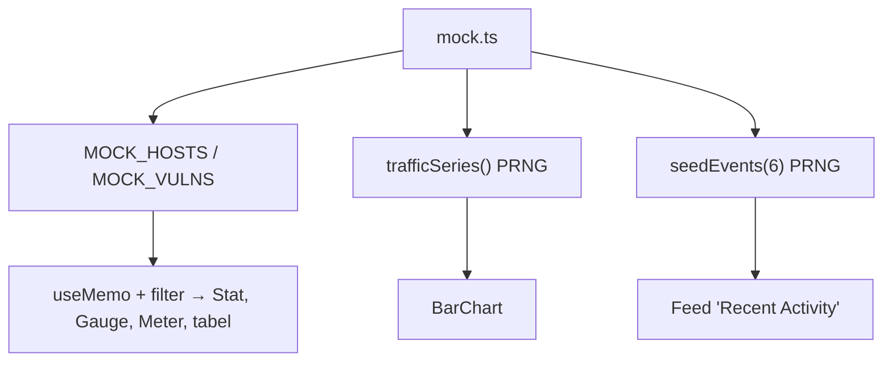

# 031 — Dashboard (Security Overview)

← [030 — Operations & Analysis (Pengantar Kelompok)](030_operations.md) · [Index](000_index.md) · [032 — Network Scanner](032_network-scanner.md) →

## Status

⚪ **SIMULASI** — Setiap metrik, host, dan event di halaman ini berasal dari data demo deterministik di `mock.ts`. Tidak ada yang discan, diintersepsi, atau dieksekusi pada sistem/jaringan nyata.

## Tujuan fitur

Memberi ringkasan "postur keamanan" satu layar: indeks ancaman, jumlah kerentanan terbuka, host terpantau, sensor online, grafik trafik 24 jam, temuan prioritas, dan aliran aktivitas terbaru. Ini etalase pertama saat aplikasi dibuka (route `/`).

## Cara kerja saat ini

Semua angka dihitung di render dari array statis `MOCK_HOSTS` dan `MOCK_VULNS`, ditambah dua generator PRNG (`trafficSeries`, `seedEvents`). Tidak ada state, timer, atau IPC.

- `riskScore` = `min(100, critical*18 + openVulns.length*4 + hostHigh*6)` — skor komposit buatan, bukan pengukuran.
- "Sensors Online" di-hardcode `"12 / 12"`.
- Panel trafik diberi badge "live model" padahal datanya `trafficSeries()` (PRNG seed `424242`, 24 titik).
- "Recent Activity" memakai `seedEvents(6).reverse()` — enam event fiksi.

## File terkait

| File | Fungsi / data utama |
|------|---------------------|
| [../src/renderer/src/pages/Dashboard.tsx](../src/renderer/src/pages/Dashboard.tsx) | Komponen `Dashboard`, perhitungan `riskScore`, `sevCounts`, `openVulns` |
| [../src/renderer/src/data/mock.ts](../src/renderer/src/data/mock.ts) | `MOCK_HOSTS`, `MOCK_VULNS`, `trafficSeries`, `seedEvents`, `severityPill`, `SEVERITY_ORDER` |
| [../src/renderer/src/components/ui.tsx](../src/renderer/src/components/ui.tsx) | `Panel`, `Stat`, `Gauge`, `BarChart`, `Meter`, `Disclaimer` |

## Cara pakai

1. Buka aplikasi — Dashboard adalah halaman default.
2. Baca kartu ringkasan dan grafik. Semua statis; tidak ada tombol aksi.
3. Banner `Disclaimer` di atas menegaskan ini lingkungan simulasi.

## Batasan / temuan

- Angka tidak berubah antar sesi (kecuali waktu di timestamp event) karena seed PRNG tetap.
- "Sensors Online 12/12" murni dekoratif — tidak ada 12 sensor.
- Badge "live model" bisa menyesatkan; data bukan live.
- Tidak terhubung ke halaman lain: mengubah status di Vulnerabilities tidak memengaruhi angka Dashboard (Dashboard baca `MOCK_VULNS` mentah, bukan override store).

## Checklist pengerjaan

- [ ] Buat store/selector agregasi yang membaca sumber nyata (hasil scan + temuan Confirmed) alih-alih `MOCK_HOSTS`/`MOCK_VULNS`.
- [ ] Ganti `trafficSeries()` dengan data trafik nyata (mis. agregasi `proxy.onLog` atau metrik OS), atau beri label "demo" jujur.
- [ ] Hitung "Monitored Hosts" dari hasil Network Scanner nyata.
- [ ] Ganti "Sensors Online 12/12" dengan status komponen nyata (proxy running, scanner idle, dll) atau hapus.
- [ ] Isi "Recent Activity" dari feed event nyata (log proxy/OS) bukan `seedEvents`.
- [ ] Ganti badge "live model" sesuai keadaan sumber data.
- [ ] Definisikan ulang `riskScore` dari temuan Confirmed + bobot yang bisa dijelaskan ke juri.
