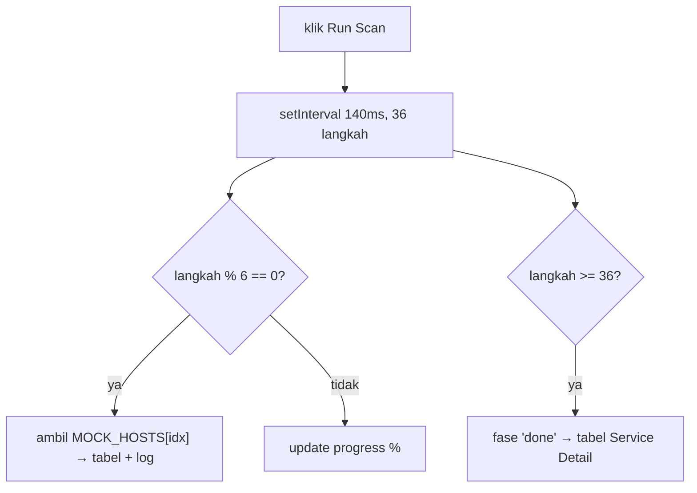

# 032 — Network Scanner

← [031 — Dashboard (Security Overview)](031_dashboard.md) · [Index](000_index.md) · [033 — Vulnerability Assessment](033_vulnerabilities.md) →

## Status

⚪ **SIMULASI** — "Scan" hanyalah animasi berbasis timer yang memunculkan host dari `MOCK_HOSTS`. Tidak ada paket yang dikirim, tidak ada port yang diprobe, tidak ada antarmuka jaringan yang disentuh. Konsol sendiri mencetak `> no packets are sent on the real network`.

## Tujuan fitur

Mensimulasikan penemuan host & service (host discovery + port/service). Menampilkan progress bar, daftar host yang "ditemukan", konsol gaya terminal, dan tabel detail port/service setelah selesai.

## Cara kerja saat ini

Tombol **Run Scan** memanggil `start()`:

1. Set fase `scanning`, reset progress & hasil.
2. `setInterval` 140 ms, total 36 langkah.
3. Tiap kelipatan 6 langkah → ambil `MOCK_HOSTS[idx]`, tambahkan ke daftar + log.
4. Pada langkah ke-36 → fase `done`, progress 100%, tabel "Service Detail" muncul.

`target` dan `profile` disimpan via `usePersistentState` (`scanner.target`, `scanner.profile`) tapi **tidak memengaruhi hasil** — hasil selalu enam host yang sama. Timer dibersihkan saat unmount dan saat **Stop**.

## File terkait

| File | Fungsi / data utama |
|------|---------------------|
| [../src/renderer/src/pages/NetworkScanner.tsx](../src/renderer/src/pages/NetworkScanner.tsx) | `start()`, `stop()`, state `phase/progress/found/log` |
| [../src/renderer/src/data/mock.ts](../src/renderer/src/data/mock.ts) | `MOCK_HOSTS`, tipe `HostResult`, `severityPill` |
| [../src/renderer/src/store/store.ts](../src/renderer/src/store/store.ts) | `usePersistentState` untuk `scanner.target`/`scanner.profile` |

## Cara pakai

1. Buka **Network Scanner** (`/scanner`).
2. Isi Target Range & pilih Profile (quick/standard/deep) — tersimpan tapi kosmetik.
3. Klik **Run Scan**, amati progress & konsol. **Stop** menghentikan timer.
4. Setelah selesai, lihat tabel "Service Detail" berisi port per host.

## Batasan / temuan

- Hasil selalu identik (6 host, port tetap) tak peduli target/profile.
- Tidak ada socket, tidak ada `net`/`dgram`, tidak ada scope gate (karena tidak ada trafik).
- `idx = step/6 - 1` hanya menampung 6 host; menambah host di `MOCK_HOSTS` butuh menaikkan `totalSteps`.

## Checklist pengerjaan

- [ ] Tambah handler IPC main-process (mis. `ruy:scan:tcp`) yang melakukan TCP connect scan via modul Node `net`.
- [ ] Terapkan **scope gate** di main (tolak target di luar `settings.scope`), mengikuti pola `ruy:http` + `hostInScope`.
- [ ] Parse `target` CIDR/range jadi daftar IP, dan `profile` jadi daftar port (top-100 / 1000 / full).
- [ ] Jalankan koneksi paralel dengan timeout per port; laporkan open/closed/filtered nyata.
- [ ] (Opsional) Banner grab untuk deteksi service/versi → umpan ke Rule Engine.
- [ ] Alirkan progres/host nyata ke UI via event IPC, ganti `MOCK_HOSTS`.
- [ ] Tambah audit log tiap scan (target, waktu, operator).
