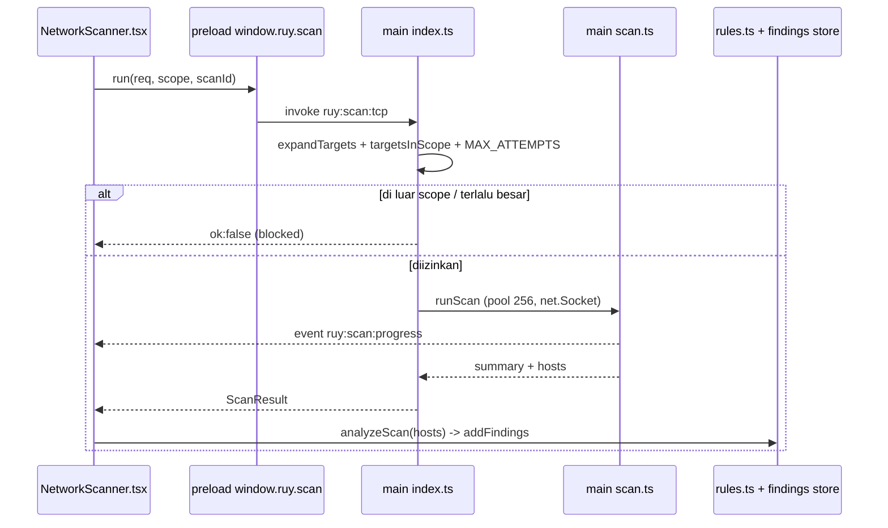

# 032 — Network Scanner

← [030 — Operations (Pengantar)](030_operations.md) · [Index](000_index.md) · [033 — Vulnerability Assessment](033_vulnerabilities.md) →

## Status

✅ **NYATA** (live saja) — melakukan **TCP connect scan** sungguhan lewat modul Node `net` di main process, dijaga **scope gate**. Bila bridge `window.ruy.scan` tidak tersedia (bukan aplikasi desktop), halaman menampilkan `Note` error "Scanner bridge unavailable" dan tombol **Run Scan** dinonaktifkan. Tidak ada mode simulasi; key `scanner.mode` tidak dipakai lagi.

## Tujuan fitur

Menemukan host aktif dan port TCP terbuka pada target yang **diizinkan** (IP / CIDR / range), mengambil banner versi (profil `deep`), lalu mengirim hasilnya ke Rule Engine agar langsung menjadi temuan di Vulnerabilities.

## Cara kerja

1. Renderer memanggil `window.ruy.scan.run({target, profile}, settings.scope, scanId)` → IPC `ruy:scan:tcp`.
2. Main: `expandTargets()` mengurai target → daftar IPv4; `targetsInScope()` menolak bila **satu saja** IP di luar scope (`blocked: true`).
3. Main menolak bila `IP × port > MAX_ATTEMPTS` (262144).
4. `runScan()` membuka koneksi paralel (pool **256**), timeout per koneksi default 1200 ms (di-clamp ke [100, 10000] bila dikirim).
   - `connect` → **open**, `ECONNREFUSED` → **closed**, timeout/error lain → **filtered**.
   - Profil `deep`: banner grab pada port terbuka — handshake TLS di port TLS (443, 8443, 993, …), `HEAD /` di port HTTP (80, 8080, 9200, …), selain itu menunggu greeting (SSH/FTP/SMTP).
   - Host dianggap **up** bila ada port open atau closed (RST); host yang semua port-nya filtered tidak dilaporkan.
5. Progres dialirkan lewat event `ruy:scan:progress` (`start` / `log` / `progress` / `host` / `done` / `error`), di-throttle ±5×/detik.
6. Hasil akhir (otoritatif) → tabel; `analyzeScan(hosts)` → `addFindings()` (lihat [041 Rule Engine](041_rule-engine.md)).

### Format target (`expandTargets`)

| Bentuk | Contoh | Catatan |
| --- | --- | --- |
| IP tunggal | `010.0.0.1` | Dinormalisasi → `10.0.0.1` (yang di-gate = yang di-scan) |
| CIDR | `10.20.0.0/24` | Mask wajib 1–2 digit; network & broadcast dibuang untuk /0–/30 |
| Range | `10.0.0.10-10.0.0.50` atau `10.0.0.10-50` | Range terbalik ditolak |
| Daftar | `10.0.0.1, 10.0.0.5` | Dipisah koma/spasi, di-dedupe |
| Hostname | `example.com` | **Ditolak** — scanner berbasis IP |

Batas: `MAX_IPS` = 4096 IP per target.

### Profil

| Profil | Jumlah port | Banner grab |
| --- | --- | --- |
| `quick` | 103 (top-100 gaya nmap) | tidak |
| `standard` | 705 (top-100 + port umum) | tidak |
| `deep` | 705 (sama dengan standard) | **ya** |

## File terkait

| File | Fungsi / data utama |
| --- | --- |
| [../src/main/scan.ts](../src/main/scan.ts) | `runScan`, `probePort`, `grabBanner`, `parseBanner`, `cancelScan`, pool koneksi |
| [../src/shared/scan.ts](../src/shared/scan.ts) | Tipe `ScanEvent`/`ScanResult`, `expandTargets`, `profilePorts`, `ipInScope`, `targetsInScope`, `MAX_IPS`, `MAX_ATTEMPTS` |
| [../src/main/index.ts](../src/main/index.ts) | Handler `ruy:scan:tcp` (scope gate, clamp timeout, concurrency 256) & `ruy:scan:cancel` |
| [../src/preload/index.ts](../src/preload/index.ts) | `window.ruy.scan.run / cancel / onProgress` |
| [../src/renderer/src/pages/NetworkScanner.tsx](../src/renderer/src/pages/NetworkScanner.tsx) | `startLive`, `hasBridge`, `runRef`, umpan ke Rule Engine |
| [../src/renderer/src/components/ScopeBar.tsx](../src/renderer/src/components/ScopeBar.tsx) | Editor Authorized scope |
| [../src/shared/scope.test.ts](../src/shared/scope.test.ts) | Tes `expandTargets`, `ipInScope`, `hostInScope` |

## Cara pakai

1. Buka **Network Scanner** (`/scanner`), (halaman selalu Live).
2. Di ScopeBar, tambahkan IP/CIDR yang kamu punya izinnya (mis. `127.0.0.1` atau `10.20.0.0/24`).
3. Isi Target (IP / CIDR / range) dan pilih Profile; label menampilkan jumlah port.
4. Klik **Run Scan**. Pantau konsol dan progress bar.
5. **Stop** membatalkan scan di main; hasil parsial yang sudah ditemukan **tetap ditampilkan** dan tetap dikirim ke Rule Engine.
6. Lihat tabel **Service Detail** dan temuan baru di **Rule Engine** / **Vulnerabilities**.

## Batasan / temuan

- Hanya IPv4 dan TCP; tidak ada UDP, SYN scan, deteksi OS, atau resolusi hostname (kolom Hostname/OS = `—` di Live).
- Nama service hanya dari tabel nomor port (`SERVICE_NAMES`), bukan deteksi protokol — `quick`/`standard` tidak memverifikasi service.
- Banner grab best-effort: hanya baris pertama / header `Server`, dipotong 80 karakter.
- Run besar yang penuh port filtered bisa lama (±20 menit untuk /24 × 705 port di 256 socket) — belum ada timeout adaptif.
- Hasil lama diabaikan bila scan baru dimulai (`runRef`); meninggalkan halaman membatalkan scan yang berjalan.
- Hasil scan **tidak disimpan** (hanya temuan Rule Engine yang dipersist); belum ada audit log.

## Checklist pengerjaan

- [x] Handler IPC `ruy:scan:tcp` + `ruy:scan:cancel`, TCP connect scan via `net`.
- [x] Scope gate di main (`targetsInScope`), mengikuti pola `ruy:http`.
- [x] Parse target IP/CIDR/range/daftar; profil quick (103) / standard & deep (705).
- [x] Koneksi paralel (256) dengan timeout per port; status open/closed/filtered nyata.
- [x] Banner grab (profil `deep`) → umpan ke Rule Engine.
- [x] Progres nyata via event `ruy:scan:progress`.
- [x] Stop menyimpan hasil parsial; scan dibatalkan saat meninggalkan halaman.
- [ ] Tambah audit log tiap scan (target, waktu, operator).
- [ ] Simpan riwayat hasil scan agar halaman lain (mis. laporan, lihat [090](090_roadmap.md)) bisa memakainya.
- [ ] (Opsional) Timeout adaptif untuk target besar yang banyak filtered.
- [ ] (Opsional) Resolusi hostname → IP (dengan scope gate pada IP hasil resolusi).
