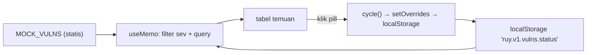

# 033 — Vulnerability Assessment

← [032 — Network Scanner](032_network-scanner.md) · [Index](000_index.md) · [034 — Threat Monitor](034_threat-monitor.md) →

## Status

⚪ **SIMULASI** — Katalog temuan adalah daftar CVE statis di `MOCK_VULNS`. Tidak ada pengujian kerentanan, eksploitasi, atau probing aset. Hanya perubahan status yang disimpan lokal.

## Tujuan fitur

Menampilkan katalog temuan kerentanan dengan pencarian, filter severity, dan kemampuan mengubah status (open → investigating → mitigated) yang tersimpan antar sesi.

## Cara kerja saat ini

- Tabel dirender dari `MOCK_VULNS` (9 temuan hardcode: CVE, CVSS, asset, kategori).
- Status default dari data; perubahan user disimpan sebagai **override** di `usePersistentState<StatusMap>('vulns.status', {})`.
- `statusOf(id, fallback)` = `overrides[id] ?? fallback`. Klik pill status memanggil `cycle()` yang memutar open→investigating→mitigated→open.
- Filter severity (`sevFilter`) & pencarian teks (`query`) hanya memfilter array yang sama, dihitung ulang via `useMemo`.
- Kartu "Mitigated" menghitung gabungan status default + override.

## File terkait

| File | Fungsi / data utama |
|------|---------------------|
| [../src/renderer/src/pages/Vulnerabilities.tsx](../src/renderer/src/pages/Vulnerabilities.tsx) | `statusOf`, `cycle`, `rows` (useMemo), filter & search |
| [../src/renderer/src/data/mock.ts](../src/renderer/src/data/mock.ts) | `MOCK_VULNS`, tipe `Vulnerability`, `SEVERITY_ORDER`, `severityPill` |
| [../src/renderer/src/store/store.ts](../src/renderer/src/store/store.ts) | `usePersistentState('vulns.status')` |

## Cara pakai

1. Buka **Vulnerabilities** (`/vulnerabilities`).
2. Cari CVE/judul/asset, atau filter per severity.
3. Klik pill status untuk memutar open → investigating → mitigated. Tersimpan otomatis.
4. Reset lewat Settings → "Reset demo environment" mengembalikan status default.

## Batasan / temuan

- Sembilan temuan selalu sama; tidak terhubung ke hasil scan apa pun.
- Tidak ada bukti (request/response/timing) yang melekat — tidak ada pembedaan Suspected vs Confirmed.
- Override hanya menyimpan status, bukan temuan baru; menambah temuan harus edit `mock.ts`.

## Checklist pengerjaan

- [ ] Ganti sumber dari `MOCK_VULNS` ke store temuan nyata yang diisi Rule Engine + hasil Network Scanner.
- [ ] Tambah tingkat keyakinan **Suspected vs Confirmed** dan tampilkan terpisah.
- [ ] Lampirkan **bukti** (request/response/timing/banner) di tiap temuan.
- [ ] Cocokkan banner versi dari scan → CVE untuk mengisi katalog otomatis.
- [ ] Pertahankan mekanisme override status lokal, tapi simpan sebagai bagian dari record temuan nyata.
- [ ] (Opsional) Tambah pemetaan MITRE ATT&CK per temuan.
- [ ] Hubungkan tombol ke Reports agar temuan terpilih masuk laporan.
