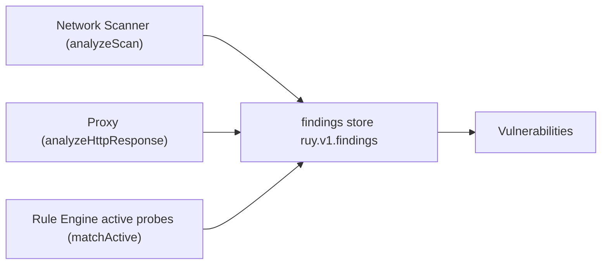

# 033 — Vulnerability Assessment

← [032 — Network Scanner](032_network-scanner.md) · [Index](000_index.md) · [034 — Exposure Monitor](034_threat-monitor.md) →

## Status

✅ **NYATA** — hanya tampilan live: membaca store temuan yang diisi Rule Engine dari Network Scanner, Proxy, dan probe aktif. Katalog demo (`MOCK_VULNS`), toggle, dan key `vulns.view` / `vulns.status` sudah dihapus (key lama yang tersisa diabaikan).

## Tujuan fitur

Satu tempat untuk melihat semua temuan kerentanan: severity, tingkat keyakinan (**Suspected** vs **Confirmed**), bukti, CVE, dan sumbernya.

## Cara kerja

- `useFindings()` (store `ruy.v1.findings`, lihat [041 Rule Engine](041_rule-engine.md)).
  - Filter severity + pencarian teks atas `name`, `target`, `cve`, `evidence`.
  - Kartu: Total, Confirmed, Suspected, Critical/High.
  - Kolom: Severity · Confidence · Finding (+ remediasi) · Target(:port) · Evidence · CVE · Src (`scanner`/`proxy`/`active`).
  - Read-only: belum ada status kerja (open/mitigated) untuk temuan nyata.

## File terkait

| File | Fungsi / data utama |
| --- | --- |
| [../src/renderer/src/pages/Vulnerabilities.tsx](../src/renderer/src/pages/Vulnerabilities.tsx) | Filter severity + pencarian, kartu hitungan, tabel temuan |
| [../src/renderer/src/store/findings.ts](../src/renderer/src/store/findings.ts) | `useFindings`, `addFindings`, `clearFindings` |
| [../src/shared/rules.ts](../src/shared/rules.ts) | Tipe `Finding`, `sortFindings`, template |
| [../src/renderer/src/lib/severity.ts](../src/renderer/src/lib/severity.ts) | `Severity`, `SEVERITY_ORDER`, `severityPill` |

## Cara pakai

1. Hasilkan temuan: jalankan **Network Scanner** (Live), jelajahi target lewat **Proxy**, atau **Run active checks** di Rule Engine.
2. Buka **Vulnerabilities** (`/vulnerabilities`), temuan Rule Engine tampil di tabel.
3. Saring per severity atau cari nama/CVE/target.
4. Hapus temuan lewat tombol **Clear** di halaman Rule Engine.

## Batasan / temuan

- Halaman ini tidak punya filter Confidence (ada di halaman Rule Engine) dan tidak punya status kerja/override.
- Temuan berlabel `suspected` (semua port rule + banner→CVE + error string) belum diverifikasi; tidak ada upgrade otomatis ke `confirmed`.
- Bukti hanya ringkasan teks (`evidence`), bukan request/response lengkap.
- Tabel tanpa temuan = kosong (tidak ada data contoh pengganti).

## Checklist pengerjaan

- [x] Sumber Live dari store temuan nyata (Rule Engine + Network Scanner + Proxy).
- [x] Tingkat keyakinan **Suspected vs Confirmed** ditampilkan.
- [x] Banner versi dari scan dicocokkan ke CVE (3 template banner → suspected).
- [x] Demo catalog dan `MOCK_VULNS` dihapus; hanya tampilan live.
- [ ] Status kerja (open/investigating/mitigated) untuk temuan, disimpan di record temuan.
- [ ] Filter Confidence di halaman ini.
- [ ] Lampirkan bukti lengkap (request/response/timing/banner) per temuan.
- [ ] (Opsional) Tampilkan pemetaan MITRE ATT&CK (field `mitre` sudah ada di sebagian template).
- [ ] (Ide) Hubungkan ke halaman laporan baru agar temuan terpilih masuk laporan (lihat [090](090_roadmap.md)).
