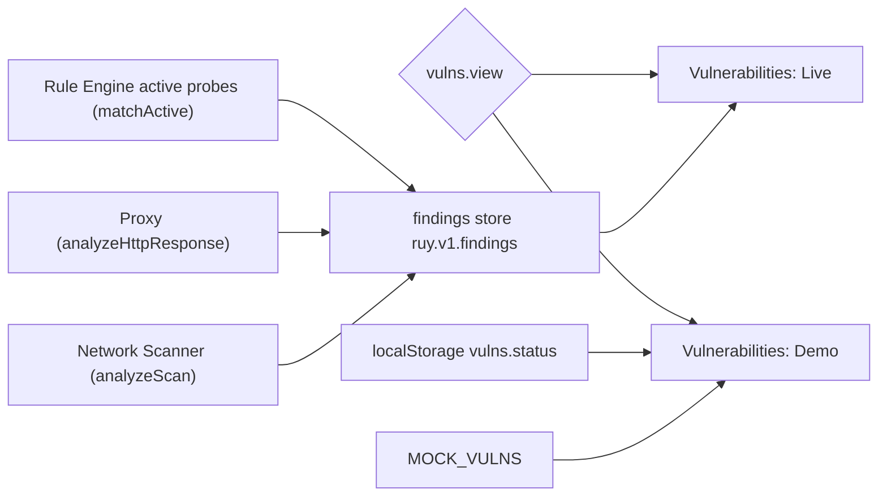

# 033 — Vulnerability Assessment

← [032 — Network Scanner](032_network-scanner.md) · [Index](000_index.md) · [034 — Threat Monitor](034_threat-monitor.md) →

## Status

🟡 **SEBAGIAN** — Tampilan **Live** (default) ✅ nyata: membaca store temuan yang diisi Rule Engine dari Network Scanner, Proxy, dan probe aktif. Tampilan **Demo catalog** ⚪ tetap simulasi (`MOCK_VULNS` + status lokal). Pilihan disimpan sebagai `vulns.view`.

## Tujuan fitur

Satu tempat untuk melihat semua temuan kerentanan: severity, tingkat keyakinan (**Suspected** vs **Confirmed**), bukti, CVE, dan sumbernya — plus katalog demo yang aman untuk presentasi tanpa target.

## Cara kerja

- **Live** — `useFindings()` (store `ruy.v1.findings`, lihat [041 Rule Engine](041_rule-engine.md)).
  - Filter severity + pencarian teks atas `name`, `target`, `cve`, `evidence`.
  - Kartu: Total, Confirmed, Suspected, Critical/High.
  - Kolom: Severity · Confidence · Finding (+ remediasi) · Target(:port) · Evidence · CVE · Src (`scanner`/`proxy`/`active`).
  - Read-only: belum ada status kerja (open/mitigated) untuk temuan nyata.
- **Demo** — `MOCK_VULNS` (9 entri) + override status di `usePersistentState('vulns.status')`; klik pill memutar open → investigating → mitigated.

## File terkait

| File | Fungsi / data utama |
| --- | --- |
| [../src/renderer/src/pages/Vulnerabilities.tsx](../src/renderer/src/pages/Vulnerabilities.tsx) | Toggle `vulns.view`, `liveRows`, `liveCounts`, `demoRows`, `cycle` |
| [../src/renderer/src/store/findings.ts](../src/renderer/src/store/findings.ts) | `useFindings`, `addFindings`, `clearFindings` |
| [../src/shared/rules.ts](../src/shared/rules.ts) | Tipe `Finding`, `sortFindings`, template |
| [../src/renderer/src/data/mock.ts](../src/renderer/src/data/mock.ts) | `MOCK_VULNS`, `SEVERITY_ORDER`, `severityPill` |
| [../src/renderer/src/store/store.ts](../src/renderer/src/store/store.ts) | `usePersistentState('vulns.view' / 'vulns.status')` |

## Cara pakai

1. Hasilkan temuan: jalankan **Network Scanner** (Live), jelajahi target lewat **Proxy**, atau **Run active checks** di Rule Engine.
2. Buka **Vulnerabilities** (`/vulnerabilities`), pastikan Source = **Live (Rule Engine)**.
3. Saring per severity atau cari nama/CVE/target.
4. Untuk presentasi tanpa target, pilih **Demo catalog** dan klik pill status untuk memutarnya.
5. Hapus temuan Live lewat tombol **Clear** di halaman Rule Engine.

## Batasan / temuan

- Live tidak punya filter Confidence (ada di halaman Rule Engine) dan tidak punya status kerja/override.
- Temuan berlabel `suspected` (semua port rule + banner→CVE + error string) belum diverifikasi; tidak ada upgrade otomatis ke `confirmed`.
- Bukti hanya ringkasan teks (`evidence`), bukan request/response lengkap.
- Demo catalog tidak terhubung ke data nyata; menambah entri berarti edit `mock.ts`.

## Checklist pengerjaan

- [x] Sumber Live dari store temuan nyata (Rule Engine + Network Scanner + Proxy).
- [x] Tingkat keyakinan **Suspected vs Confirmed** ditampilkan.
- [x] Banner versi dari scan dicocokkan ke CVE (3 template banner → suspected).
- [x] Demo catalog dipertahankan di balik toggle `vulns.view`.
- [ ] Status kerja (open/investigating/mitigated) untuk temuan Live, disimpan di record temuan.
- [ ] Filter Confidence di halaman ini.
- [ ] Lampirkan bukti lengkap (request/response/timing/banner) per temuan.
- [ ] (Opsional) Tampilkan pemetaan MITRE ATT&CK (field `mitre` sudah ada di sebagian template).
- [ ] Hubungkan ke Reports agar temuan terpilih masuk laporan.
