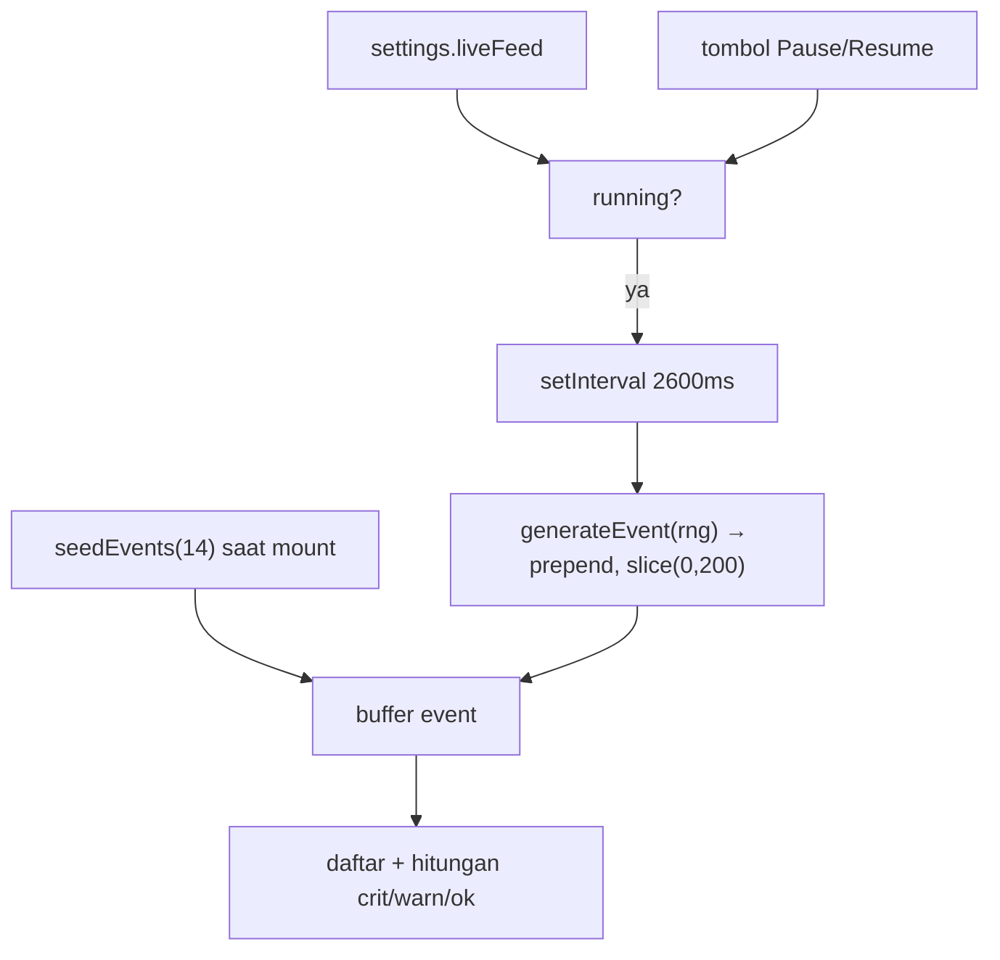

# 034 — Threat Monitor

← [033 — Vulnerability Assessment](033_vulnerabilities.md) · [Index](000_index.md) · [035 — Firewall Rules](035_firewall.md) →

## Status

⚪ **SIMULASI** — Aliran event dihasilkan sintetis oleh PRNG lokal. Tidak ada deteksi intrusi, penangkapan paket, atau intersepsi. Sumber dan signature fiktif. (Catatan roadmap: Threat Monitor boleh tetap demo bila waktu mepet.)

## Tujuan fitur

Menampilkan feed ancaman "live": event intrusi/anomali berjalan terus dengan hitungan critical/warning/auto-mitigated, bisa di-pause/resume.

## Cara kerja saat ini

- State awal: `seedEvents(14).reverse()` — 14 event fiksi deterministik.
- `running` diinisialisasi dari `settings.liveFeed` (toggle di Settings).
- Saat `running`, `setInterval` 2600 ms menambah `generateEvent(rng.current)` ke depan buffer, dipotong `slice(0, 200)`.
- `rng` di-seed dari `Date.now() & 0xffff` (bervariasi per sesi).
- Kartu menghitung `crit`, `warn`, dan `ok` (label "Auto-Mitigated") dari buffer.
- Pesan dirakit `FEED_TEMPLATES` × `SOURCES` (IP fiksi, beberapa diberi akhiran "(SIMULATED)").

## File terkait

| File | Fungsi / data utama |
|------|---------------------|
| [../src/renderer/src/pages/ThreatMonitor.tsx](../src/renderer/src/pages/ThreatMonitor.tsx) | state `events/running`, efek timer, `counts` |
| [../src/renderer/src/data/mock.ts](../src/renderer/src/data/mock.ts) | `makeRng`, `generateEvent`, `seedEvents`, `FEED_TEMPLATES`, `SOURCES` |
| [../src/renderer/src/store/store.ts](../src/renderer/src/store/store.ts) | `useSettings` → `liveFeed` menentukan auto-start |

## Cara pakai

1. Buka **Threat Monitor** (`/threats`).
2. Jika "Live threat feed" aktif di Settings, feed langsung berjalan.
3. **Pause** menghentikan generator; **Resume** memulai lagi.

## Batasan / temuan

- Buffer tidak di-persist — berganti halaman/restart mengosongkan event (hanya seed awal muncul lagi).
- "Auto-Mitigated" hanya menghitung event level `ok`; tidak ada mitigasi nyata.
- IP sumber dan kategori semuanya dari daftar fiksi `SOURCES`/`FEED_TEMPLATES`.

## Checklist pengerjaan

- [ ] Putuskan: tetap demo (beri label jujur) atau jadikan nyata.
- [ ] Jika nyata: alirkan `proxy.onLog` yang sudah ada dari main process sebagai sumber event.
- [ ] (Opsional) Baca Windows Event Log / log lokal via handler IPC baru.
- [ ] Terapkan klasifikasi severity dari Rule Engine, bukan template acak.
- [ ] Persist buffer (atau ring-buffer) agar event bertahan antar navigasi.
- [ ] Tautkan event ke temuan/aset nyata agar bisa di-drill-down.
