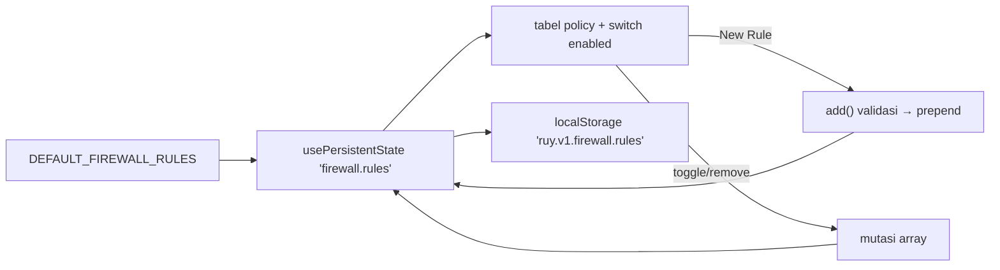

# 035 — Firewall Rules

← [034 — Threat Monitor](034_threat-monitor.md) · [Index](000_index.md) · [036 — Reports](036_reports.md) →

## Status

⚪ **SIMULASI** — Editor policy tiruan. Rule disimpan lokal dan **tidak berpengaruh** pada Windows Firewall atau perangkat jaringan mana pun. Tidak ada konfigurasi sistem yang diubah.

## Tujuan fitur

Menyediakan editor aturan firewall: menampilkan rule default, menambah/menghapus rule kustom, dan mengaktifkan/menonaktifkan rule — semua tersimpan antar sesi.

## Cara kerja saat ini

- State `rules` via `usePersistentState<FirewallRule[]>('firewall.rules', DEFAULT_FIREWALL_RULES)` (6 rule bawaan, `builtin: true`).
- **New Rule** membuka form draft; `add()` memvalidasi nama & port tidak kosong lalu menaruh rule baru di depan daftar dengan `id = fw-<timestamp>`.
- `toggle(id)` membalik `enabled`; `remove(id)` hanya untuk rule non-builtin (rule default tak bisa dihapus).
- Kartu menghitung total, active, deny aktif, dan custom (non-builtin).
- Semua perubahan ditulis ke `localStorage` key `ruy.v1.firewall.rules`. Tidak ada IPC.

## File terkait

| File | Fungsi / data utama |
|------|---------------------|
| [../src/renderer/src/pages/Firewall.tsx](../src/renderer/src/pages/Firewall.tsx) | `blank()`, `add`, `toggle`, `remove`, hitungan `active`/`denies` |
| [../src/renderer/src/data/mock.ts](../src/renderer/src/data/mock.ts) | `DEFAULT_FIREWALL_RULES`, tipe `FirewallRule` |
| [../src/renderer/src/store/store.ts](../src/renderer/src/store/store.ts) | `usePersistentState('firewall.rules')` |

## Cara pakai

1. Buka **Firewall Rules** (`/firewall`).
2. Klik **New Rule**, isi nama/arah/protokol/port/source/action, lalu **Add Rule** (nama & port wajib).
3. Pakai switch untuk enable/disable; hapus rule kustom lewat ikon trash (rule default tak bisa dihapus).
4. Reset via Settings mengembalikan 6 rule default.

## Batasan / temuan

- Tidak ada efek nyata ke OS — murni daftar di localStorage.
- Tidak ada evaluasi/penegakan rule; urutan "evaluated top to bottom" hanya label.
- Tidak ada validasi format port/CIDR selain cek non-kosong.

## Checklist pengerjaan

- [ ] Mulai aman: tambah **export** rule ke format `netsh` / file, tanpa menyentuh sistem.
- [ ] Tambah handler IPC main-process untuk membaca rule Windows Firewall nyata (`netsh advfirewall firewall show rule`).
- [ ] (Hati-hati) Handler untuk menerapkan rule via `netsh`/Windows Firewall API, dengan konfirmasi ganda & hak admin.
- [ ] Validasi port/protokol/CIDR sebelum apply.
- [ ] Audit log tiap perubahan rule (legal-by-design).
- [ ] Bedakan jelas rule "simulasi" vs rule yang benar-benar diterapkan di UI.
