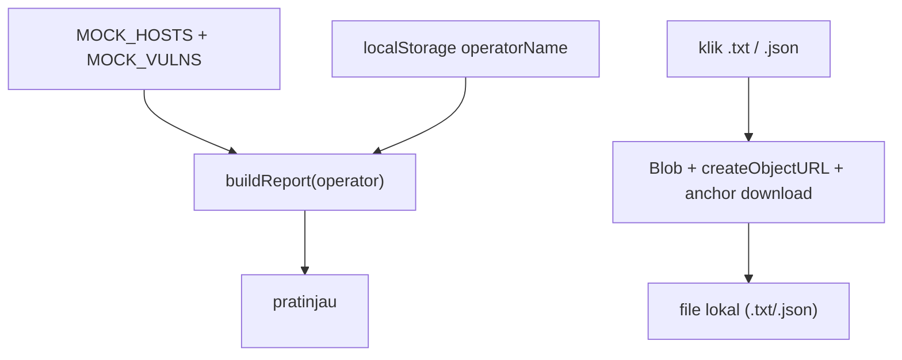

# 036 — Reports

← [035 — Firewall Rules](035_firewall.md) · [Index](000_index.md) · [037 — Settings](037_settings.md) →

## Status

🟡 **SEBAGIAN** — Isi laporan dirakit dari data demo (`MOCK_HOSTS`/`MOCK_VULNS`), **tetapi** export ke file `.txt`/`.json` adalah operasi nyata (Blob + dialog download). Jadi: konten simulasi, mekanisme export nyata.

## Tujuan fitur

Menghasilkan ringkasan postur keamanan berbentuk teks: summary, temuan per severity, top priority, inventori host — lalu mengekspornya ke `.txt` atau `.json`.

## Cara kerja saat ini

- `buildReport(operator)` menyusun string multi-baris dari `MOCK_HOSTS` & `MOCK_VULNS` (jumlah host, open findings, breakdown severity, 5 temuan CVSS tertinggi, inventori host). Header eksplisit: `*** SIMULATED DEMONSTRATION DATA — NOT A REAL ASSESSMENT ***`.
- `operator` dibaca langsung dari `localStorage['ruy.v1.settings'].operatorName`.
- **Generate/Regenerate** menaruh hasil ke state & menandai waktu.
- `download(ext)`: untuk `.json` serialisasi `{hosts, findings, note, generated}`; untuk `.txt` pakai report (atau bangun ulang). Dibuat `Blob`, `URL.createObjectURL`, lalu klik anchor `download` — file ke lokasi pilihan user. Tidak ada upload.

## File terkait

| File | Fungsi / data utama |
|------|---------------------|
| [../src/renderer/src/pages/Reports.tsx](../src/renderer/src/pages/Reports.tsx) | `buildReport()`, `generate()`, `download()` |
| [../src/renderer/src/data/mock.ts](../src/renderer/src/data/mock.ts) | `MOCK_HOSTS`, `MOCK_VULNS`, `SEVERITY_ORDER` |
| [../src/renderer/src/store/store.ts](../src/renderer/src/store/store.ts) | namespace `ruy.v1.settings` (sumber `operatorName`) |

## Cara pakai

1. Buka **Reports** (`/reports`).
2. Klik **Generate** untuk merakit ringkasan; **Regenerate** memperbarui timestamp.
3. Klik **.txt** atau **.json** untuk mengunduh. Nama file: `RUY-report-<tanggal>.<ext>`.

## Batasan / temuan

- Seluruh isi berasal dari data palsu; header menegaskan itu bukan asesmen nyata.
- `operator` dibaca manual dari localStorage, bukan lewat `useSettings` (tidak reaktif terhadap perubahan dalam sesi yang sama).
- Belum ada export PDF maupun laporan Bahasa Indonesia.
- Temuan nyata sudah tersedia di store Rule Engine (`ruy.v1.findings`, lihat [041](041_rule-engine.md)) tetapi belum dibaca Reports.

## Checklist pengerjaan

- [ ] Rakit laporan dari store temuan nyata (`getFindings()` / `useFindings()` di `store/findings.ts`, pisahkan Confirmed vs Suspected) + hasil Network Scanner, bukan `mock.ts`.
- [ ] Sertakan bukti per temuan (request/response/timing) di laporan.
- [ ] Tambah export **PDF** dan versi **Bahasa Indonesia** yang rapi.
- [ ] Baca `operatorName` via `useSettings` agar reaktif.
- [ ] (Opsional) Sematkan Attack Path Graph & pemetaan MITRE ATT&CK.
- [ ] Hapus/ubah header "SIMULATED" begitu sumber data sudah nyata.
