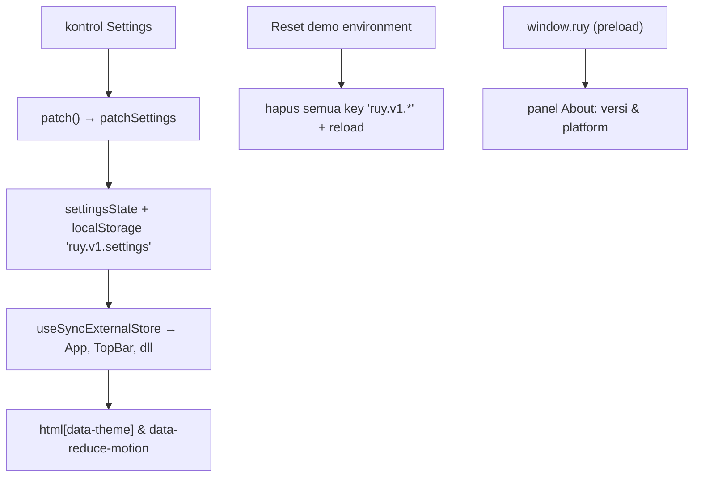

# 037 — Settings

← [036 — Reports](036_reports.md) · [Index](000_index.md) · [090 — Roadmap](090_roadmap.md) →

## Status

🟡 **SEBAGIAN** — Preferensi ini **nyata dan berfungsi**: tema, persistence, live feed, reduce motion, nama operator, serta reset lingkungan demo semuanya tersimpan/diterapkan sungguhan lewat `localStorage` dan `window.ruy`. Yang disebut "demo" di sini adalah *data* yang dikelolanya, bukan mekanisme pengaturannya.

## Tujuan fitur

Pusat preferensi lokal + manajemen lingkungan demo: ubah tema & perilaku aplikasi, reset semua data demo ke default, dan lihat info build/runtime.

## Cara kerja saat ini

- `useSettings()` membaca/menulis store settings tunggal (namespace `ruy.v1.settings`) yang di-share ke seluruh aplikasi via `useSyncExternalStore`.
- Preferensi: `operatorName`, `theme` (dark/light, diterapkan ke `html[data-theme]`), `persistence`, `liveFeed`, `reduceMotion`.
- Toggle **persistence**: saat off, `write()` melewati penyimpanan semua key **kecuali** `settings` sendiri (agar toggle tetap sticky).
- **Reset demo environment**: `resetDemoEnvironment()` menghapus semua key berawalan `ruy.v1.` lalu `window.location.reload()` agar modul membaca default pristine.
- Panel **About**: baca `window.ruy.versions` (electron/chrome/node) & `window.ruy.platform` dari preload; fallback `—` bila `window.ruy` absen.

## File terkait

| File | Fungsi / data utama |
|------|---------------------|
| [../src/renderer/src/pages/Settings.tsx](../src/renderer/src/pages/Settings.tsx) | komponen `Settings`, `doReset`, panel About |
| [../src/renderer/src/store/store.ts](../src/renderer/src/store/store.ts) | `useSettings`, `patchSettings`, `resetDemoEnvironment`, `usePersistentState`, `useApplyTheme`, `useBodyMotionFlag`, NS `ruy.v1.` |
| [../src/preload/index.ts](../src/preload/index.ts) | `window.ruy.versions` & `window.ruy.platform` |

## Cara pakai

1. Buka **Settings** (`/settings`).
2. Ubah nama operator (dipakai Reports), tema, dan toggle persistence/live feed/reduce motion — langsung tersimpan.
3. **Reset demo environment** → konfirmasi "Yes, reset everything" untuk menghapus semua data demo & reload.
4. Lihat panel **About** untuk versi Electron/Chromium/Node & platform.

## Batasan / temuan

- "Mode: Offline simulation" di About adalah label statis, bukan deteksi mode.
- `settings.scope` (host berizin untuk Live) diatur lewat komponen `ScopeBar` di Web Suite, bukan dari halaman Settings ini.
- Reset menghapus **semua** key `ruy.v1.*` termasuk scope & status temuan — sesuai desain, tidak bisa undo.

## Checklist pengerjaan

- [ ] Tambah editor **Authorized scope** di halaman Settings (saat ini hanya via `ScopeBar`), agar pengelolaan izin terpusat.
- [ ] Jadikan label "Mode" dinamis (deteksi apakah ada modul Live aktif).
- [ ] Tambah pengaturan untuk fitur nyata mendatang (timeout scan, port Rule Engine, lokasi audit log).
- [ ] Tambah export/import settings agar konfigurasi bisa dibagikan.
- [ ] Tampilkan ringkasan audit log (lihat roadmap cross-cutting).
