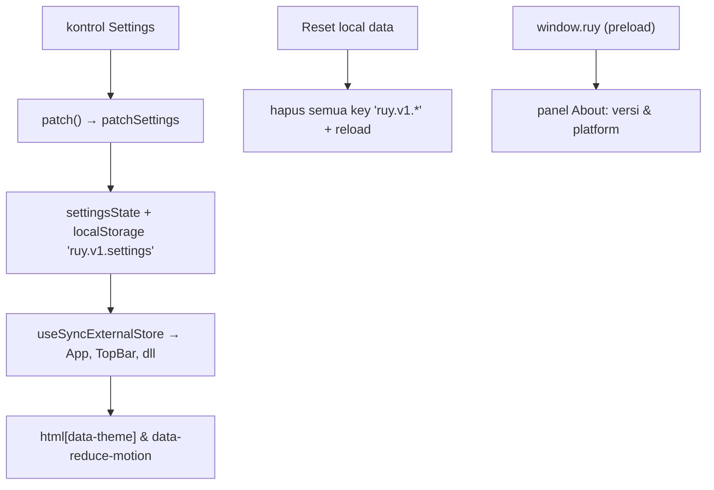

# 037 — Settings

← [034 — Exposure Monitor](034_threat-monitor.md) · [Index](000_index.md) · [040 — Detection (Pengantar Kelompok)](040_detection.md) →

## Status

✅ **NYATA** — Preferensi ini **nyata dan berfungsi**: tema, persistence, live feed, reduce motion, nama operator, serta reset data lokal semuanya tersimpan/diterapkan sungguhan lewat `localStorage` dan `window.ruy`.

## Tujuan fitur

Pusat preferensi lokal + manajemen data lokal: ubah tema & perilaku aplikasi, reset semua data lokal ke default, dan lihat info build/runtime.

## Cara kerja saat ini

- `useSettings()` membaca/menulis store settings tunggal (namespace `ruy.v1.settings`) yang di-share ke seluruh aplikasi via `useSyncExternalStore`.
- Preferensi: `operatorName`, `theme` (dark/light, diterapkan ke `html[data-theme]`), `persistence`, `liveFeed`, `reduceMotion`.
- Toggle **persistence**: saat off, `write()` melewati penyimpanan semua key **kecuali** `settings` sendiri (agar toggle tetap sticky).
- **Reset local data** (panel **Local data**): `resetLocalData()` menghapus semua key berawalan `ruy.v1.` lalu `window.location.reload()` agar modul membaca default pristine.
- Panel **About**: baca `window.ruy.versions` (electron/chrome/node) & `window.ruy.platform` dari preload; fallback `—` bila `window.ruy` absen.

## File terkait

| File | Fungsi / data utama |
|------|---------------------|
| [../src/renderer/src/pages/Settings.tsx](../src/renderer/src/pages/Settings.tsx) | komponen `Settings`, `doReset`, panel About |
| [../src/renderer/src/store/store.ts](../src/renderer/src/store/store.ts) | `useSettings`, `patchSettings`, `resetLocalData`, `usePersistentState`, `useApplyTheme`, `useBodyMotionFlag`, NS `ruy.v1.` |
| [../src/preload/index.ts](../src/preload/index.ts) | `window.ruy.versions` & `window.ruy.platform` |

## Cara pakai

1. Buka **Settings** (`/settings`).
2. Ubah nama operator, tema, dan toggle persistence/live feed/reduce motion — langsung tersimpan.
3. **Reset local data** → konfirmasi "Yes, reset everything" untuk menghapus semua data lokal & reload.
4. Lihat panel **About** untuk versi Electron/Chromium/Node & platform.

## Batasan / temuan

- Baris "Mode: Offline simulation" di About sudah dihapus (tidak ada mode).
- `operatorName` saat ini tersimpan tetapi belum dipakai halaman lain (Reports sudah dihapus).
- `settings.scope` (host/IP/CIDR berizin untuk Live) diatur lewat komponen `ScopeBar` (Web Suite, Network Scanner, Rule Engine), bukan dari halaman Settings ini.
- Reset menghapus **semua** key `ruy.v1.*` termasuk scope dan store temuan Rule Engine (`ruy.v1.findings`) — sesuai desain, tidak bisa undo.
- Toggle persistence juga dihormati store temuan Rule Engine (load & save).

## Checklist pengerjaan

- [ ] Tambah editor **Authorized scope** di halaman Settings (saat ini hanya via `ScopeBar`), agar pengelolaan izin terpusat.
- [ ] Tambah pengaturan untuk fitur nyata mendatang (timeout scan, port Rule Engine, lokasi audit log).
- [ ] Tambah export/import settings agar konfigurasi bisa dibagikan.
- [ ] Tampilkan ringkasan audit log (lihat roadmap cross-cutting).
