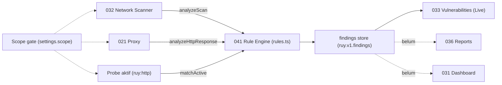

# 040 — Detection (Pengantar Kelompok)

← [037 — Settings](037_settings.md) · [Index](000_index.md) · [041 — Rule Engine](041_rule-engine.md) →

Kelompok **Detection** adalah lapisan yang mengubah data mentah dari modul nyata (Network Scanner, Proxy) menjadi **temuan** yang bisa dipertanggungjawabkan: severity, CVE/CWE, remediasi, dan label jujur **Suspected** vs **Confirmed**. Di sidebar muncul sebagai grup "Detection" (setelah Operations), route `/detection`.

## Tujuan

- Satu mesin deteksi bergaya Nuclei: template = data, bukan kode bercabang.
- Memisahkan **inferensi** (port terbuka, banner → CVE, pesan error) dari **bukti** (header teramati, probe aktif yang berhasil).
- Menjadi sumber tunggal temuan untuk Vulnerabilities, lalu Reports dan Dashboard.

## Daftar fitur

| Doc | Halaman | Status |
| --- | --- | --- |
| [041_rule-engine.md](041_rule-engine.md) | Rule Engine (`/detection`) | ✅ NYATA |

Terkait (dokumen kelompok lain):

- [032 Network Scanner](032_network-scanner.md) — pemasok sinyal port/banner.
- [021 Proxy / MITM](021_proxy-mitm.md) — pemasok respons HTTP (hanya in-scope).
- [033 Vulnerabilities](033_vulnerabilities.md) — pembaca temuan (tampilan Live).
- [011 Scope Gate](011_scope-gate.md) — penjaga semua trafik nyata.

## Hubungan antar-fitur

## Tabel status

| Aspek | Status | Keterangan |
| --- | --- | --- |
| Template & matcher | ✅ | 27 template, 6 tipe matcher (`time`/`service` belum dipakai) |
| Umpan dari Scanner | ✅ | Otomatis setelah scan Live, termasuk hasil parsial |
| Umpan dari Proxy | ✅ | Setiap respons in-scope |
| Probe aktif | ✅ | 5 probe, scope-gated lewat `ruy:http` |
| Store temuan | ✅ | localStorage, de-dup per key, maks 1000 |
| Upgrade Suspected → Confirmed | ⚪ | Belum ada |
| Dipakai Reports / Dashboard | ⚪ | Belum — keduanya masih `mock.ts` |

## Urutan kerja

1. ✅ Rule Engine + store temuan + halaman `/detection`.
2. ✅ Hubungkan Scanner, Proxy, dan Vulnerabilities.
3. ⏭ Upgrade Suspected → Confirmed + baseline soft-404 (lihat checklist [041](041_rule-engine.md)).
4. ⏭ Reports membaca store temuan (lihat [036](036_reports.md)).
5. ⏭ Dashboard mengagregasi store temuan (lihat [031](031_dashboard.md)).
