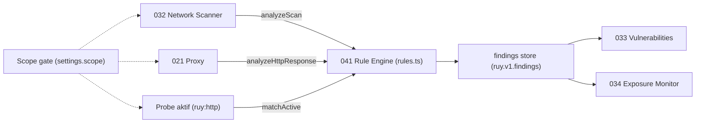

# 040 — Detection (Pengantar Kelompok)

← [037 — Settings](037_settings.md) · [Index](000_index.md) · [041 — Rule Engine](041_rule-engine.md) →

Kelompok **Detection** adalah lapisan yang mengubah data mentah dari modul nyata (Network Scanner, Proxy) menjadi **temuan** yang bisa dipertanggungjawabkan: severity, CVE/CWE, remediasi, dan label jujur **Suspected** vs **Confirmed**. Di sidebar muncul sebagai grup "Detection" (setelah Operations), route `/detection`.

## Tujuan

- Satu mesin deteksi bergaya Nuclei: template = data, bukan kode bercabang.
- Memisahkan **inferensi** (port terbuka, banner → CVE, pesan error) dari **bukti** (header teramati, probe aktif yang berhasil).
- Menjadi sumber tunggal temuan untuk Vulnerabilities, dan Exposure Monitor; halaman laporan dari temuan Confirmed adalah ide baru ([090](090_roadmap.md)).

## Daftar fitur

| Doc | Halaman | Status |
| --- | --- | --- |
| [041_rule-engine.md](041_rule-engine.md) | Rule Engine (`/detection`) | ✅ NYATA |

Terkait (dokumen kelompok lain):

- [032 Network Scanner](032_network-scanner.md) — pemasok sinyal port/banner.
- [021 Proxy / MITM](021_proxy-mitm.md) — pemasok respons HTTP (hanya in-scope).
- [033 Vulnerabilities](033_vulnerabilities.md) — pembaca temuan.
- [011 Scope Gate](011_scope-gate.md) — penjaga semua trafik nyata.

## Hubungan antar-fitur

## Tabel status

| Aspek | Status | Keterangan |
| --- | --- | --- |
| Template & matcher | ✅ | 408 template (28 port/banner, 47 HTTP pasif, 333 HTTP aktif), 7 tipe matcher termasuk `dsl` (`time`/`service` ada di engine tetapi belum dipakai template) |
| Umpan dari Scanner | ✅ | Otomatis setelah scan Live, termasuk hasil parsial |
| Umpan dari Proxy | ✅ | Setiap respons in-scope |
| Probe aktif | ✅ | 333 template aktif, scope-gated lewat `ruy:http`, dengan baseline soft-404 |
| Scan terautentikasi | ✅ | Cookie Interu Browser atau header manual, lihat [042](042_scan-terautentikasi.md) |
| Store temuan | ✅ | localStorage, de-dup per key, maks 1000 |
| Upgrade Suspected → Confirmed | 🟡 | Korelasi `group`: confirmed menggeser suspected (`superseded`). Pasangan otomatis suspected-port → confirmed-aktif belum ada |
| Laporan dari temuan | ⚪ | Belum ada halaman laporan (ide baru di [090](090_roadmap.md)) |

## Urutan kerja

1. ✅ Rule Engine + store temuan + halaman `/detection`.
2. ✅ Hubungkan Scanner, Proxy, dan Vulnerabilities.
3. ✅ Baseline soft-404 dan korelasi `group` (lihat [041](041_rule-engine.md)); ⏭ pasangan otomatis suspected-port → confirmed-aktif.
4. ⏭ Halaman laporan baru yang membaca store temuan (lihat [090](090_roadmap.md)).
