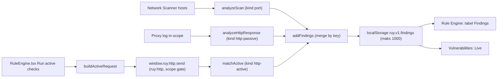

# 041 — Rule Engine

← [040 — Detection (Pengantar Kelompok)](040_detection.md) · [Index](000_index.md) · [090 — Roadmap](090_roadmap.md) →

## Status

✅ **NYATA** — Mesin deteksi bergaya Nuclei: template berupa **data**, dievaluasi terhadap sinyal nyata (hasil Network Scanner, respons Proxy yang ter-capture, dan probe HTTP aktif yang scope-gated). Tanpa eksploitasi (probe aktif hanya **membaca**). **408 template** (28 port/banner, 47 HTTP pasif, 333 HTTP aktif oracle-confirmed). Diuji dengan `npm test` (vitest, 47 tes).

**Prinsip anti-false-positive:** setiap template HTTP aktif **wajib** punya penanda konten spesifik (tidak pernah status 200 saja — dijaga oleh tes `isStatusOnly`). Penanda yang terlalu ketat paling banter menghasilkan *false negative*, bukan *false positive*. Keluarga varian (mis. 12 ekstensi backup per file config) berbagi `group` sehingga `correlate` menyatukannya jadi **satu temuan per host**. Probe aktif dijalankan paralel terbatas (pool 10) dengan baseline soft-404 lebih dulu.

Fitur engine kelas Nuclei yang sudah ada: **6+1 tipe matcher** (termasuk `dsl`), **extractors** (regex/kval/word → data terstruktur), **interpolasi variabel** `{{BaseURL}}`/`{{Hostname}}`/dll, **baseline soft-404** anti false-positive, **korelasi Suspected→Confirmed**, dan **penyimpanan bukti request/response** per temuan.

## Tujuan fitur

Mengubah data mentah (port terbuka, banner, header/body HTTP) menjadi **temuan** berlabel severity, CVE/CWE, remediasi, dan tingkat keyakinan yang jujur: **Suspected** (inferensi) vs **Confirmed** (teramati langsung / dibuktikan probe).

## Cara kerja

Tiga jalur masuk, satu store:

| Jalur | Fungsi | Dipanggil dari | `source` |
| --- | --- | --- | --- |
| Port/banner | `analyzeScan(hosts)` | `NetworkScanner.tsx` setelah scan Live (termasuk hasil parsial setelah Stop) | `scanner` |
| HTTP pasif | `analyzeHttpResponse(entry)` | `Proxy.tsx`, setiap log yang punya respons; proxy hanya me-log trafik **in-scope** | `proxy` |
| HTTP aktif | `buildActiveRequest` → `window.ruy.http.send` → `matchActive` | `RuleEngine.tsx` tombol **Run active checks** (scope-gated `ruy:http`) | `active` |

### Matcher

- Tipe: `status`, `word`, `regex`, `port`, `service`, `time`, **`dsl`**. Gabungan per matcher via `condition` (and/or), antar matcher via `matchersCondition` (default `and`). `negative: true` = cocok bila pola **tidak ada** (header hilang).
- `part`: `header` / `body` / `response` / `banner`.
- Regex dikompilasi dengan flag `im` (case-insensitive, `^`/`$` per baris) — tiap baris `Set-Cookie` dinilai terpisah, jadi satu cookie tanpa flag sudah cukup memicu temuan.

### Matcher `dsl` (bahasa ekspresi aman)

`src/shared/dsl.ts` adalah evaluator ekspresi **tanpa `eval`** (tokenizer + recursive-descent parser → AST → evaluasi atas konteks fakta tetap). Template tidak akan pernah bisa menjalankan kode sembarang.

- Variabel: `status`, `content_length`, `duration` (ms), `body`, `header`, `response`, `banner`, `port`, `service`. Variabel tak dikenal = `null` (falsey), tidak error.
- Operator: `! -`, `* / %`, `+ -`, `< <= > >=`, `== !=`, `&& ||`. `+` menyambung string bila salah satu sisi bukan angka.
- Fungsi: `len`, `contains`, `icontains`, `startswith`, `endswith`, `regex(pola, teks)`, `tolower`, `toupper`, `trim`, `int`, `str`.
- Contoh: `status == 200 && contains(body, "phpinfo()") && content_length > 50`. Ekspresi yang gagal di-parse dihitung **false** (tidak crash).

### Extractors

`extractors[]` pada template menarik data terstruktur saat template cocok, disimpan di `finding.extracted` (mis. versi PHP, `cluster_name`, username, kunci API).

- `type: 'regex'` (dengan `group` untuk capture group), `'kval'` (baca header `key: value`), `'word'`.
- Contoh: `http-server-version` meng-extract header `Server`; `expose-phpinfo` meng-extract `PHP Version`; `expose-wp-users` meng-extract tiap `slug`.

### Interpolasi variabel (probe aktif)

`request.path/headers/body` mendukung `{{Nama}}` ala Nuclei, diisi `requestVars(baseUrl)`:

`{{BaseURL}}` `{{RootURL}}` `{{Hostname}}` `{{Host}}` `{{Port}}` `{{Scheme}}` `{{Path}}` `{{RandomString}}`. Path boleh URL absolut (lewat `{{BaseURL}}`) atau root-relative (`/.git/config`).

### Baseline soft-404 (anti false-positive)

Sebelum menjalankan probe aktif, `RuleEngine.tsx` mem-probe satu path yang **dijamin tidak ada** (`/interu-not-here-<random>.html`) lalu `computeBaseline(res)`:

- Jika host tak merespons → probe **dibatalkan** (tidak ada gunanya menembak terus).
- Jika server menjawab 2xx untuk path acak itu = **catch-all** → temuan yang hanya mengandalkan status (`isStatusOnly`) di-**demote** ke `suspected` dengan catatan `baseline: server is catch-all 2xx`. Template yang punya penanda konten tetap `confirmed` (halaman catch-all tak memuat penanda spesifik).

### Korelasi (Suspected → Confirmed)

Template boleh punya `group`. `correlate(findings)` menggabungkan temuan yang berbagi `group` + `target`: yang berkeyakinan lebih tinggi (confirmed > suspected, lalu severity) **menang**, sisanya ditandai `superseded` (disembunyikan default di tabel, bisa ditampilkan). Inilah jalur upgrade suspected → confirmed saat oracle membuktikan isu yang sama. Dipanggil di `addFindings`.

### Bukti request/response

Temuan aktif menyimpan `request` (baris request yang dikirim) dan `response` (mentah, dipotong ~8 KB) untuk laporan di masa depan; temuan pasif menyimpan `response`; plus `matchedAt`, `extracted`, `cwe`, `cvss`, `reference`, `mitre`. Tabel Findings bisa di-klik untuk membuka baris detail.

### Kunci temuan (de-dup)

- `key = templateId|target[:port]`. Temuan dengan key sama ditimpa (bukti terbaru menang).
- HTTP pasif yang **semua matcher-nya `part: header`** → target = **origin** (satu temuan per situs). Rule body/status → target = URL penuh.
- Store dipotong ke **1000** temuan paling parah (`sortFindings`: severity → confirmed dulu → target).
- Flag `persistence` (Settings) dihormati saat load dan save; bila off, Clear juga menghapus data tersimpan.

### Katalog template (408)

Daftar lengkap ada di **Template library** (UI Rule Engine) dan di `src/shared/rules.ts`. Katalog = **CURATED** (kurasi tangan) + **generator packs** (ekspansi data-driven). Ringkasan:

**Generator packs** (fungsi `gen*()` di `rules.ts`, digabung ke `TEMPLATES`):
- `genBackups` — 8 file config × 12 ekstensi backup (`.bak/.old/~/…`), penanda = isi rahasia (DB_PASSWORD dll), per-config `group` → dedup.
- `genEnv` — 9 varian `.env.*` (penanda `APP_/DB_/SECRET=…`, +extract key).
- `genFiles` — ~45 file spesifik: VCS (`.git/index|logs|packed-refs`), log (Laravel/Rails/error/debug), CI/IaC (CircleCI/GitHub Actions/Jenkinsfile/Terraform state/Ansible/serverless), kredensial cloud (`.aws/config`, `.boto`, `.s3cfg`, `.docker/config.json`, `.kube/config`, `.netrc`), config app (appsettings.json/web.config/htaccess), manifest dependensi, info (robots/sitemap/security.txt).
- `genActuators` — ~22 surface debug: Spring Actuator (beans/env/threaddump/httptrace/prometheus/gateway/…) + legacy `/env`/`/trace`/`/beans`, Laravel Ignition/Horizon/DebugBar, Symfony WDT, Rails info, Werkzeug console, Sidekiq.
- `genApis` — ~10 spesifikasi API (Swagger/OpenAPI v2/v3, GraphiQL/Playground, WADL, OIDC discovery, OData).
- `genPanels` — ~90 deteksi panel/produk (path kanonik + penanda nama produk → FP sangat kecil): Joomla, Magento, Grafana, Jenkins, GitLab, Jira/Confluence, SonarQube, Nexus, Artifactory, Harbor, Rancher, Prometheus, Consul, Vault, Traefik, Airflow, Metabase, Jupyter, Zabbix, WebLogic/WebSphere/JBoss, ColdFusion, Tomcat sample apps, Spark/Hadoop/NiFi/Flink, MinIO, pfSense/OPNsense/MikroTik, dsb.
- `genSecrets` — 11 regex token presisi di body (Stripe `sk_live`, GitHub PAT, GitLab PAT, Slack, SendGrid, Mailgun, Twilio, npm, Google OAuth, PGP).
- `genTechHeaders` — 8 cookie fingerprint (PHPSESSID/JSESSIONID/ASP.NET_SessionId/laravel_session/…) + 5 header (X-Generator/X-Drupal/X-Varnish/x-amz/Server-tech).
- `genPortVersions` — 6 banner versi (SSH/FTP/SMTP/HTTP/MySQL/Redis, info + extract versi).

Ringkasan kurasi (CURATED):

**Port / banner — 28 total** (`analyzeScan`, semua **suspected** — scan hanya membuktikan port terbuka, bukan layanan sebenarnya)

- **14 layanan ter-ekspos** (`svc-*`): telnet, ftp, smb/netbios, rdp, database (MySQL/PostgreSQL/MSSQL/Oracle/DB2), NoSQL/cache (Redis/Mongo/Elastic/Memcached/CouchDB/Cassandra), message broker (RabbitMQ/AMQP/MQTT/Kafka), VNC, X11, SMTP, LDAP/SNMP/NFS/rpcbind, Docker API, Kubernetes/etcd, port backdoor umum (4444/31337/1337/12345).
- **8 banner → CVE** (hanya CVE mapan, tetap suspected karena banner bisa dipalsukan/back-port): vsftpd 2.3.4 `CVE-2011-2523`, ProFTPD 1.3.5 `CVE-2015-3306`, OpenSSH 8.5–9.7 regreSSHion `CVE-2024-6387`, OpenSSH <7.7 user-enum `CVE-2018-15473`, Apache 2.4.49/50 `CVE-2021-41773`/`CVE-2021-42013`, nginx 1.3.9–1.4.0 `CVE-2013-2028`, Exim 4.87–4.91 `CVE-2019-10149`, IIS 6.0 WebDAV `CVE-2017-7269`. Banner hanya ter-grab di profil scan `deep`.

**HTTP pasif — 23** (`analyzeHttpResponse`)

- **Header keamanan hilang** (origin-wide, confirmed): HSTS, CSP, X-Frame-Options, X-Content-Type-Options, Referrer-Policy, Permissions-Policy.
- **CORS**: `access-control-allow-origin: *` (medium), reflektif + credentials (high).
- **Cookie** (per baris `Set-Cookie`): tanpa HttpOnly, tanpa Secure (HTTPS), tanpa SameSite.
- **Disclosure/debug**: Server version (+extract), X-Powered-By (+extract), ASP.NET version, header debug Symfony, Basic-auth via HTTP, IP privat (RFC1918, +extract), kebocoran secret/API key di body (AWS/Google/GitHub/Slack/private key, +extract), JWT di body.
- **Body**: directory listing, halaman default server (nginx/Apache/IIS), pesan error SQL (suspected), stack trace/debug (suspected).

**HTTP aktif — 58** (`matchActive`, scope-gated, **confirmed**, semua GET + penanda konten spesifik — baca saja)

- **VCS/SCM**: `.git/config`, `.git/HEAD`, `.git-credentials`, `.svn/wc.db`, `.hg/requires`, `.bzr/README`.
- **Env/secret/config**: `.env` (+extract keys), `.aws/credentials`, `.npmrc`, `.htpasswd`, `web.config`, `id_rsa`, `docker-compose.yml`, `Dockerfile`, `composer.json`, `package.json`, `.gitlab-ci.yml`, `.DS_Store`, `wp-config.php.bak`.
- **Backup/dump SQL**: `backup.sql`, `dump.sql`, `database.sql` (satu `group` → dedup).
- **Status/info**: Apache `server-status`/`server-info`, nginx `stub_status`, `phpinfo.php`/`info.php` (+extract versi PHP).
- **Framework/actuator/debug**: Spring `actuator`/`/env`/`/health`, Symfony profiler, Laravel Telescope, Go `pprof`, ASP.NET `trace.axd`, ELMAH.
- **API**: `swagger.json`, `openapi.json`, Swagger UI, GraphQL introspection.
- **CMS**: WP user-enum `wp-json/wp/v2/users` (+extract slug), WP `debug.log`, `wp-login.php`, `readme.html` (+extract versi), Drupal `CHANGELOG.txt` (+extract versi).
- **Policy**: `crossdomain.xml`/`clientaccesspolicy.xml` wildcard.
- **DB over HTTP**: Elasticsearch (+extract cluster), CouchDB.
- **Panel** (deteksi keberadaan, bukan bypass): phpMyAdmin, Adminer, Tomcat Manager, Solr, Jenkins, Grafana, Kibana, GitLab, Jira, Webmin.

### Attack / Defense advisor (`advice.ts`)

Tiap temuan **confirmed** otomatis dapat dua rekomendasi lewat `getAdvice(finding)` (modul murni `src/shared/advice.ts`, di-key per **kelas kerentanan**, bukan per-template):

- **🛡 Defense (patching)**: ringkasan, langkah, dan **snippet config siap-salin** (nginx/Apache/framework), plus tombol **Re-test fix** (untuk temuan aktif: jalankan ulang oracle template yang sama; kalau sudah tidak cocok → temuan dihapus dari store = loop tertutup).
- **⚔ Attack**: berlabel `kind` —
  - `verify` = reproduksi **baca-saja** (mengulang bukti yang sama persis dengan oracle → deterministik, **tak mungkin false-positive**); app boleh jalan sendiri.
  - `operator` = payload **disiapkan**, dieksekusi manual via **Send to Repeater/Intruder** (tanpa auto-exploit; SQLi pakai payload *deteksi* boolean/time, panel pakai daftar default-cred).
  - `info` = tak ada eksploit server langsung (mis. header hardening hilang) → penjelasan risiko + **PoC lokal tak berbahaya** (clickjacking iframe, fetch CORS).
- Label `destructive-capable` muncul bila `safe=false` (mis. pakai token bocor / exploit CVE). Semua handoff tetap **scope-gated**.

Anti-FP: advisor **tidak** melakukan deteksi baru — murni menurunkan aksi dari temuan yang sudah confirmed. Diuji di `advice.test.ts` (9 tes).

## CVE pada template aktif

- Helper `expose`, `detect`, dan `af` menerima opsi `cve`. Nilainya disalin ke `classification.cve`, sehingga temuan membawa CVE dan (bila ada di katalog KEV) badge **KEV**.
- Saat ini hanya **`act-ignition`** (CVE-2021-3129) yang memakai CVE terstruktur, dengan matcher yang mensyaratkan nilai `true`. Template ekspos, panel, dan teknologi **sengaja tidak diberi CVE**, karena "panel terbuka" bukan berarti rentan.
- Penjaga: `src/shared/cve-tags.test.ts` gagal bila nama template menyebut CVE tanpa mencantumkannya di `classification.cve`.
- Batasan: validasi `act-ignition` hanya terhadap body mock, belum terhadap instance Laravel asli.

## Deteksi produk KEV (berbasis fingerprint)

Selain template, mesin mengenali **produk** dari banner scan dan header/meta respons Proxy, lalu mencocokkannya ke katalog CISA KEV. Tabel fingerprint ada di [../src/shared/fingerprint.ts](../src/shared/fingerprint.ts).

| Produk | Sumber yang dikenali | Kunci KEV |
| --- | --- | --- |
| Apache HTTP Server | banner / `Server: Apache/x` | `Apache\|HTTP Server` |
| Apache Tomcat | banner / `Server: Apache-Coyote` | `Apache\|Tomcat` |
| Microsoft IIS | banner / `Server: Microsoft-IIS/x` | `Microsoft\|Internet Information Services (IIS)` |
| PHP | `X-Powered-By: PHP/x` | `PHP Group\|PHP`, `PHP\|PHP` |
| ProFTPD | banner | `ProFTPD\|ProFTPD` |
| Exim | banner | `Exim\|Exim` |
| WordPress | `<meta name="generator">` | `WordPress\|Core` |
| Drupal | meta generator / `X-Generator` | `Drupal\|Core` |
| Joomla! | meta generator | `Joomla!\|Joomla!` |

- **Version-blind.** Hasil hanya berarti produk itu punya entri KEV, bukan bahwa host rentan. Versi tidak dicocokkan, dan daftar CVE bisa memuat yang tidak berlaku untuk versi yang terpasang (contoh menurut NVD: untuk Apache 2.4.58 hanya CVE-2024-38475 yang berlaku di antara empat CVE Apache HTTP Server di KEV; CVE-2021-41773 hanya untuk 2.4.49, CVE-2021-42013 untuk 2.4.49 dan 2.4.50, dan CVE-2019-0211 untuk 2.4.17 sampai 2.4.38). Karena itu temuannya `suspected`, berlabel "version not verified", dengan severity `medium`.
- **Tampilan.** Kolom CVE menampilkan `N KEV CVEs (product)` untuk temuan level produk. Daftar ID ada di tooltip dan di detail temuan Rule Engine, dengan label "not matched to your version". Pencarian di Vulnerabilities tidak mencocokkan ID level produk.
- **Badge `KEV product`** (kuning), bukan `KEV` (merah). Temuan produk tidak dihitung sebagai "actively exploited", tidak mendapat dorongan prioritas KEV, dan dicatat sebagai `warn` di aktivitas.
- CVE yang sudah dilaporkan template presisi di port yang sama tidak diulang.
- Respons Proxy menghasilkan satu temuan per produk per origin.
- Tidak tercakup: nginx dan OpenSSH (tidak ada entri KEV), dan ASP.NET (tidak ada produk KEV dengan nama itu).
- Penjaga drift: `fingerprint.test.ts` gagal bila ada kunci produk yang hilang dari snapshot KEV.

## Memperbarui KEV

1. `npm run kev:update` mengambil feed CISA dan menulis ulang `src/shared/kev-index.ts`. Ini satu-satunya akses jaringan, dijalankan developer saat build, bukan saat aplikasi berjalan.
2. `npm test`. Penjaga drift memastikan semua kunci produk masih ada di snapshot.
3. `npm run kev:coverage [N]` menampilkan produk KEV terbanyak yang belum punya fingerprint.
4. Untuk menambah produk, tambahkan entri di `FINGERPRINTS` (`src/shared/fingerprint.ts`): id, label, `kevProducts` dengan kunci persis dari laporan coverage, serta regex banner/header/body. Lalu tambahkan satu tes deteksi di `fingerprint.test.ts`.
5. Commit `kev-index.ts` dan perubahan fingerprint bersama-sama.

## Perlu dicek

- **Template `banner-apache-traversal` salah kaitkan CVE.** Template mengaitkan CVE-2021-41773 dan CVE-2021-42013 ke Apache 2.4.49 dan 2.4.50. Menurut NVD, CVE-2021-41773 hanya 2.4.49, sedangkan CVE-2021-42013 untuk 2.4.49 dan 2.4.50. Belum diperbaiki karena berasal dari kode asal (PR #1); perbaikannya kecil: pisahkan pemicu per CVE.
- **Belum divalidasi pada server asli.** Ignition (`act-ignition`) baru diuji dengan body mock. Apache 2.4.49 belum diuji sebagai server nyata untuk probe apa pun.
- **Rentang versi belum disimpan.** Daftar CVE per produk tetap buta-versi. Opsi pencocokan versi lewat NVD ditunda sampai ada kebutuhan nyata (lihat catatan keputusan di PR).
- **Cakupan fingerprint sempit.** Sembilan fingerprint mencakup 10 kunci KEV dari 742 produk. Windows, Exchange, Chromium, dan Apple belum tercakup. Jalankan `npm run kev:coverage` untuk daftar terbaru.
- **Snapshot KEV perlu disegarkan berkala.** Snapshot saat ini `2026.10.30`. Jalankan `npm run kev:update`, lalu commit hasilnya.
- **Screenshot e2e ter-track di git** dan berubah setiap kali e2e dijalankan. Pertimbangkan untuk tidak meng-commit folder `testcase/results/`.
- **408 template hanya diuji dengan marker** di GUI (tiga temuan). Sisanya belum diverifikasi satu per satu terhadap server yang sesuai.

## File terkait

| File | Fungsi / data utama |
| --- | --- |
| [../src/shared/fingerprint.ts](../src/shared/fingerprint.ts) | `FINGERPRINTS` (produk → kunci KEV), `detectProducts`, penjaga drift |
| [../src/renderer/src/components/KevBadge.tsx](../src/renderer/src/components/KevBadge.tsx) · [../scripts/kev-coverage.mjs](../scripts/kev-coverage.mjs) | Badge `KEV` / `KEV product`; laporan cakupan KEV |
| [../src/shared/rules.ts](../src/shared/rules.ts) | `TEMPLATES` (408 = CURATED + `gen*` packs), `evalMatcher`, extractors, `analyzeScan`, `analyzeHttpResponse`, `buildActiveRequest`/`interpolate`/`requestVars`, `matchActive`, `computeBaseline`, `correlate`, `sortFindings` |
| [../src/shared/dsl.ts](../src/shared/dsl.ts) | Evaluator ekspresi DSL aman (tokenizer + parser + eval, tanpa `eval`) |
| [../src/shared/advice.ts](../src/shared/advice.ts) | `getAdvice(finding)` → rekomendasi Defense (patching) + Attack (verify/operator/info) per kelas |
| [../src/renderer/src/store/findings.ts](../src/renderer/src/store/findings.ts) | Store `ruy.v1.findings`: `addFindings`, `clearFindings`, `useFindings`, batas 1000 |
| [../src/renderer/src/pages/RuleEngine.tsx](../src/renderer/src/pages/RuleEngine.tsx) | Halaman `/detection`: probe aktif, tabel Findings, Template library |
| [../src/renderer/src/pages/NetworkScanner.tsx](../src/renderer/src/pages/NetworkScanner.tsx) | Memanggil `analyzeScan` setelah scan Live |
| [../src/renderer/src/pages/web/Proxy.tsx](../src/renderer/src/pages/web/Proxy.tsx) | Memanggil `analyzeHttpResponse` untuk tiap respons ter-capture |
| [../src/shared/http.ts](../src/shared/http.ts) | `hostInScope` (domain + IP/CIDR via `ipInScope`) |
| [../src/main/index.ts](../src/main/index.ts) | Handler `ruy:http` (scope gate probe aktif) |
| [../src/main/proxy.ts](../src/main/proxy.ts) | Proxy hanya me-log/dekripsi host in-scope |
| [../src/renderer/src/App.tsx](../src/renderer/src/App.tsx) · [../src/renderer/src/components/Sidebar.tsx](../src/renderer/src/components/Sidebar.tsx) | Route `/detection`, grup sidebar "Detection" |
| [../src/shared/rules.test.ts](../src/shared/rules.test.ts) | Tes cookie, CORS, secret-leak, banner, interpolasi, oracle, baseline, korelasi, integritas katalog |
| [../src/shared/dsl.test.ts](../src/shared/dsl.test.ts) | Tes evaluator DSL (literal, operator, fungsi, keamanan) |

## Cara pakai

1. Buka **Rule Engine** (sidebar grup **Detection**, `/detection`).
2. Tambahkan host/IP/CIDR target di **ScopeBar**.
3. Isi **Target base URL** (mis. `http://127.0.0.1/`) → **Run active checks**. Log menampilkan tiap probe: CONFIRMED, not present, blocked by scope, atau `request failed: <error>`.
4. Temuan pasif masuk otomatis dari **Network Scanner** (Live) dan **Proxy** (trafik in-scope).
5. Saring Findings per Confidence/Severity; lihat **Template library** untuk ke-27 rule.
6. **Clear** mengosongkan store. Uji unit: `npm test`.

## Batasan / temuan

- Matcher `time` dan `service` sudah diimplementasi tetapi belum ada template yang memakainya (disediakan untuk template mendatang).
- Korelasi `group` sekarang men-dedup/menandai `superseded`, tetapi belum ada pasangan suspected-port → confirmed-aktif yang terhubung otomatis (butuh probe yang membuktikan layanan, bukan sekadar versi).
- Probe aktif berurutan, satu base URL per jalan, timeout 8000 ms; berhenti di probe pertama yang di-block scope. 58 probe = bisa makan waktu bila host lambat (ada guard: dibatalkan jika host mati).
- Template di-hardcode di `rules.ts` (belum bisa memuat file YAML/JSON dari luar).
- Beberapa template aktif meng-GET `/` (Elasticsearch/CouchDB/Webmin) — penanda konten spesifik mencegah tabrakan, tetapi baseline hanya mem-probe satu path acak.

## Checklist pengerjaan

- [x] Mesin template data-driven dengan 7 tipe matcher (termasuk `dsl`) + kondisi and/or + negative.
- [x] **408 template**: 28 port/banner, 47 HTTP pasif, 333 HTTP aktif (CURATED + generator packs data-driven).
- [x] Anti-FP: setiap probe aktif wajib penanda konten (tes `isStatusOnly`), varian dedup via `group`, runner paralel pool 10.
- [x] Jalur Scanner → `analyzeScan`, Proxy → `analyzeHttpResponse`, probe aktif scope-gated.
- [x] Store temuan bersama, de-dup per key, batas 1000, hormati flag persistence.
- [x] Temuan header per origin, body per URL; cookie dinilai per baris.
- [x] Halaman `/detection` + grup sidebar "Detection".
- [x] Tes vitest (`rules.test.ts`, `dsl.test.ts`, `scope.test.ts` — 45 tes).
- [x] Matcher `dsl`: evaluator ekspresi aman tanpa `eval` (`dsl.ts`).
- [x] Extractor (versi, token, cluster, slug) ke field `extracted` terstruktur.
- [x] Interpolasi variabel `{{BaseURL}}`/`{{Hostname}}`/dll di request aktif.
- [x] Baseline soft-404 sebelum probe aktif (+ guard host mati).
- [x] Korelasi `group`: confirmed menggeser suspected → `superseded`.
- [x] Simpan bukti request/response + `matchedAt` per temuan (untuk laporan di masa depan).
- [x] Baris detail temuan di UI (extracted, request, response, CWE/CVSS/ATT&CK).
- [x] Perbarui komentar kepala `rules.ts` agar sesuai (port = suspected).
- [ ] Hubungkan pasangan suspected (scanner) → confirmed (aktif) via `group` nyata.
- [ ] Pakai matcher `time`/`service` di template konkret.
- [ ] Muat template dari file eksternal (YAML/JSON) agar bisa ditambah tanpa rebuild.
