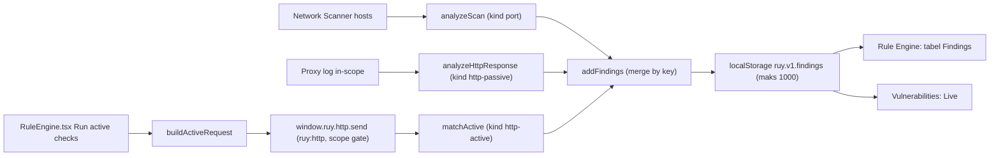

# 041 — Rule Engine

← [040 — Detection (Pengantar Kelompok)](040_detection.md) · [Index](000_index.md) · [050 — Operasi Terkendali](050_operasi-terkendali.md) →

## Status

✅ **NYATA** — Mesin deteksi bergaya Nuclei: template berupa **data**, dievaluasi terhadap sinyal nyata (hasil Network Scanner, respons Proxy yang ter-capture, dan probe HTTP aktif yang scope-gated). Tanpa eksploitasi. Diuji dengan `npm test` (vitest).

## Tujuan fitur

Mengubah data mentah (port terbuka, banner, header/body HTTP) menjadi **temuan** berlabel severity, CVE/CWE, remediasi, dan tingkat keyakinan yang jujur: **Suspected** (inferensi) vs **Confirmed** (teramati langsung / dibuktikan probe).

## Cara kerja

Tiga jalur masuk, satu store:

| Jalur | Fungsi | Dipanggil dari | `source` |
| --- | --- | --- | --- |
| Port/banner | `analyzeScan(hosts)` | `NetworkScanner.tsx` setelah scan Live (termasuk hasil parsial setelah Stop) | `scanner` |
| HTTP pasif | `analyzeHttpResponse(entry)` | `Proxy.tsx`, setiap log yang punya respons; proxy hanya me-log trafik **in-scope** | `proxy` |
| HTTP aktif | `buildActiveRequest` → `window.ruy.http.send` → `matchActive` | `RuleEngine.tsx` tombol **Run active checks** (scope-gated `ruy:http`) | `active` |

### Matcher

- Tipe: `status`, `word`, `regex`, `port`, `service`, `time`. Gabungan per matcher via `condition` (and/or), antar matcher via `matchersCondition` (default `and`). `negative: true` = cocok bila pola **tidak ada** (header hilang).
- `part`: `header` / `body` / `response` / `banner`.
- Regex dikompilasi dengan flag `im` (case-insensitive, `^`/`$` per baris) — tiap baris `Set-Cookie` dinilai terpisah, jadi satu cookie tanpa flag sudah cukup memicu temuan.

### Kunci temuan (de-dup)

- `key = templateId|target[:port]`. Temuan dengan key sama ditimpa (bukti terbaru menang).
- HTTP pasif yang **semua matcher-nya `part: header`** → target = **origin** (satu temuan per situs). Rule body/status → target = URL penuh.
- Store dipotong ke **1000** temuan paling parah (`sortFindings`: severity → confirmed dulu → target).
- Flag `persistence` (Settings) dihormati saat load dan save; bila off, Clear juga menghapus data tersimpan.

### Katalog template (27)

**Port — 11** (`analyzeScan`)

| ID | Severity | Confidence | Pemicu |
| --- | --- | --- | --- |
| `svc-telnet-exposed` | high | suspected | port 23 |
| `svc-ftp-exposed` | medium | suspected | port 21 |
| `svc-smb-exposed` | high | suspected | port 445 |
| `svc-rdp-exposed` | high | suspected | port 3389 |
| `svc-db-exposed` | high | suspected | 3306, 5432, 1433, 1521 |
| `svc-nosql-exposed` | high | suspected | 6379, 27017, 9200, 11211 |
| `svc-vnc-exposed` | high | suspected | 5900, 5901 |
| `svc-docker-exposed` | critical | suspected | 2375, 2376 |
| `banner-vsftpd-234` | critical | suspected | banner `vsftpd 2.3.4` (CVE-2011-2523) |
| `banner-openssh-regresshion` | high | suspected | banner `OpenSSH_8.5–9.7` (CVE-2024-6387) |
| `banner-apache-traversal` | critical | suspected | banner `Apache/2.4.49/50` (CVE-2021-41773, CVE-2021-42013) |

Semua `svc-*` **suspected** karena yang diketahui hanya nomor port, bukan layanan yang benar-benar berjalan. Template banner hanya bisa cocok di profil scan `deep`.

**HTTP pasif — 11** (`analyzeHttpResponse`)

| ID | Severity | Confidence | Pemicu | Kunci |
| --- | --- | --- | --- | --- |
| `http-missing-hsts` | low | confirmed | tanpa `Strict-Transport-Security` (HTTPS saja) | origin |
| `http-missing-csp` | low | confirmed | tanpa `Content-Security-Policy` | origin |
| `http-missing-xfo` | low | confirmed | tanpa `X-Frame-Options` / `frame-ancestors` | origin |
| `http-missing-xcto` | info | confirmed | tanpa `X-Content-Type-Options` | origin |
| `http-server-version` | low | confirmed | header `Server` berisi versi | origin |
| `http-powered-by` | info | confirmed | ada `X-Powered-By` | origin |
| `http-cookie-httponly` | low | confirmed | `Set-Cookie` tanpa `HttpOnly` | origin |
| `http-cookie-secure` | medium | confirmed | `Set-Cookie` tanpa `Secure` (HTTPS saja) | origin |
| `http-dir-listing` | medium | confirmed | status 200 + `Index of /` | URL |
| `http-sql-error` | high | suspected | pesan error SQL di body | URL |
| `http-stacktrace` | medium | suspected | stack trace / debug di body | URL |

**HTTP aktif — 5** (`matchActive`, semua status 200 + pola body)

| ID | Severity | Confidence | Probe |
| --- | --- | --- | --- |
| `expose-git-config` | high | confirmed | `GET /.git/config` |
| `expose-dotenv` | critical | confirmed | `GET /.env` |
| `expose-phpinfo` | medium | confirmed | `GET /phpinfo.php` |
| `expose-backup-sql` | high | confirmed | `GET /backup.sql` |
| `expose-apache-status` | medium | confirmed | `GET /server-status` |

## File terkait

| File | Fungsi / data utama |
| --- | --- |
| [../src/shared/rules.ts](../src/shared/rules.ts) | `TEMPLATES`, `evalMatcher`, `analyzeScan`, `analyzeHttpResponse`, `buildActiveRequest`, `matchActive`, `sortFindings` |
| [../src/renderer/src/store/findings.ts](../src/renderer/src/store/findings.ts) | Store `ruy.v1.findings`: `addFindings`, `clearFindings`, `useFindings`, batas 1000 |
| [../src/renderer/src/pages/RuleEngine.tsx](../src/renderer/src/pages/RuleEngine.tsx) | Halaman `/detection`: probe aktif, tabel Findings, Template library |
| [../src/renderer/src/pages/NetworkScanner.tsx](../src/renderer/src/pages/NetworkScanner.tsx) | Memanggil `analyzeScan` setelah scan Live |
| [../src/renderer/src/pages/web/Proxy.tsx](../src/renderer/src/pages/web/Proxy.tsx) | Memanggil `analyzeHttpResponse` untuk tiap respons ter-capture |
| [../src/shared/http.ts](../src/shared/http.ts) | `hostInScope` (domain + IP/CIDR via `ipInScope`) |
| [../src/main/index.ts](../src/main/index.ts) | Handler `ruy:http` (scope gate probe aktif) |
| [../src/main/proxy.ts](../src/main/proxy.ts) | Proxy hanya me-log/dekripsi host in-scope |
| [../src/renderer/src/App.tsx](../src/renderer/src/App.tsx) · [../src/renderer/src/components/Sidebar.tsx](../src/renderer/src/components/Sidebar.tsx) | Route `/detection`, grup sidebar "Detection" |
| [../src/shared/rules.test.ts](../src/shared/rules.test.ts) | Tes cookie rules & target temuan (origin vs URL) |

## Cara pakai

1. Buka **Rule Engine** (sidebar grup **Detection**, `/detection`).
2. Tambahkan host/IP/CIDR target di **ScopeBar**.
3. Isi **Target base URL** (mis. `http://127.0.0.1/`) → **Run active checks**. Log menampilkan tiap probe: CONFIRMED, not present, blocked by scope, atau `request failed: <error>`.
4. Temuan pasif masuk otomatis dari **Network Scanner** (Live) dan **Proxy** (trafik in-scope).
5. Saring Findings per Confidence/Severity; lihat **Template library** untuk ke-27 rule.
6. **Clear** mengosongkan store. Uji unit: `npm test`.

## Batasan / temuan

- Tidak ada **extractor** (mis. menarik versi ke field terpisah) — bukti hanya string `evidence`.
- Matcher `time` dan `service` sudah diimplementasi tetapi **belum dipakai** template mana pun.
- Tidak ada **baseline soft-404**: server yang menjawab 200 untuk semua path bisa memicu false positive bila body juga cocok.
- **Suspected tidak pernah di-upgrade** jadi Confirmed: probe aktif memakai template & key berbeda, jadi keduanya muncul terpisah.
- Probe aktif berurutan, satu base URL per jalan, timeout 8000 ms; berhenti di probe pertama yang di-block scope.
- Template di-hardcode di `rules.ts` (belum bisa memuat file YAML/JSON dari luar).
- Komentar kepala `rules.ts` masih menyebut "open port … confirmed", padahal kini semua template port = suspected.

## Checklist pengerjaan

- [x] Mesin template data-driven dengan 6 tipe matcher + kondisi and/or + negative.
- [x] 27 template: 11 port, 11 HTTP pasif, 5 HTTP aktif.
- [x] Jalur Scanner → `analyzeScan`, Proxy → `analyzeHttpResponse`, probe aktif scope-gated.
- [x] Store temuan bersama, de-dup per key, batas 1000, hormati flag persistence.
- [x] Temuan header per origin, body per URL; cookie dinilai per baris.
- [x] Halaman `/detection` + grup sidebar "Detection".
- [x] Tes vitest (`rules.test.ts`, `scope.test.ts`).
- [ ] Upgrade Suspected → Confirmed saat oracle membuktikan temuan yang sama.
- [ ] Baseline soft-404 sebelum probe aktif.
- [ ] Extractor (versi, token) ke field terstruktur.
- [ ] Pakai matcher `time`/`service` (mis. time-based check, verifikasi service dari banner).
- [ ] Muat template dari file eksternal (YAML/JSON) agar bisa ditambah tanpa rebuild.
- [x] Simpan bukti request/response lengkap per temuan (lihat [052](052_paket-bukti.md)); Reports belum memakainya.
- [x] Perbarui komentar kepala `rules.ts` agar sesuai (port = suspected).
