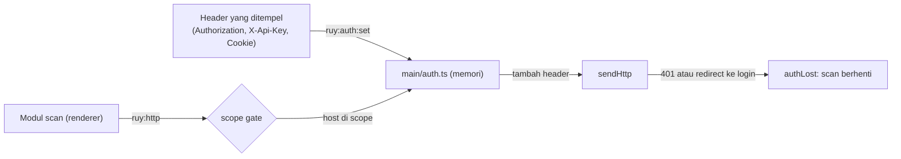

# 042 — Scan Terautentikasi

← [041 — Rule Engine](041_rule-engine.md) · [Index](000_index.md) · [090 — Roadmap](090_roadmap.md) →

## 1. Status

✅ **NYATA** — Semua modul yang mengirim request (Rule Engine aktif, Crawler, Active Scan, Target, Intruder, Repeater) bisa memindai bagian situs yang ada di balik login. Satu-satunya sumber kredensial adalah **header yang kamu tempel sendiri**: token `Authorization`, API key, atau baris `Cookie` yang disalin dari sesi milikmu. Interu **tidak** mengambil cookie dari Interu Browser dan **tidak** mengisi form login sendiri; keduanya dibuang dengan sengaja agar tidak ada kredensial yang berpindah tanpa kamu menempelkannya.

## 2. Tujuan fitur

Tanpa kredensial, probe hanya melihat halaman publik. Dengan sesi yang sah, scan menjangkau halaman dan API yang butuh login (kontrol akses, IDOR, temuan pasif di respons yang hanya muncul setelah login), tetap dalam batas scope.

## 3. Cara kerja

- **Satu pintu.** Semua request live lewat `ruy:http` di [`../src/main/index.ts`](../src/main/index.ts). Setelah cek scope, `sendAuthed` ([`../src/main/auth.ts`](../src/main/auth.ts)) menambahkan header. Karena scope dicek lebih dulu, kredensial tidak pernah terkirim ke host di luar Authorized scope.
- **Header manual.** Satu `Name: value` per baris, diparse `parseAuthHeaders` ([`../src/shared/auth.ts`](../src/shared/auth.ts)). `Host`, `Content-Length`, `Connection`, `Transfer-Encoding`, `Expect`, `Upgrade` ditolak dengan pesan, baris yang tidak valid dilaporkan, dan baris yang valid tetap dipakai. Hanya disimpan di memori main process: tidak di `localStorage`, tidak di disk, hilang saat aplikasi ditutup. Renderer hanya menerima **nama** header (untuk pil di bar), bukan nilainya.
- **Tidak menimpa.** Header yang sudah diset request (mis. Cookie yang diketik di Repeater) menang atas header yang ditempel.
- **Jangan keluar dari sesi.** Saat header terpasang, modul otomatis melewati URL bergaya `logout`, `signout`, `delete`, `remove`, `destroy`, `unsubscribe`, `deactivate`, `close-account`, `revoke`, `reset-password` (`isUnsafeAuthedPath`). Repeater (request manual, `manual: true`) dikecualikan: operator boleh sengaja mengirimnya.
- **Sesi habis.** Respons `401`, atau redirect (`3xx`) ke path login (`/login`, `/signin`, `/sso`, `/oauth`, `/authorize`, `/auth`), menandai sesi hilang (`lostSession`). Request otomatis berikutnya langsung gagal dengan `authLost`, scan berhenti dan Exposure Monitor mencatat peringatan. `403` **bukan** tanda sesi habis (itu hasil kontrol akses yang sah). Tempel token baru lalu tekan **Refresh**.
- **Evidence tanpa rahasia.** `redactSecrets` menyamarkan nilai `Set-Cookie`, `Cookie`, dan `Authorization` di kolom evidence temuan.

## 4. File terkait

| File | Fungsi utama |
|---|---|
| [`../src/shared/auth.ts`](../src/shared/auth.ts) · `auth.test.ts` | `parseAuthHeaders`, `mergeAuth`, `isUnsafeAuthedPath`, `lostSession`, `redactSecrets` |
| [`../src/main/auth.ts`](../src/main/auth.ts) | Header di memori, `sendAuthed`, IPC `ruy:auth:set`, `get`, `refresh`, `status` |
| [`../src/renderer/src/components/AuthBar.tsx`](../src/renderer/src/components/AuthBar.tsx) | Bar "Authenticated scan": kotak header, pil nama header, status sesi, Refresh |
| [`../src/renderer/src/components/ScopeBar.tsx`](../src/renderer/src/components/ScopeBar.tsx) | Prop `withAuth` menampilkan AuthBar di bawah scope |
| [`../src/renderer/src/lib/http.ts`](../src/renderer/src/lib/http.ts) | `sendLive`, `noteAuthLost` |
| `testcase/e2e/auth-scan.e2e.ts`, `webgoat.e2e.ts` | e2e dengan server lokal; e2e opsional terhadap WebGoat milik sendiri |

## 5. Cara pakai

1. Isi **Authorized scope** dengan host target.
2. Ambil token atau cookie dari sesi milikmu (mis. dari DevTools browser, atau respons login API) dan tempel di kotak **Headers** pada bar "Authenticated scan", satu per baris, misalnya:
   `Authorization: Bearer <token>` atau `Cookie: JSESSIONID=<nilai>`.
3. Klik di luar kotak agar header diterapkan; pil menampilkan nama header yang aktif. Jalankan scan di Crawler / Active Scan / Rule Engine.
4. Bila muncul "session expired", tempel token baru lalu tekan **Refresh**.

Gunakan akun uji, bukan akun produksi: scan mengirim request atas nama akun itu.

## 6. Batasan / temuan

- Interu tidak mengikuti redirect. Seed crawler harus halaman yang menjawab langsung (mis. `/WebGoat/start.mvc`, bukan `/WebGoat/` yang 404 saat login).
- Daftar path berbahaya berbasis nama; aksi destruktif lewat GET dengan nama lain tidak terdeteksi. Pakai akun uji.
- Deteksi sesi habis berbasis `401`/redirect login; situs yang menjawab `200` dengan halaman "silakan login" tidak terdeteksi.
- Token yang kedaluwarsa tidak diperbarui otomatis; kamu menempel yang baru.
- Intruder ikut membawa header tetapi tidak berhenti otomatis saat sesi habis; barisnya menampilkan pesan error.
- Pada WebGoat lokal: tanpa login crawler dari `/WebGoat/start.mvc` hanya melihat 1 halaman; dengan sesi (diukur saat itu lewat cookie sesi) menjangkau 14 halaman dan melewati `/WebGoat/logout`, sehingga sesi tetap hidup. Pengukuran itu dilakukan sebelum opsi cookie browser dihapus; spec `webgoat.e2e.ts` sekarang menempel cookie sesi sebagai header dan belum dijalankan ulang.

## 7. Checklist pengerjaan

- [x] Header yang ditempel, scope-gated di satu pintu.
- [x] Lewati logout/delete; berhenti saat sesi habis; Refresh.
- [x] Nilai rahasia tidak sampai ke renderer maupun evidence.
- [x] e2e lokal (`auth-scan.e2e.ts`: Bearer, Cookie, header terlarang, crawler, sesi habis) dan opsional WebGoat (`webgoat.e2e.ts`).
- [x] Cookie otomatis dari Interu Browser dibuang (hanya header manual).
- [ ] Jalankan ulang `webgoat.e2e.ts` dengan WebGoat aktif.
- [ ] Opsi: Intruder berhenti saat sesi habis.
