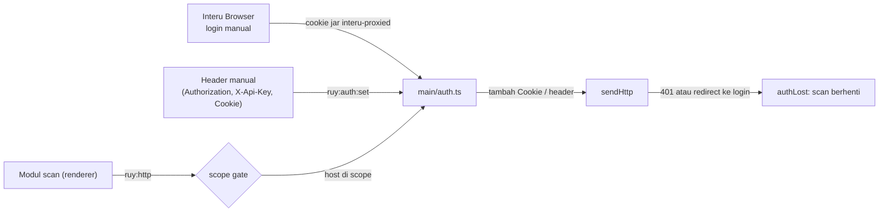

# 042 — Scan Terautentikasi

← [041 — Rule Engine](041_rule-engine.md) · [Index](000_index.md) · [090 — Roadmap](090_roadmap.md) →

## 1. Status

✅ **NYATA** — Semua modul yang mengirim request (Rule Engine aktif, Crawler, Active Scan, Target, Intruder, Repeater) bisa memindai bagian situs yang ada di balik login. Kredensial datang dari dua sumber yang dikendalikan operator: **cookie sesi Interu Browser** atau **header yang diketik manual**. Login otomatis (Interu mengisi form login sendiri) **tidak** ada, dengan sengaja.

## 2. Tujuan fitur

Tanpa kredensial, probe hanya melihat halaman publik. Dengan sesi yang sah, scan menjangkau halaman dan API yang butuh login (kontrol akses, IDOR, temuan pasif di respons yang hanya muncul setelah login), tetap dalam batas scope.

## 3. Cara kerja

- **Satu pintu.** Semua request live lewat `ruy:http` di [`../src/main/index.ts`](../src/main/index.ts). Setelah cek scope, `sendAuthed` ([`../src/main/auth.ts`](../src/main/auth.ts)) menambahkan kredensial. Karena scope dicek lebih dulu, kredensial tidak pernah terkirim ke host di luar Authorized scope.
- **Cookie browser.** Diambil per URL dari session `interu-proxied` (`cookies.get({ url })`, sehingga domain/path/secure dicocokkan oleh Electron). Nilai cookie tidak pernah dikirim ke renderer; renderer hanya menerima jumlah cookie per host scope.
- **Header manual.** Satu `Name: value` per baris, diparse `parseAuthHeaders` ([`../src/shared/auth.ts`](../src/shared/auth.ts)). `Host`, `Content-Length`, `Connection`, `Transfer-Encoding`, `Expect`, `Upgrade` ditolak. Hanya disimpan di memori main process, tidak di `localStorage`, hilang saat aplikasi ditutup.
- **Tidak menimpa.** Header yang sudah diset request (mis. Cookie yang diketik di Repeater) menang atas kredensial; header manual `Cookie` menang atas cookie browser.
- **Jangan keluar dari sesi.** Saat kredensial terpasang, modul otomatis melewati URL bergaya `logout`, `signout`, `delete`, `remove`, `destroy`, `unsubscribe`, `deactivate`, `close-account`, `revoke`, `reset-password` (`isUnsafeAuthedPath`). Repeater (request manual, `manual: true`) dikecualikan: operator boleh sengaja mengirimnya.
- **Sesi habis.** Respons `401`, atau redirect (`3xx`) ke path login (`/login`, `/signin`, `/sso`, `/oauth`, `/authorize`, `/auth`), menandai sesi hilang (`lostSession`). Request otomatis berikutnya langsung gagal dengan `authLost`, scan berhenti dan Exposure Monitor mencatat peringatan. `403` **bukan** tanda sesi habis (itu hasil kontrol akses yang sah). Login ulang di Interu Browser lalu tekan **Refresh**.
- **Evidence tanpa rahasia.** `redactSecrets` menyamarkan nilai `Set-Cookie`, `Cookie`, dan `Authorization` di kolom evidence temuan.

## 4. File terkait

| File | Fungsi utama |
|---|---|
| [`../src/shared/auth.ts`](../src/shared/auth.ts) · `auth.test.ts` | `parseAuthHeaders`, `mergeAuth`, `isUnsafeAuthedPath`, `lostSession`, `redactSecrets` |
| [`../src/main/auth.ts`](../src/main/auth.ts) | State kredensial di memori, `sendAuthed`, IPC `ruy:auth:set`, `get`, `refresh`, `status` |
| [`../src/renderer/src/components/AuthBar.tsx`](../src/renderer/src/components/AuthBar.tsx) | Bar "Authenticated scan": saklar cookie browser, status, header manual, Refresh |
| [`../src/renderer/src/components/ScopeBar.tsx`](../src/renderer/src/components/ScopeBar.tsx) | Prop `withAuth` menampilkan AuthBar di bawah scope |
| [`../src/renderer/src/lib/http.ts`](../src/renderer/src/lib/http.ts) | `sendLive`, `noteAuthLost` |
| `testcase/e2e/auth-scan.e2e.ts`, `webgoat.e2e.ts` | e2e dengan server lokal; e2e opsional terhadap WebGoat milik sendiri |

## 5. Cara pakai

1. Isi **Authorized scope** dengan host target.
2. Buka **Proxy**, Start, lalu **Open Browser** ke halaman login dan login seperti biasa.
3. Di halaman Crawler / Active Scan / Rule Engine, nyalakan **Use Interu Browser cookies**; pil hijau menunjukkan jumlah cookie untuk scope. Untuk token API, buka **Headers** dan isi mis. `Authorization: Bearer ...`.
4. Jalankan scan. Bila muncul "session expired", login ulang di browser lalu **Refresh**.

Gunakan akun uji, bukan akun produksi: scan mengirim request atas nama akun itu.

## 6. Batasan / temuan

- Interu tidak mengikuti redirect. Seed crawler harus halaman yang menjawab langsung (mis. `/WebGoat/start.mvc`, bukan `/WebGoat/` yang 404 saat login).
- Daftar path berbahaya berbasis nama; aksi destruktif lewat GET dengan nama lain tidak terdeteksi. Pakai akun uji.
- Deteksi sesi habis berbasis `401`/redirect login; situs yang menjawab `200` dengan halaman "silakan login" tidak terdeteksi.
- Login otomatis (menyimpan username/password) sengaja tidak dibuat.
- Intruder ikut membawa kredensial tetapi tidak berhenti otomatis saat sesi habis; barisnya menampilkan pesan error.
- Pada WebGoat lokal: tanpa login crawler dari `/WebGoat/start.mvc` hanya melihat 1 halaman; dengan sesi browser menjangkau 14 halaman dan melewati `/WebGoat/logout`, sehingga sesi tetap hidup.

## 7. Checklist pengerjaan

- [x] Cookie browser dan header manual, scope-gated di satu pintu.
- [x] Lewati logout/delete; berhenti saat sesi habis; Refresh.
- [x] Nilai rahasia tidak sampai ke renderer maupun evidence.
- [x] e2e lokal (`auth-scan.e2e.ts`) dan opsional WebGoat (`webgoat.e2e.ts`).
- [ ] Opsi: Intruder berhenti saat sesi habis.
