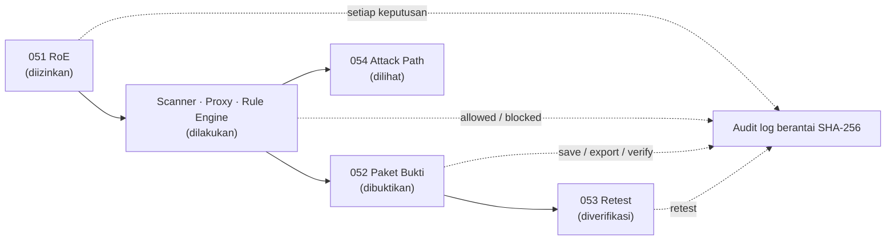

# 050 — Operasi Terkendali (Pengantar Kelompok)

← [041 — Rule Engine](041_rule-engine.md) · [Index](000_index.md) · [051 — RoE & Audit Log](051_roe-audit-log.md) →

Kelompok ini berisi pembeda Interu dari Burp Suite, nmap, dan Nuclei. Ketiga tools itu dibuat untuk pentester bebas. Interu dibuat untuk **operasi resmi yang harus bisa dipertanggungjawabkan**: setiap aksi terikat izin, tercatat, dan menghasilkan bukti yang bisa diverifikasi, dari recon sampai retest.

## Siklus penindakan

## Daftar fitur

| Dokumen | Status | Inti |
| --- | --- | --- |
| [051 RoE & Audit Log](051_roe-audit-log.md) | ✅ | Operasi, operator, jendela waktu, teknik yang diizinkan; tanpa RoE semua trafik diblokir; log berantai hash |
| [052 Paket Bukti](052_paket-bukti.md) | ✅ | Request/response mentah per temuan Confirmed di disk; ekspor folder + manifest; verifikasi ulang |
| [053 Retest](053_retest.md) | ✅ | Uji ulang temuan; hasil ditambahkan sebagai riwayat, bukti lama tidak ditimpa |
| [054 Attack Path](054_attack-path.md) | ✅ | Graf host → service → temuan per taktik ATT&CK, jalur kritis disorot |

## Perubahan perilaku penting

- **Tanpa RoE aktif, semua trafik nyata diblokir** (scan, proxy, Repeater, Intruder, Target, probe aktif, retest). Buat RoE dulu di halaman **Operation** (`/operation`).
- `window.ruy.http.send` kini wajib menyertakan `technique`; channel `ruy:http` menolak permintaan tanpa teknik yang dikenal.
- Proxy menjawab **403** untuk host in-scope bila RoE tidak mengizinkan teknik `proxy` (mis. jendela waktu sudah lewat).
