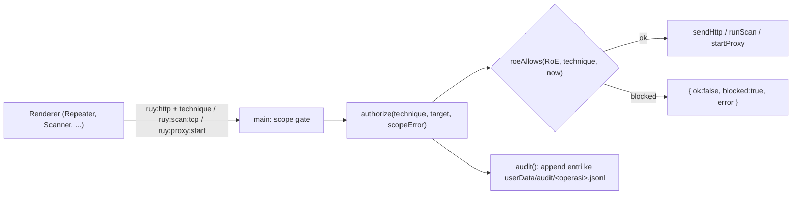

# 051 — Rules of Engagement & Audit Log

← [050 — Operasi Terkendali](050_operasi-terkendali.md) · [Index](000_index.md) · [052 — Paket Bukti](052_paket-bukti.md) →

## Status

✅ **NYATA** — RoE disimpan dan ditegakkan di main process; setiap keputusan ditulis ke log JSONL berantai SHA-256. Logika murni diuji dengan `npm test` (`roe.test.ts`, `audit.test.ts`).

## Tujuan fitur

Scope gate ([011](011_scope-gate.md)) menjawab **host mana** yang boleh disentuh. RoE menambah **siapa** yang beroperasi, **kapan** boleh, dan **teknik apa** yang diizinkan. Audit log membuktikan apa yang benar-benar terjadi, dan menunjukkan kalau log diubah.

## Cara kerja

### RoE

- Bentuk: `{ operation, operator, windowStart?, windowEnd?, allow: { scan, proxy, repeater, intruder, discovery, active, retest } }`, disimpan di `userData/roe.json`.
- `sanitizeRoe` memvalidasi input dari IPC/disk: nama operasi dan operator wajib, hanya teknik yang dikenal dan bernilai `true` yang dihitung, dan waktu yang tidak valid dibuang.
- `roeAllows`: tanpa RoE → tolak; di luar jendela waktu → tolak; teknik tidak dicentang → tolak.
- Pemetaan teknik:

| Teknik | Sumber |
| --- | --- |
| `scan` | `ruy:scan:tcp` (Network Scanner) |
| `proxy` | `ruy:proxy:start` dan **setiap request in-scope** di proxy |
| `repeater` / `intruder` / `discovery` | `ruy:http` dari Repeater / Intruder / Target |
| `active` | `ruy:http` dari probe aktif Rule Engine |
| `retest` | `ruy:http` dan `ruy:scan:tcp` (`retest: true`) dari tombol Retest |

### Audit log

- Satu file per operasi; entri sebelum ada RoE masuk `_no-operation.jsonl`.
- Entri: `{ seq, at, operation, operator, action, target, result: allowed|blocked|info, detail?, prevHash, hash }`.
- `hash = sha256(JSON.stringify([seq, at, operation, operator, action, target, result, detail, prevHash]))`; entri pertama memakai `prevHash = 0×64`.
- `verifyLog` mendeteksi baris yang diubah, dihapus, ditukar urutannya, atau bukan JSON, lalu melaporkan **nomor baris pertama** yang rusak.
- Yang dicatat: setiap keputusan allowed/blocked (termasuk penolakan scope), `roe:set`, `proxy:stop`, `evidence:save/export/verify`.

## File terkait

| File | Fungsi |
| --- | --- |
| [../src/shared/roe.ts](../src/shared/roe.ts) | `Roe`, `TECHNIQUES`, `roeAllows`, `sanitizeRoe`, `isTechnique` |
| [../src/shared/audit.ts](../src/shared/audit.ts) | `chainEntry`, `verifyChain`, `verifyLog` (sha di-inject) |
| [../src/main/audit.ts](../src/main/audit.ts) | Store RoE, `audit`, `authorize`, `listAudit`, `verifyAudit` |
| [../src/main/index.ts](../src/main/index.ts) | Gate di `ruy:http`, `ruy:scan:tcp`, `ruy:proxy:start/stop`; channel `ruy:roe:*`, `ruy:audit:*` |
| [../src/main/proxy.ts](../src/main/proxy.ts) | `authorize('proxy', ...)` per request in-scope; 403 bila ditolak |
| [../src/preload/index.ts](../src/preload/index.ts) | `window.ruy.roe`, `window.ruy.audit`, `http.send(req, scope, technique)` |
| [../src/renderer/src/pages/Operation.tsx](../src/renderer/src/pages/Operation.tsx) | Halaman `/operation`: form RoE, tabel audit, Verify integrity |
| [../src/shared/roe.test.ts](../src/shared/roe.test.ts) · [../src/shared/audit.test.ts](../src/shared/audit.test.ts) | Tes jendela waktu, teknik, sanitasi, deteksi baris rusak |

## Cara pakai

1. Buka **Operation (RoE)** di sidebar (grup Overview).
2. Isi nama operasi, operator (default dari Settings), jendela waktu (opsional), lalu centang teknik yang diizinkan → **Activate RoE**.
3. Jalankan operasi seperti biasa. Aksi di luar RoE ditolak dengan alasan yang jelas.
4. **Verify integrity** memeriksa seluruh rantai: ✅ utuh, atau ❌ dengan nomor baris yang rusak.
5. Demo manipulasi: buka file log (path tampil setelah verifikasi), ubah satu karakter, lalu Verify lagi.

## Batasan / temuan

- `technique` dikirim oleh renderer. Renderer yang dimodifikasi bisa mengaku "repeater" padahal Intruder; trust model-nya sama dengan scope yang juga dikirim per panggilan.
- Jendela waktu memakai **jam sistem**; mengubah jam OS bisa melewatinya (waktu asli tetap terekam di `at`).
- Log tidak ditandatangani. Orang dengan akses tulis ke `userData` bisa menulis ulang **seluruh** rantai secara konsisten; yang terdeteksi adalah perubahan sebagian. Untuk bukti ke pihak luar, pakai fingerprint paket ([052](052_paket-bukti.md)).
- Menghapus **baris-baris terakhir** log tidak terdeteksi oleh verifikasi rantai (tidak ada jangkar eksternal untuk head hash).
- Trafik proxy **di luar scope** tetap diteruskan apa adanya (tidak didekripsi, tidak dicatat) dan tidak dicek RoE; yang ditegakkan adalah trafik in-scope, start proxy, dan pembukaan browser proxy.
- Setiap request proxy in-scope menambah satu baris (`appendFileSync` sinkron); tidak ada rotasi file.
- Harness `RUY_PROXY_TEST` tanpa RoE aktif kini mendapat 403 untuk host in-scope.

## Checklist pengerjaan

- [x] Model RoE + validasi + `roeAllows` (shared, teruji).
- [x] Rantai hash + verifikasi per baris (shared, teruji).
- [x] Penegakan di `ruy:http`, `ruy:scan:tcp`, proxy start dan request in-scope.
- [x] Halaman Operation + route + sidebar.
- [ ] Tanda tangan digital (mis. kunci per operasi) untuk head hash.
- [ ] Rotasi / pemadatan log proxy.
- [ ] Jam tepercaya (NTP) untuk jendela waktu.
