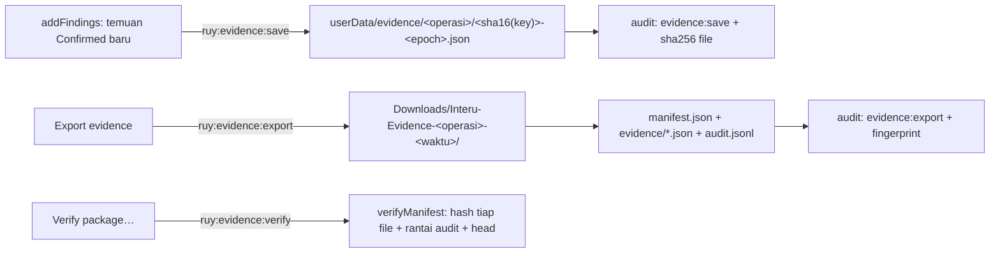

# 052 — Paket Bukti (Chain of Custody)

← [051 — RoE & Audit Log](051_roe-audit-log.md) · [Index](000_index.md) · [053 — Retest](053_retest.md) →

## Status

✅ **NYATA** — Bukti mentah ditulis ke disk oleh main process; ekspor ke folder dengan manifest SHA-256; verifikasi ulang dari UI. Logika manifest diuji di `evidence.test.ts`.

## Tujuan fitur

Laporan biasa hanya berupa kalimat. Paket bukti berisi request/response mentah yang membuktikan temuan, terikat ke operasi dan operator, dan bisa diperiksa pihak ketiga: ubah satu byte saja, verifikasi gagal.

## Cara kerja

- `Finding.raw = { request, response }` (maks 50.000 karakter masing-masing) diisi oleh `matchActive` (probe aktif) dan `analyzeHttpResponse` (proxy). `Finding.req` menyimpan request yang bisa diputar ulang ([053](053_retest.md)).
- Bukti disimpan **sekali per temuan baru**. Temuan header yang terlihat berulang di proxy tidak membanjiri disk. Snapshot tambahan ditulis setiap kali ada retest.
- Nama file bukti diturunkan dari hash, sehingga teks dari renderer tidak pernah menjadi path.
- `manifest.json`: `{ format: 'interu-evidence/1', operation, operator, exportedAt, auditHead, files: [{ path, sha256, length }] }`.
- Ekspor ditolak bila audit log operasi sudah rusak.
- Verifikasi memeriksa hash tiap file, rantai `audit.jsonl`, kecocokan head hash dengan manifest, path aman (tanpa `..`/absolut), dan file di `evidence/` yang tidak tercantum di manifest.
- **Fingerprint** = sha256 dari `manifest.json`, dicatat di audit log saat ekspor. Penerima mencocokkannya dengan nilai yang dilaporkan operator.

## File terkait

| File | Fungsi |
| --- | --- |
| [../src/shared/evidence.ts](../src/shared/evidence.ts) | `buildManifest`, `verifyManifest`, `isSafeRelPath` |
| [../src/main/evidence.ts](../src/main/evidence.ts) | `saveEvidence`, `exportEvidence`, `verifyEvidence` (dialog pilih folder) |
| [../src/shared/rules.ts](../src/shared/rules.ts) | `Finding.req`, `Finding.raw`, `RAW_CAP` |
| [../src/renderer/src/store/findings.ts](../src/renderer/src/store/findings.ts) | Memanggil `evidence.save` untuk temuan Confirmed baru dan setelah retest |
| [../src/renderer/src/pages/Operation.tsx](../src/renderer/src/pages/Operation.tsx) | Panel **Evidence package**: Export / Verify |
| [../src/shared/evidence.test.ts](../src/shared/evidence.test.ts) | Tes paket utuh, byte berubah, audit dimanipulasi, path traversal |

## Cara pakai

1. Jalankan operasi; temuan Confirmed otomatis tersimpan sebagai bukti.
2. Halaman **Operation** → **Export evidence**. Path folder dan fingerprint ditampilkan.
3. Kirim folder (boleh di-zip). Penerima membuka Interu → **Verify package…** → pilih folder.
4. Demo: ubah satu karakter di `evidence/*.json` atau `audit.jsonl` → verifikasi menyebut file/baris yang rusak.

## Batasan / temuan

- Setiap file bukti juga dicocokkan dengan hash di entri `evidence:save` pada audit log berantai, jadi mengubah file **dan** manifest saja tetap ketahuan. Yang tidak terdeteksi hanyalah penulisan ulang **seluruh** paket (file, audit log, dan manifest) secara konsisten; fingerprint di log operator adalah pembandingnya. Saat verifikasi di mesin pengekspor, Interu memberi tahu apakah fingerprint tercatat di log operasi aktif.
- Nama perangkat Windows (`CON`, `NUL`, `COM1`, ...) ditolak di path manifest dan nama operasi.
- Bukti dari Network Scanner (port) tidak punya request/response HTTP; isinya hanya data temuan.
- Batas 400 KB per file bukti; temuan yang lebih besar ditolak dengan pesan error.
- Body biner di proxy sudah diganti teks `[N bytes ... omitted]` sejak di main, jadi tidak ikut dalam bukti.
- Format folder, bukan zip, karena belum ada dependensi zip.

## Checklist pengerjaan

- [x] Simpan request/response mentah di Finding.
- [x] Store bukti di main process (bertahan setelah Clear / batas 1000).
- [x] Ekspor folder + manifest + audit log + fingerprint.
- [x] Verifikasi paket dengan validasi path.
- [ ] Tanda tangan digital manifest.
- [ ] Ekspor zip tunggal.
- [ ] Reports ([036](036_reports.md)) memakai bukti nyata, bukan data contoh.
