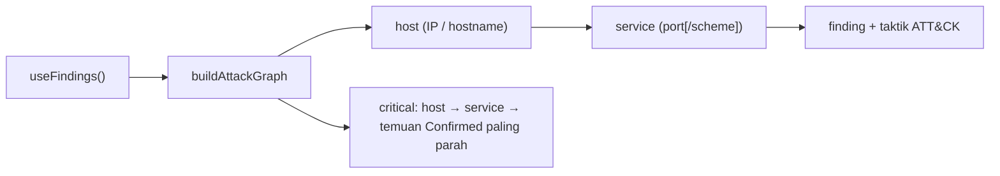

# 054 — Attack Path

← [053 — Retest](053_retest.md) · [Index](000_index.md) · [090 — Roadmap](090_roadmap.md) →

## Status

✅ **NYATA** — Graf dihitung dari temuan nyata di store (Scanner, Proxy, Rule Engine). Model graf diuji di `attackPath.test.ts`.

## Tujuan fitur

nmap, Burp, dan Nuclei masing-masing hanya melihat lapisannya sendiri. Attack Path menyatukan semuanya per host, supaya terlihat jalur menuju temuan paling berbahaya.

## Cara kerja

- Host dan port diambil dari `target`: URL → hostname + port (default 80/443); selain itu `target` + `port`. Temuan tanpa port terhubung langsung ke host.
- Taktik (`tacticOf`):
  1. Dari ID teknik ATT&CK di template (saat ini hanya `T1021*` → **Lateral Movement**).
  2. Heuristik: tag `secrets` → **Credential Access**; sumber `scanner` → **Discovery**; selain itu → **Initial Access** (aplikasi publik).
- Jalur kritis = temuan **Confirmed** dengan severity tertinggi. Bila belum ada yang Confirmed, tidak ada jalur kritis.
- Tampilan: SVG inline 3 kolom, warna tepi = severity, garis putus = Suspected, merah = jalur kritis. Node temuan bisa diklik (atau Enter) untuk melihat detail.

## File terkait

| File | Fungsi |
| --- | --- |
| [../src/shared/attackPath.ts](../src/shared/attackPath.ts) | `buildAttackGraph`, `tacticOf`, peta teknik → taktik |
| [../src/renderer/src/pages/AttackPath.tsx](../src/renderer/src/pages/AttackPath.tsx) | Halaman `/attack-path`: layout, SVG, panel detail |
| [../src/renderer/src/App.tsx](../src/renderer/src/App.tsx) · [../src/renderer/src/components/Sidebar.tsx](../src/renderer/src/components/Sidebar.tsx) | Route + menu (grup Detection) |
| [../src/shared/attackPath.test.ts](../src/shared/attackPath.test.ts) | Tes pengelompokan, temuan tanpa port, jalur kritis, taktik |

## Cara pakai

1. Kumpulkan temuan (scan, proxy, probe aktif).
2. Buka **Attack Path** (grup Detection). Statistik di atas menunjukkan jumlah host, temuan, panjang jalur kritis, dan severity terburuk.
3. Klik temuan untuk melihat target, bukti, remediasi, dan status retest terakhir.

## Batasan / temuan

- Pemetaan taktik sebagian besar **heuristik**: baru 3 dari 27 template yang punya ID teknik ATT&CK.
- Graf tidak menyimpulkan rantai antar-host (mis. kredensial dari host A dipakai di host B); setiap host berdiri sendiri.
- "Jalur kritis" berarti jalur ke temuan terparah, bukan simulasi eksploitasi.
- Untuk ratusan temuan, graf menjadi sangat tinggi (satu baris per temuan); belum ada filter atau zoom.

## Checklist pengerjaan

- [x] Model graf + taktik + jalur kritis (teruji).
- [x] Halaman SVG tanpa library tambahan, bisa diakses keyboard.
- [ ] Lengkapi ID teknik ATT&CK di semua template.
- [ ] Filter per host / severity, tampilan sebelum vs sesudah retest.
- [ ] Korelasi antar-host.
