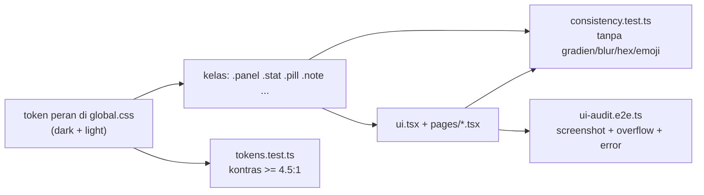

# 092 — Panduan Tampilan (Konvensi UI)

← [090 — Roadmap](090_roadmap.md) · [Index](000_index.md)

## 1. Status

✅ **NYATA** — sistem visual industrial yang datar sudah diterapkan di seluruh halaman dan dijaga oleh dua guard test serta satu audit e2e.

## 2. Tujuan

Operator membaca temuan sepanjang hari. Karena itu tampilan dibuat **industrial, tenang, dan padat**: satu warna aksen, tanpa gradien/glow/blur, angka tabular, data memakai font mono, dan warna hanya membawa makna (severity, status). Emoji diganti ikon. Dokumen ini adalah aturan agar komponen baru tidak merusak konsistensi itu.

## 3. Cara kerja

Warna **hanya** didefinisikan sebagai token peran di `global.css` (dark dan light). Komponen dan halaman memakai token itu lewat kelas CSS; tidak ada kode warna di `.tsx`.

### Token warna

| Token | Dark | Light | Peran |
|---|---|---|---|
| `bg` | `#0d0f12` | `#f4f5f7` | Latar halaman |
| `surface` | `#12151a` | `#ffffff` | Panel, kartu |
| `raised` | `#181c22` | `#eceef1` | Hover, header tabel, input |
| `line` | `#262c35` | `#d5d9df` | Garis tipis (hairline) |
| `line-strong` | `#343c48` | `#bcc2cb` | Garis tegas, batas input |
| `fg` | `#e6e9ee` | `#14181f` | Teks utama |
| `fg-2` | `#a9b2bf` | `#46505e` | Teks sekunder |
| `fg-3` | `#8892a1` | `#5d6775` | Teks tersier, label |
| `accent` | `#5b9dff` | `#1b57c2` | Satu-satunya aksen (aktif, fokus, tombol utama) |
| `crit` | `#ff6b63` | `#b92f28` | Critical, error, blokir |
| `high` | `#f0974a` | `#a34a07` | High |
| `med` | `#e2b94a` | `#7a5e00` | Medium, peringatan |
| `low` | `#7aa2d6` | `#2f6aa8` | Low |
| `info` | `#8892a1` | `#5d6775` | Info |
| `ok` | `#4cb88a` | `#1f7a54` | Berhasil, Confirmed sehat |

Semua token teks/status minimal **4.5:1** (WCAG AA) terhadap `bg`, `surface`, dan `raised` di kedua tema. Nama variabel lama (`--silver-*`, `--royal*`, `--panel-*`, `--obsidian-*`, `--white`, `--warn`, dst.) hanya hidup sebagai **alias** di bagian atas `global.css` (ditandai "alias: remove when inline styles are gone"); jangan dipakai untuk kode baru.

### Bentuk dan tipografi

- Radius **3px** (pill **2px**). Tidak ada bayangan, kecuali satu: menu klik-kanan yang melayang.
- Font dasar **13px** (tabel **12.5px**), angka tabular, **mono** untuk data (host, path, hash, token).
- Tombol dan input tinggi **28px**; `.btn-sm` **24px**.

### Tata letak

| Elemen | Aturan |
|---|---|
| Sidebar | Lebar 216px, datar; item aktif memakai rel aksen 2px di kiri |
| Topbar | Tinggi 44px |
| Panel | Bingkai hairline dengan header 36px |
| Strip stat | Satu baris `.stat` otomatis menjadi satu strip bersekat (`.grid:has(> .stat)`) |
| Severity rail | Baris tabel yang sel pertamanya pill severity mendapat rel berwarna 3px di kiri |
| Pill | Tag persegi kecil (`.pill`, varian `.pill-ok` dst.) |
| Note | `
`; `block` dan `error` memakai rel merah 2px dan ikon |
| Animasi | Tidak ada animasi masuk halaman |

Komponen `Disclaimer` dan `Note` (`ui.tsx`) sama-sama merender `.note`. Halaman menyimpan state pesan sebagai `NoteMsg { kind: 'warn' | 'block' | 'error' | 'ok'; text }`. Kelas lama `.disclaimer` dan emoji (⛔ ⚠ ✓ ➤) sudah tidak ada.

### Aksesibilitas

- **Kontras:** dijaga `tokens.test.ts` (lihat bagian 4).
- **Fokus:** `:focus-visible` global berupa outline 2px warna aksen.
- **Reduced motion:** `prefers-reduced-motion` dan pengaturan Settings "Reduce motion" (`html[data-reduce-motion='1']`) mematikan animasi.
- **Keyboard:** halaman dengan baris yang bisa diklik memberi `<tr>` `className="clickable sel"`, `tabIndex={0}`, dan penanganan Enter/Spasi. Tombol hapus "x" di `ScopeBar` adalah `role="button"` yang bisa difokus dan ber-`aria-label`.

### Selector e2e yang harus tetap stabil

Tes e2e memakai selector berikut; jangan ganti namanya tanpa memperbarui tes.

| Selector / nama | Dipakai untuk |
|---|---|
| `.pill-ok` dan `span[title="Remove"]` di dalamnya | Entri scope di `ScopeBar` dan tombol hapusnya |
| `.feed` | Daftar aktivitas Exposure Monitor |
| `.stat` dengan `.s-label` / `.s-value` | Kartu hitungan |
| `tr.detail-row` | Baris detail yang terbuka |
| `td.mono.small` | Sel data mono kecil |
| `.code-pane` | Textarea/panel kode (request, respons, token) |
| item `<nav>` berdasarkan label | Navigasi sidebar |
| `.note[data-kind="block"]` dan `.note[data-kind="error"]` | Pesan blokir scope dan error |
| nama tombol: `Run Scan`, `Clear`, `Add`, `Run active checks`, `Send` | Aksi utama |
| placeholder `127.0.0.1  /  10.20.0.0/24  /  10.0.0.1-50` | Input target Network Scanner |
| placeholder `https://target-host:port` | Input target Crawler, Active Scan, Target, Repeater, Intruder |
| placeholder `host.example.com / 10.0.0.0/24` | Input scope di `ScopeBar` |
| placeholder `http://127.0.0.1/  ·  https://host.example.com/` | Input target Rule Engine |

## 4. File terkait

| File | Peran |
|---|---|
| [`../src/renderer/src/styles/global.css`](../src/renderer/src/styles/global.css) | Token peran, alias lama, semua kelas |
| [`../src/renderer/src/styles/tokens.test.ts`](../src/renderer/src/styles/tokens.test.ts) | Guard kontras: setiap token teks/status >= 4.5:1 di dua tema |
| [`../src/renderer/src/styles/consistency.test.ts`](../src/renderer/src/styles/consistency.test.ts) | Guard konsistensi (lihat di bawah) |
| [`../src/renderer/src/components/ui.tsx`](../src/renderer/src/components/ui.tsx) | `Panel`, `Stat`, `Gauge`, `Disclaimer`, `Note`, `NoteMsg` |
| [`../src/renderer/src/components/Sidebar.tsx`](../src/renderer/src/components/Sidebar.tsx) | Daftar navigasi per grup |
| [`../src/renderer/src/App.tsx`](../src/renderer/src/App.tsx) | Route |
| [`../src/renderer/src/lib/severity.ts`](../src/renderer/src/lib/severity.ts) | `Severity`, `SEVERITY_ORDER`, `severityPill` |
| [`../testcase/e2e/ui-audit.e2e.ts`](../testcase/e2e/ui-audit.e2e.ts) | Audit UI: buka semua halaman sidebar |

`consistency.test.ts` gagal bila: `global.css` berisi gradien, blur, atau drop-shadow; ada kode warna di luar blok token; `box-shadow` dipakai selain satu bayangan menu klik-kanan; atau ada `.tsx` (kecuali `Crest.tsx` dan `icons.tsx`) yang berisi literal warna atau emoji/dingbat.

## 5. Cara pakai

1. **Guard test** (cepat, tanpa Electron): `npx vitest run src/renderer/src/styles`.
2. **Audit UI e2e:** `npm run build`, lalu `npx vitest run --config testcase/e2e/vitest.config.ts testcase/e2e/ui-audit.e2e.ts`. **Tutup dulu jendela Interu yang sedang berjalan** karena aplikasi memakai kunci single-instance.
3. Audit membuka setiap halaman sidebar dalam tema dark dan light, menyimpan `testcase/results/screenshots/ui-<halaman>-<tema>.png`, dan gagal bila ada error renderer atau overflow horizontal.

### Cara menambah komponen tanpa merusak konsistensi

- Pakai **token** (`var(--...)`) dan kelas yang sudah ada; jangan menulis kode warna (`#...`, `rgb(...)`) di `.tsx` maupun di luar blok token `global.css`.
- Pakai komponen **`Note`** untuk pesan (warn/block/error/ok); jangan memakai emoji. Ikon ada di `icons.tsx`.
- Butuh gaya baru? **Tambahkan kelas di `global.css`** (memakai token), bukan `style={{ color: ... }}` inline.
- Jangan menambah gradien, blur, glow, atau `box-shadow` baru.
- Baris tabel yang bisa diklik: `className="clickable sel"`, `tabIndex={0}`, tangani Enter/Spasi.
- Halaman baru: tambahkan entri nav di `Sidebar.tsx` (label, ikon, grup) dan route di `App.tsx`.

## 6. Batasan / temuan

- Alias variabel lama masih ada di `global.css` selama masih ada gaya inline lama; hapus bila sudah tidak terpakai.
- `consistency.test.ts` membaca teks sumber; ia tidak menangkap warna yang dibangun dinamis di JS (hindari pola itu).
- Audit e2e butuh build produksi dan jendela Interu lain harus ditutup; ia tidak berjalan di `npm test`.
- Kontras dijaga untuk token, bukan untuk setiap kombinasi ad-hoc yang ditulis di komponen.

## 7. Checklist pengerjaan

- [x] Token peran dark/light + alias lama.
- [x] Guard kontras (`tokens.test.ts`) dan konsistensi (`consistency.test.ts`).
- [x] Emoji diganti ikon; `Note` menggantikan `.disclaimer`.
- [x] Baris klik bisa diakses keyboard; fokus terlihat.
- [x] Audit e2e semua halaman dark + light (`ui-audit.e2e.ts`).
- [ ] Hapus alias lama setelah gaya inline terakhir dipindah ke kelas.

---
← [090 Roadmap](090_roadmap.md) · [Index](000_index.md)
